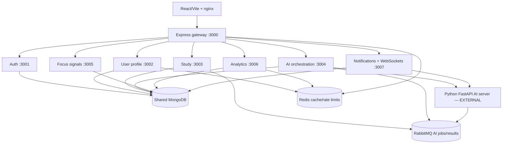

> **HISTORICAL / SUPERSEDED as current-state evidence (18 October 2026).** Retained for migration/security context. Completion, deployment, old paths and test counts below are historical assertions, not current validation. Use [CURRENT architecture](ARCHITECTURE.md), [EdNova audit](audit/2026-10-18/EDNOVA_AUDIT.md), [permissions](docs-repo/docs/roles-and-permissions.md) and [executed validation](audit/2026-10-18/VALIDATION.md). Do not run historical migration/removal steps without checking the current source and data.

# Architecture analysis (discovery completed before implementation)

The workspace contains separate Git repositories for `study-partner-api`, `study-partner-web`, `study-partner-ai`, and documentation. The parent folder is not itself a Git repository. Preserve the current folders and the character feature removal already present in the worktrees.

## Database ownership and compatibility

All Node services use Mongoose and the same `study_partner` database; there is no database-per-service transfer. Auth owns users, payments and coupons; users owns profiles, availability, friendships, gamification, ranks, quests and season ledgers; study owns courses, plans, objectives, competencies and sessions; signals owns focus sessions; analytics owns analytics events; notifications owns notifications, chat and voice sessions; orchestration owns AI jobs/evaluation records. The orchestration LearningObjective view shares a model name with the study writer and must be given a unique model name on the existing collection. No collection moves, data deletion, transaction changes, or AI database migration are required.

## Communication and lifecycle

Internal Axios calls award XP, update quests, load profile/availability, create notifications, verify WebSocket membership, track analytics, and submit AI jobs. Replace transport with in-process calls through explicit module interfaces while retaining their authorization and validation. AI HTTP remains external and must use one client. RabbitMQ is required for asynchronous external AI work, result correlation, ingestion status and retry/DLQ topology; retain it. Redis provides caches and rate limits; retain it. The study competency updater, ingestion tracker, AI result consumer/topology setup, and notification WebSocket heartbeat need one coordinated startup/shutdown.

## Security and delivery

JWT access/refresh secrets, internal-secret delegation, ownership and role checks, tier gates, upload validation, Stripe raw-body signatures, endpoint rate limits and CORS must remain enforced. Retain email/Stripe integrations. Replace the gateway with direct module mounts; move WebSockets onto the same HTTP server. Existing CI contains npm commands and stale PostgreSQL references despite MongoDB usage. Replace Node jobs with pnpm workspace checks; keep Python CI independent. Frontend nginx and WebSocket configuration currently target separate containers/port 3007 and must point to one API.

## Service inventory

### ai-orchestrator
Classification: MIGRATE

Entrypoint: `study-partner-api/services/ai-orchestrator/src/server.js`; Express/CommonJS on Node.
Dependencies: @study-partner/shared, express, dotenv, axios, express-fileupload, form-data, joi.

API paths: `/api/v1/ai`, `/api/v1/ai/coach`, `/api/v1/ai/ingest`, `/api/v1/ai/plan`, `/api/v1/ai/signals`, `/api/v1/eval`, `/api/v1/eval/step`, `/api/v1/health`, `/api/v1/search`, `/api/v1/search/query`, `/coach`, `/coach/history/:userId`, `/evaluator/session`, `/evaluator/socratic/answer`, `/evaluator/socratic/start`, `/ingest`, `/jobs`, `/jobs/:jobId`, `/plan`, `/plan/create`, `/plan/list`, `/query`, `/reviews/pending/:userId`, `/reviews/record-result`, `/reviews/schedule`, `/reviews/stats/:userId`, `/schedule`, `/schedule/apply-coach-action`, `/schedule/optimize`, `/schedule/reschedule`, `/schedule/status`, `/search/ask`, `/search/history/:userId`, `/signals/analyze-frame`, `/signals/current/:userId`, `/signals/fatigue/reset`, `/signals/history/:userId`, `/signals/latest/:userId`, `/signals/process`, `/status`, `/step`, `/vector/rebuild/:courseId`, `/vector/status/:courseId`.

Environment: `AI_SERVICE_URL`, `DOCKER_MONGODB_URI`, `INTERNAL_API_SECRET`, `JWT_REFRESH_SECRET`, `JWT_SECRET`, `MONGODB_URI`, `NODE_ENV`, `PORT`, `PYTHON_SERVICE_URL`, `RABBITMQ_URL`, `USER_PROFILE_SERVICE_URL`.

Tests: 6 suites; Dockerfile at `study-partner-api/services/ai-orchestrator/Dockerfile`.

### analytics
Classification: MIGRATE

Entrypoint: `study-partner-api/services/analytics/src/server.js`; Express/CommonJS on Node.
Dependencies: @study-partner/shared, express, dotenv, joi, mongoose.

API paths: `/api/v1/analytics`, `/api/v1/health`, `/daily-activity`, `/insights`, `/stats/:eventType`, `/summary`, `/timeline`, `/track`.

Environment: `JWT_SECRET`, `MONGODB_URI`, `NODE_ENV`, `PORT`.

Tests: 1 suites; Dockerfile at `study-partner-api/services/analytics/Dockerfile`.

### api-gateway
Classification: REMOVE (gateway concerns move to the API shell)

Entrypoint: `study-partner-api/services/api-gateway/src/server.js`; Express/CommonJS on Node.
Dependencies: @study-partner/shared, axios, express, http-proxy-middleware, dotenv.

API paths: `*`, `/api/v1/ai`, `/api/v1/analytics`, `/api/v1/auth`, `/api/v1/coach`, `/api/v1/docs`, `/api/v1/docs/openapi.json`, `/api/v1/health`, `/api/v1/monitoring/health`, `/api/v1/monitoring/metrics`, `/api/v1/notifications`, `/api/v1/session-chat`, `/api/v1/signals`, `/api/v1/study`, `/api/v1/study/courses`, `/api/v1/study/courses/:courseId/files`, `/api/v1/users`, `/api/v1/voice`, `/uploads`.

Environment: `AI_ORCHESTRATOR_SERVICE_URL`, `AI_SERVICE_URL`, `ANALYTICS_SERVICE_URL`, `AUTH_SERVICE_URL`, `INTERNAL_API_SECRET`, `JWT_SECRET`, `MONGODB_URI`, `NODE_ENV`, `NOTIFICATION_SERVICE_URL`, `PORT`, `SIGNAL_PROCESSING_SERVICE_URL`, `STUDY_SERVICE_URL`, `USER_PROFILE_SERVICE_URL`.

Tests: 2 suites; Dockerfile at `study-partner-api/services/api-gateway/Dockerfile`.

### auth
Classification: MIGRATE

Entrypoint: `study-partner-api/services/auth/src/server.js`; Express/CommonJS on Node.
Dependencies: @study-partner/shared, bcryptjs, dotenv, express, joi, jsonwebtoken, mongoose, nodemailer, stripe.

API paths: `/`, `/analytics/revenue`, `/api/v1/auth`, `/api/v1/auth/admin`, `/api/v1/auth/forgot-password`, `/api/v1/auth/login`, `/api/v1/auth/register`, `/api/v1/auth/resend-verification`, `/api/v1/auth/reset-password`, `/api/v1/auth/stripe`, `/api/v1/auth/stripe/webhook`, `/api/v1/auth/verify-email`, `/api/v1/auth/verify-otp`, `/api/v1/health`, `/config`, `/confirm`, `/coupon/list`, `/coupon/redeem`, `/coupons`, `/coupons/:couponId`, `/coupons/:couponId/usage`, `/forgot-password`, `/login`, `/logout`, `/me`, `/refresh`, `/register`, `/resend-verification`, `/reset-password`, `/stats`, `/subscribe`, `/subscription/status`, `/subscriptions`, `/subscriptions/:paymentId/cancel`, `/users`, `/users/:userId`, `/users/:userId/tier`, `/verify-email`, `/verify-otp`.

Environment: `ADMIN_REGISTRATION_KEY`, `ALLOW_TEST_COUPONS`, `APP_URL`, `COUPON_CODES`, `COUPON_MAX_DURATION`, `EMAIL_FROM`, `FRONTEND_URL`, `JWT_EXPIRES_IN`, `JWT_REFRESH_EXPIRES_IN`, `JWT_REFRESH_SECRET`, `JWT_SECRET`, `MONGODB_URI`, `NODE_ENV`, `PORT`, `SMTP_HOST`, `SMTP_PASS`, `SMTP_PORT`, `SMTP_SECURE`, `SMTP_USER`, `STRIPE_SECRET_KEY`, `STRIPE_WEBHOOK_SECRET`.

Tests: 2 suites; Dockerfile at `study-partner-api/services/auth/Dockerfile`.

### notification
Classification: MIGRATE

Entrypoint: `study-partner-api/services/notification/src/server.js`; Express/CommonJS on Node.
Dependencies: @study-partner/shared, axios, dotenv, express, joi, mongoose, nodemailer, ws.

API paths: `/`, `/:id`, `/:id/read`, `/:sessionId/:messageId`, `/:sessionId/end`, `/:sessionId/history`, `/:sessionId/mute`, `/:sessionId/participant`, `/:sessionId/query`, `/:sessionId/start`, `/:sessionId/status`, `/api/v1/health`, `/api/v1/notifications`, `/api/v1/session-chat`, `/api/v1/voice`, `/broadcast`, `/email/test`, `/read-all`.

Environment: `AI_SERVICE_URL`, `AUTH_SERVICE_URL`, `EMAIL_NOTIFICATIONS_ENABLED`, `INTERNAL_API_SECRET`, `JWT_REFRESH_SECRET`, `JWT_SECRET`, `MONGODB_URI`, `MONGO_CONNECT_TIMEOUT_MS`, `MONGO_SERVER_SELECTION_TIMEOUT_MS`, `MONGO_SOCKET_TIMEOUT_MS`, `NODE_ENV`, `NOTIFICATION_DB_TIMEOUT_MS`, `PORT`, `RABBITMQ_URL`, `SMTP_FROM`, `SMTP_HOST`, `SMTP_PASS`, `SMTP_PORT`, `SMTP_USER`, `STUDY_SERVICE_URL`, `USER_PROFILE_SERVICE_URL`.

Tests: 2 suites; Dockerfile at `study-partner-api/services/notification/Dockerfile`.

### signal-processing
Classification: MIGRATE

Entrypoint: `study-partner-api/services/signal-processing/src/server.js`; Express/CommonJS on Node.
Dependencies: @study-partner/shared, express, dotenv, joi, mongoose, axios.

API paths: `/`, `/:sessionId`, `/:sessionId/data`, `/:sessionId/end`, `/api/v1/health`, `/api/v1/signals/focus`, `/start`, `/stats/summary`.

Environment: `AI_SERVICE_URL`, `INTERNAL_API_SECRET`, `JWT_SECRET`, `MONGODB_URI`, `NODE_ENV`, `PORT`, `USER_PROFILE_SERVICE_URL`.

Tests: 2 suites; Dockerfile at `study-partner-api/services/signal-processing/Dockerfile`.

### study
Classification: MIGRATE

Entrypoint: `study-partner-api/services/study/src/server.js`; Express/CommonJS on Node.
Dependencies: @study-partner/shared, axios, dotenv, express, form-data, joi, jsonwebtoken, mongoose, multer.

API paths: `/`, `/:courseId`, `/:courseId/files`, `/:courseId/ingest-status`, `/:planId`, `/:planId([0-9a-fA-F]{24})`, `/:planId/schedule`, `/:sessionId`, `/:sessionId/task/complete`, `/:sessionId/task/skip`, `/:subjectId`, `/:taskId`, `/:topicId`, `/api/v1/coach`, `/api/v1/competencies`, `/api/v1/health`, `/api/v1/plans`, `/api/v1/study/courses`, `/api/v1/study/courses/:courseId/files`, `/api/v1/study/learning-objectives`, `/api/v1/study/plans`, `/api/v1/study/sessions`, `/api/v1/study/subjects`, `/api/v1/study/tasks`, `/api/v1/study/topics`, `/calendar`, `/challenge/:sessionId`, `/challenge/:sessionId/complete`, `/challenge/start`, `/create`, `/create-status`, `/generate-from-planner`, `/jobs/:jobId`, `/manual`, `/nudge`, `/schedule-tasks`, `/sessions`, `/setup`, `/stats/summary`, `/tasks`, `/team`, `/team/:sessionId/end`, `/team/:sessionId/invite`, `/team/:sessionId/join`, `/team/:sessionId/leave`, `/team/:sessionId/participants`, `/team/:sessionId/start`, `/team/join-by-code`, `/topics`, `/topics/:topicId`, `/uploads`.

Environment: `AI_ORCHESTRATOR_URL`, `AI_SERVICE_URL`, `ANALYTICS_SERVICE_URL`, `BASE_CHALLENGE_COMPLETE_XP`, `BASE_SESSION_COMPLETE_XP`, `BASE_TEAM_HOST_XP`, `BASE_TEAM_SESSION_XP`, `BYPASS_TASK_TIMING_GATE`, `COMPETENCY_POLL_INTERVAL_MS`, `COMPETENCY_POLL_LIMIT`, `INTERNAL_API_SECRET`, `JWT_REFRESH_SECRET`, `JWT_SECRET`, `MONGODB_URI`, `NODE_ENV`, `NOTIFICATION_SERVICE_URL`, `PORT`, `RABBITMQ_URL`, `USER_PROFILE_SERVICE_URL`.

Tests: 14 suites; Dockerfile at `study-partner-api/services/study/Dockerfile`.

### user-profile
Classification: MIGRATE

Entrypoint: `study-partner-api/services/user-profile/src/server.js`; Express/CommonJS on Node.
Dependencies: @study-partner/shared, axios, dotenv, express, fs-extra, joi, jsonwebtoken, mongoose, multer, stripe.

API paths: `/`, `/:friendId`, `/:friendId/profile`, `/:id`, `/animated-background/apply`, `/animated-background/presets`, `/animated-background/upload`, `/api/v1/health`, `/api/v1/users/availability`, `/api/v1/users/friends`, `/api/v1/users/gamification`, `/api/v1/users/gamification/rank`, `/api/v1/users/profile`, `/api/v1/users/quests`, `/award-xp`, `/background`, `/background/apply`, `/background/presets`, `/background/upload`, `/badges`, `/block/:userId`, `/blocked`, `/count`, `/events/award`, `/free-slots`, `/goals`, `/goals/:goalId`, `/history`, `/leaderboard`, `/level`, `/notification-preferences`, `/online`, `/online-status`, `/online-status/batch`, `/privacy`, `/profile`, `/progress`, `/request`, `/request/:friendshipId`, `/request/:friendshipId/accept`, `/request/:friendshipId/reject`, `/requests/incoming`, `/requests/outgoing`, `/search`, `/seasons/close`, `/seasons/current`, `/seasons/reset-preview`, `/seasons/start`, `/session-result`, `/stats`, `/uploads`.

Environment: `INTERNAL_API_SECRET`, `JWT_REFRESH_SECRET`, `JWT_SECRET`, `MONGODB_URI`, `NODE_ENV`, `NOTIFICATION_SERVICE_URL`, `PORT`, `RANK_COMEBACK_BONUS_SESSIONS`, `RANK_COMEBACK_INACTIVITY_HOURS`, `RANK_DAILY_KP_CAP`, `RANK_LOW_DIFFICULTY_REPEAT_THRESHOLD`, `RANK_LOW_DIFFICULTY_WINDOW_MINUTES`, `SEC`, `USER_PROFILE_SERVICE_URL`.

Tests: 7 suites; Dockerfile at `study-partner-api/services/user-profile/Dockerfile`.

### Python AI service
Classification: KEEP EXTERNAL. FastAPI/uvicorn, Python 3.11+, Poetry dependencies, independent Dockerfile and Git repository. Entrypoint `study-partner-ai/services/api/main.py`. HTTP routers: ingestion, planning, coaching, signals, search, reflection and scheduling. RabbitMQ workers and MongoDB usage retain their existing protocol and ownership. No changes to its source, dependencies, database, lifecycle or Dockerfile.

### Frontend
React 18, Vite, Zustand, Axios, Tailwind, Vitest and Playwright; build served by nginx. Migrate only Node package management and API/WebSocket targets.

## Framework migration resolution

The migration from React + Express to Next.js + NestJS is **COMPLETE**:
- Frontend: Migrated to native Next.js 16 App Router with 28 explicit page routes under `app/`, Server Component roots, selective Client Component leaves, and native Route Handlers for Better Auth (`app/api/auth/[...all]`).
- Backend: Migrated to native NestJS 12 Modular Monolith with single entrypoint (`study-partner-api/src/main.js`), typed Nest Controllers, Injectable domain providers, `SessionGuard` for cookie identity, `ContractParameterPipe` for validation, and `ApiExceptionFilter` for global error handling.
- External AI: Python FastAPI service in `study-partner-ai` remains **100% INDEPENDENT** and was NOT merged into NestJS.
- Workspace: Fully consolidated under `pnpm` 11.3.0 workspace with isolated node linker and frozen lockfile.
- Verification: All tests (unit, integration, auth lifecycle, e2e, lint, typecheck, build) passed. See [MIGRATION_INVENTORY.md](MIGRATION_INVENTORY.md), [API_COMPATIBILITY.md](API_COMPATIBILITY.md), and [MIGRATION.md](MIGRATION.md).
