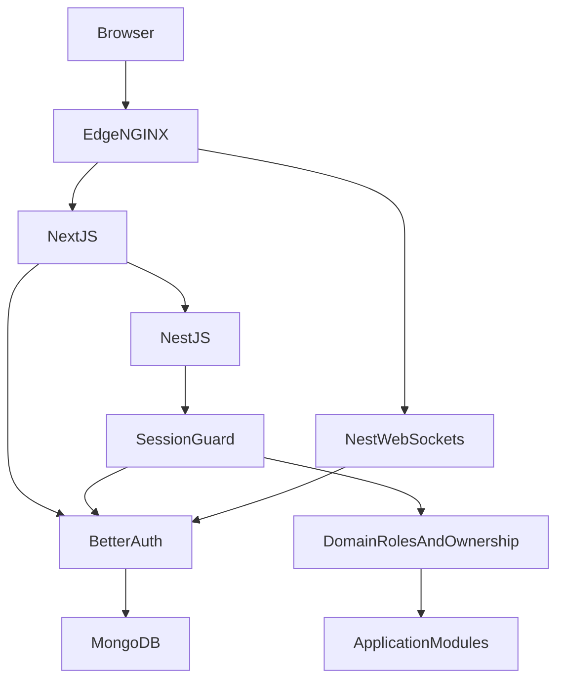

> **HISTORICAL / SUPERSEDED as current-state evidence (18 October 2026).** Retained for migration/security context. Completion, deployment, old paths and test counts below are historical assertions, not current validation. Use [CURRENT architecture](ARCHITECTURE.md), [EdNova audit](audit/2026-10-18/EDNOVA_AUDIT.md), [permissions](docs-repo/docs/roles-and-permissions.md) and [executed validation](audit/2026-10-18/VALIDATION.md). Do not run historical migration/removal steps without checking the current source and data.

# Better Auth authentication migration

Status: COMPLETE — implemented, migrated, deployed and verified on 2026-10-08.

## Architecture and ownership

Better Auth 1.7.7 is the only authentication authority, hosted by Next.js 16.4.0 official route handlers. NestJS 12.1.2 owns the existing backend listener, authenticates through the central BetterAuthService/AuthGuard and retains application role, ownership, internal-contract and subscription policies. CurrentUser is available for new Nest controllers. Existing Express domain routers are retained behind the Nest controller, preserving validated business contracts without replacing all business handlers. React screens now live in `src/screens`, rendered inside Next; React Router is retained as client navigation while Next server page checks and Nest API guards remain authoritative. Python AI source, dependencies, database and lifecycle are unchanged.

## Persistence and users

MongoDB remains the unified database. Better Auth uses `auth_users`, `auth_accounts`, `auth_sessions`, `auth_verifications`, and `auth_rate_limits`; business `users` and profile/study/billing collections remain. ObjectIds are preserved across identity and all domain references. New public registration always creates students; existing admin roles are preserved and authenticated admin management remains available. Signup onboarding drafts are sanitized and saved in domain users.

Run `pnpm --filter study-partner-api auth:migrate` for read-only preflight; append `-- --apply` to apply, or `node study-partner-api/scripts/migrate-auth.mjs --apply`. The idempotent migration validates all identity/email/hash rows before writing, rejects conflicts, adds unique/expiry indexes, and never overwrites an existing credential after a password reset. It reports counts only. Live database: one existing user inspected and migrated, preserving ID, verified state, business fields and bcrypt cost-12 credential. No collections dropped. Legacy auth fields remain inactive for rollback evidence and are excluded from responses. They are not used for login/reset/session verification.

Existing bcrypt passwords remain valid through Better Auth's documented custom password verifier. New passwords and resets use native Better Auth scrypt. There is no custom JWT issuer/verifier or refresh-token implementation. Existing JWT sessions end at cutover; users sign in again. Old verification/reset links must be resent using Better Auth. No forced password reset.

## Endpoint replacements

| Previous backend endpoint | New Next/Better Auth endpoint |
|---|---|
| POST /api/v1/auth/register | POST /api/auth/sign-up/email |
| POST /api/v1/auth/login | POST /api/auth/sign-in/email |
| POST /api/v1/auth/logout | POST /api/auth/sign-out |
| POST /api/v1/auth/refresh | Automatic Better Auth session renewal |
| POST /api/v1/auth/forgot-password | POST /api/auth/request-password-reset |
| POST /api/v1/auth/reset-password | POST /api/auth/reset-password |
| POST /api/v1/auth/verify-email | GET /api/auth/verify-email |
| POST /api/v1/auth/verify-otp | POST /api/auth/email-otp/verify-email |
| POST /api/v1/auth/resend-verification | POST /api/auth/email-otp/send-verification-otp |
| GET /api/v1/auth/me | Retained domain account/subscription view |
| Billing/tier/coupon/admin routes | Retained under /api/v1/auth |

No external/mobile integrations were found in the repository. Browser code uses the official Better Auth client, not manual endpoint token generation. UI profile state is a nonpersistent display cache derived from the authoritative session/domain account. No auth credentials or persisted authentication claims in localStorage. Cookies travel through Next to Nest; in-process calls forward cookies using request context and existing internal-secret contracts. WebSocket query credentials are rejected; cookie identities must match requested user and team membership. Messages, broadcasts and heartbeats revalidate sessions; realtime message handlers recheck membership. Logged-out sockets reject subsequent messages.

## Session and security review

HTTP-only sameSite=lax cookies, secure for HTTPS, seven-day sessions, daily renewal, disabled cookie cache, DB expiry/invalidation. Production non-local origins require HTTPS; local HTTP development at localhost is intentional. Better Auth owns CSRF/origin checks, hashing, verification, reset and renewal. Nest rejects untrusted mutation origins and cross-site browser mutations without origin. CORS is explicitly limited to configured origins even in development. Fresh domain state enforces disabling/admin changes immediately; frontend role checks cannot grant backend access. OTPs use hashed storage, ten-minute expiry and five attempts. The OTP plugin is used for verification; passwordless OTP login and automatic OTP signup are disabled, preserving password-based registration/login. Password resets expire after one hour and revoke all sessions. Password policy preserves upper/lowercase, number, punctuation and minimum eight characters. Auth endpoint rate limits use persisted Better Auth counters plus domain API Redis limits. Secrets are server-only; Next request logging is disabled to avoid logging verification/reset URLs. No password/hash/cookie/OTP/secret logging. Edge request URL logging is disabled and legacy access/refresh cookies are expired by the new auth route handler. No OAuth configured previously or added speculatively.

## Deployment and environment

Node 24/pnpm 11.3 workspace and single frozen lockfile retained. `pnpm dev` starts Next :5173 and Nest :3000; `pnpm start` starts the backend. Copy API and web environment examples, configure both servers with the same Mongo URI and BETTER_AUTH_SECRET, matching trusted origins and independent AI URL. Backend startup validates auth configuration.

Docker: `docker compose --env-file study-partner-api/.env up -d --build app web frontend mailpit`. Main services: Nest backend, Next frontend server, nginx edge :8080, MongoDB (optional when cloud URI configured), Redis, RabbitMQ, development Mailpit. Next API proxy target is a Docker build argument `BACKEND_URL`, default http://app:3000; override for different topology. Development mailbox: http://localhost:8025; development SMTP is loopback port 1025. `pnpm test:infra:up` provides isolated MongoDB :27018 and SMTP/mailbox :1026/:8026; then `pnpm test:e2e` starts isolated Next/Nest and runs browser flows. Never expose the mailbox publicly. Production override profiles out Mailpit and requires SMTP, public HTTPS Better Auth URL and trusted origins. Python AI remains independently configured with existing separate Compose lifecycle.

## Validation

Real MongoDB auth lifecycle coverage includes migration/idempotency/conflicts, bcrypt identity preservation, invalid credentials, disabled accounts, fresh roles, old JWT rejection, expiry, registration policy/admin injection, verification OTP success/lockout/expiry, logout/replay, reset non-enumeration/expiry/replay/revocation/scrypt, origin rejection, rate limiting, HTTPS cookie attributes and random new sessions. Real Nest startup tests verify public health, protected resources, current user ID, student admin denial/admin role changes, origin rejection and invalidated-session rejection. Browser flow uses actual Next/Nest/Mongo/SMTP delivery and verifies registration → verification link → login → reload → admin denial → logout → old cookie rejection → protected-page redirect.

Jest domain tests deliberately inject session identity fixtures; they are not evidence of Better Auth authentication and do not run a second auth system. Independent real-auth tests exercise installed Better Auth and MongoDB directly. Legacy JWT controller tests were replaced by retirement assertions and the real lifecycle suite. Default test runner includes both. Final results: 519 Jest domain/architecture tests, 17 real Better Auth/Mongo/Nest tests, and 159 frontend tests passed (695 total). Twelve existing opt-in/frontend tests remain skipped. Nine browser checks passed against the actual Docker deployment at http://localhost:8080, including delivered verification and password reset links, new-password login, reset session invalidation, logout invalidation and seven UI smoke checks. The repeatable isolated browser command uses temporary MongoDB and Mailpit with Next/Nest started by Playwright. Lint passed with no errors (115 existing/backend console warnings and one frontend hook warning); JavaScript/JSX/ESM syntax checks passed (no TypeScript application sources configured). Workspace frozen installation, production build and both Docker images passed. Edge, Next, Nest, Redis, RabbitMQ and development Mailpit are healthy. One Node process runs the backend. The deployment test account and its domain/auth records were removed; the original one domain user and one auth identity remain. Python AI Git status is clean. Remote CI was not executed.

## Rollback and limitations

Legacy images and domain records were preserved. Restore prior images/configuration only with a planned data review: credentials changed to scrypt cannot be authenticated by the old bcrypt implementation. Never blindly overwrite reset credentials from retained legacy hashes. Keep a private backup of database and environment configuration; no password export files are generated by migration. The parent workspace is not a Git repo; root files and the API/web repo changes must be versioned together. React 18 is supported with a Next deprecation warning; future React 19 upgrade is separate. No OAuth provider validation needed. Remote GitHub CI is updated but not executed locally.

## Final authentication report

| Area | Result |
|---|---|
| Previous authentication | bcrypt cost 12, custom access/refresh JWTs and OTP/reset fields |
| New authentication | Better Auth 1.7.7, sole authority |
| Database | Existing MongoDB with independent auth collections beside preserved domain records |
| Users migrated | 1 existing user; ObjectId, email, verification, role and business data preserved |
| Sessions | Persisted Better Auth sessions; expiry, renewal, logout/reset invalidation verified |
| Password migration | Legacy bcrypt compatibility; native scrypt for new/reset passwords |
| OAuth | None previously configured; none added |
| Email verification | Links and hashed expiring OTPs tested; SMTP link tested in deployed browser |
| Password reset | Delivered link, UI reset, session revocation and new login tested |
| Roles | Fresh domain roles and admin checks preserved |
| Permissions | Resource ownership, team membership, tier and internal contracts retained; 193-route mapping recorded |
| NestJS integration | Backend shell, BetterAuthService, AuthGuard, AuthModule, CurrentUser |
| Next.js integration | Official handler/client, server protected pages, reactive session-derived display state, nonce CSP |
| Old authentication removed | Yes, runtime JWT/refresh/custom controllers and obsolete env/dependencies removed; inactive legacy DB fields retained for evidence/rollback |
| Security audit | Passed lifecycle/failure/origin/cookie/hash/rate-limit/ownership/revocation checks |
| Authentication tests | 17 real auth/Nest tests plus deployed registration/reset/logout browser flows |
| Known issues | 12 existing skips; production requires HTTPS/SMTP; React 18 deprecation warning; remote CI and independent AI provider HTTP environment not run |

See [AUTH_ROUTE_MAP.md](AUTH_ROUTE_MAP.md) for actual protected endpoint mappings, and [AUTH_MIGRATION_ANALYSIS.md](AUTH_MIGRATION_ANALYSIS.md) for the pre-change audit.
