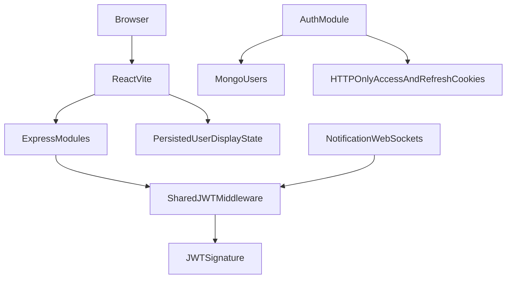
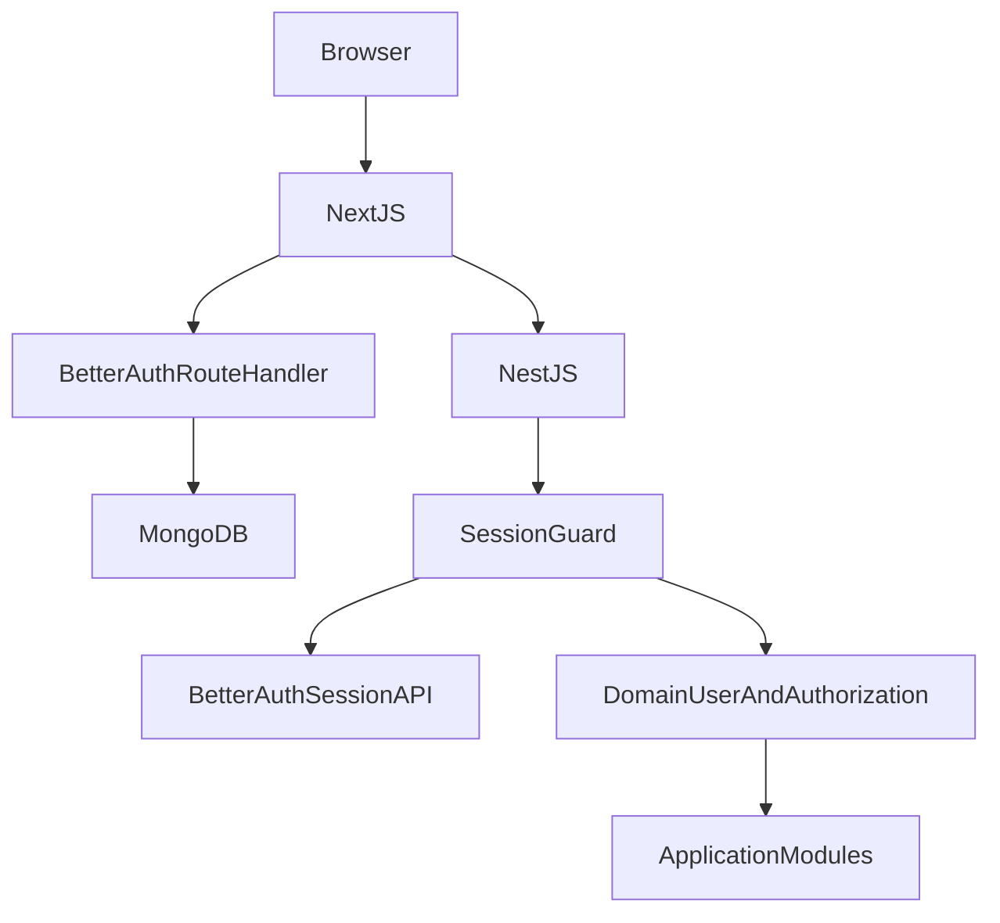

> **HISTORICAL / SUPERSEDED as current-state evidence (18 October 2026).** Retained for migration/security context. Completion, deployment, old paths and test counts below are historical assertions, not current validation. Use [CURRENT architecture](ARCHITECTURE.md), [EdNova audit](audit/2026-10-18/EDNOVA_AUDIT.md), [permissions](docs-repo/docs/roles-and-permissions.md) and [executed validation](audit/2026-10-18/VALIDATION.md). Do not run historical migration/removal steps without checking the current source and data.

# Authentication migration analysis

Audit date: 2026-10-08. Implementation baseline: React 18/Vite 7 frontend, Express 4 modular monolith, Mongoose 8/MongoDB; Python AI is independent and excluded.

## Current architecture

## Audited flows and persistence
Registration validates email/name and a password containing uppercase, lowercase, digit and punctuation, hashes using bcryptjs cost 12 with per-password salt embedded in $2a/$2b hash. Registration accepts student or admin; admin requires server ADMIN_REGISTRATION_KEY. Domain User stores Mongo ObjectId, normalized unique email, name, password, role, isAdmin, isActive, isVerified, lastLogin, trial/subscription/billing/preferences/onboarding fields, timestamps. No OAuth providers, OAuth account linking or organization/permission tables exist. Frontend teacher role helpers have no matching database role.

Login checks bcrypt, disabled account and verification; downgrades expired trials, updates login, issues one-hour JWT and seven-day refresh JWT. HTTP-only sameSite=lax cookies, secure in production, path /. Refresh tokens stored as SHA256 token hashes with jti/expiration (maximum five), rotate on use; detected reuse revokes all refresh tokens. Access JWTs survive logout/reset/deactivation until expiry because shared auth only checks embedded state. Backend bearer fallback and WebSocket token query fallback exist. Frontend Zustand persists user/display authentication flags and synthetic one-hour expiry but no raw tokens; Axios refreshes after 401. Must replace this with authoritative server session retrieval, no refresh protocol.

Email verification: opaque 32-byte link token stored plaintext in User, 24h expiry, plus six-digit plaintext OTP 10min expiry and five attempts; resend creates new secrets. Password reset: opaque 32-byte token stored plaintext, one-hour expiration; reset updates bcrypt password and revokes refresh tokens. Email uses nodemailer SMTP or development Ethereal fallback. Existing dev preview logs contain access links: remove auth-token/preview logging. Stripe webhook is signed with raw body; billing is domain functionality and retained.

Authorization: shared authenticate plus requireRole/admin routes, requireInternal shared secret, subscription/tier policy, resource ownership in route handlers and team membership for WebSockets. No separate permission tables; ownership, role and feature/tier policies are authoritative backend rules. Public registration must never assign admin from client fields without explicit server policy. Shared helmet/CORS and Redis/in-memory endpoint limits exist. Current custom auth lacks explicit origin-based CSRF validation; Better Auth origin/CSRF protections must remain enabled and business mutations must validate origin too.

## Target and decisions

Next.js hosts Better Auth through official toNextJsHandler. NestJS independently resolves sessions through one integration service and exposes guards/current-user context, then dispatches existing domain module interfaces in the one backend process. One reusable server auth configuration and Mongo adapter use the existing Mongo database; separate auth collections avoid coupling business fields. Preserve ObjectId identity so domain references remain valid. Sessions opaque persisted Better Auth sessions with HTTP-only cookie, seven-day expiry, daily renewal, server verification without cookie cache, secure production, sameSite lax, explicit trusted origins. Legacy JWT sessions end at cutover; passwords/users are preserved. No dual authentication runtime.

Password strategy: migrate existing bcrypt hashes to credential accounts; Better Auth supported custom verifier accepts legacy bcrypt and native scrypt; new hashes/resets use Better Auth native scrypt. No plaintext password export or logging. Verify against actual installed package/source and real integration tests before any live data write. Idempotent migration preflight rejects duplicate normalized emails, invalid identity/hash or conflicting auth records; no blind drops. Maintain domain users and collections; only remove obsolete runtime code after checkpoint. Existing reset/verification tokens need resending at cutover; old JWT cookies cleared and users log in again.

Internal consumers: web services/api.js, login/register/verify/reset pages, Zustand store, WebSockets and backend module calls. No external/mobile consumers found in repository. Update internal clients to Better Auth API; retain business /api/v1/auth/me, billing/tier/coupon/admin interfaces; old custom login/register/refresh/reset endpoints retired with documented replacement paths. Forward session cookie for internal user-scoped module calls, preserve shared-secret service calls, never use browser-supplied identity.

## Actual protected frontend routes
Dashboard, sessions, tasks, subjects/detail, upload-course, planner, competency, session-live, calendar, leaderboard, reviews, search, friends, analytics, session-setup, team-lobby, customize/wallpaper and customize/animated require student; profile requires authentication; admin/dashboard/coupons/analytics/users/subscriptions require admin. Public landing, login/register, verification/reset, pricing and checkout result pages. Next server routing will enforce session and role before rendering; Nest independently protects APIs.

## Field mapping
| Existing | Better Auth | Action |
|---|---|---|
| users._id | auth user._id / account.userId | Preserve Mongo identity |
| email/name | email/name | Preserve normalized identity |
| password | credential account.password | Preserve compatible bcrypt hash |
| isVerified | emailVerified | Preserve verified state |
| createdAt/updatedAt | createdAt/updatedAt | Preserve |
| role/isAdmin/isActive | domain users | Enforce fresh from database |
| tier/subscriptions/onboarding/preferences | domain users | Preserve independently |
| refresh/reset/OTP tokens | none | Retire only after validated cutover |

## Endpoint inventory
Each module app applies authentication at its protected router mount; route-level ownership/tier/role checks remain. Nest session guard is applied to protected API prefixes and shared authentication delegates to the same session resolver. Public health/docs, auth host and signed billing webhook remain explicit exemptions. Internal-only contracts retain requireInternal (never exposed through a forged cookie identity).

| Source | Actual route declaration |
|---|---|
| `study-partner-api/modules/ai-orchestrator/src/routes/eval.js:27` | `router.post('/step', async (req, res, next) => {` |
| `study-partner-api/modules/ai-orchestrator/src/routes/eval.js:112` | `router.get('/jobs/:jobId', async (req, res, next) => {` |
| `study-partner-api/modules/ai-orchestrator/src/routes/jobs.js:17` | `router.post('/jobs', async (req, res, next) => {` |
| `study-partner-api/modules/ai-orchestrator/src/routes/jobs.js:83` | `router.get('/jobs/:jobId', async (req, res, next) => {` |
| `study-partner-api/modules/ai-orchestrator/src/routes/jobs.js:105` | `router.get('/jobs', async (req, res, next) => {` |
| `study-partner-api/modules/ai-orchestrator/src/routes/search.js:22` | `router.post('/query', async (req, res, next) => {` |
| `study-partner-api/modules/ai-orchestrator/src/routes/search.js:86` | `router.get('/jobs/:jobId', async (req, res, next) => {` |
| `study-partner-api/modules/ai-orchestrator/src/routes/ai.js:65` | `router.post(` |
| `study-partner-api/modules/ai-orchestrator/src/routes/ai.js:78` | `router.get(` |
| `study-partner-api/modules/ai-orchestrator/src/routes/ai.js:88` | `router.post(` |
| `study-partner-api/modules/ai-orchestrator/src/routes/ai.js:108` | `router.post(` |
| `study-partner-api/modules/ai-orchestrator/src/routes/ai.js:125` | `router.post(` |
| `study-partner-api/modules/ai-orchestrator/src/routes/ai.js:136` | `router.post(` |
| `study-partner-api/modules/ai-orchestrator/src/routes/ai.js:148` | `router.get(` |
| `study-partner-api/modules/ai-orchestrator/src/routes/ai.js:157` | `router.put(` |
| `study-partner-api/modules/ai-orchestrator/src/routes/ai.js:171` | `router.post(` |
| `study-partner-api/modules/ai-orchestrator/src/routes/ai.js:182` | `router.post(` |
| `study-partner-api/modules/ai-orchestrator/src/routes/ai.js:193` | `router.post(` |
| `study-partner-api/modules/ai-orchestrator/src/routes/ai.js:203` | `router.post(` |
| `study-partner-api/modules/ai-orchestrator/src/routes/ai.js:213` | `router.get(` |
| `study-partner-api/modules/ai-orchestrator/src/routes/ai.js:222` | `router.post(` |
| `study-partner-api/modules/ai-orchestrator/src/routes/ai.js:231` | `router.post(` |
| `study-partner-api/modules/ai-orchestrator/src/routes/ai.js:265` | `router.get(` |
| `study-partner-api/modules/ai-orchestrator/src/routes/ai.js:276` | `router.get(` |
| `study-partner-api/modules/ai-orchestrator/src/routes/ai.js:286` | `router.get(` |
| `study-partner-api/modules/ai-orchestrator/src/routes/ai.js:297` | `router.post(` |
| `study-partner-api/modules/ai-orchestrator/src/routes/ai.js:307` | `router.get(` |
| `study-partner-api/modules/ai-orchestrator/src/routes/ai.js:318` | `router.get(` |
| `study-partner-api/modules/ai-orchestrator/src/routes/ai.js:329` | `router.delete(` |
| `study-partner-api/modules/ai-orchestrator/src/routes/ai.js:339` | `router.post(` |
| `study-partner-api/modules/ai-orchestrator/src/routes/ai.js:349` | `router.post(` |
| `study-partner-api/modules/ai-orchestrator/src/routes/ai.js:373` | `router.get(` |
| `study-partner-api/modules/ai-orchestrator/src/routes/ai.js:384` | `router.get(` |
| `study-partner-api/modules/ai-orchestrator/src/routes/ai.js:397` | `router.post('/plan/create', tierGate('vip', 'vip_plus', 'trial'), async (req, res) => {` |
| `study-partner-api/modules/ai-orchestrator/src/routes/ai.js:445` | `router.post('/signals/analyze-frame', tierGate('vip_plus', 'trial'), async (req, res) => {` |
| `study-partner-api/modules/ai-orchestrator/src/routes/ai.js:471` | `router.post('/search/ask', tierGate('vip', 'vip_plus', 'trial'), async (req, res) => {` |
| `study-partner-api/modules/ai-orchestrator/src/routes/ai.js:503` | `router.get('/status', async (req, res) => {` |
| `study-partner-api/modules/analytics/src/routes/analytics.js:32` | `router.post(` |
| `study-partner-api/modules/analytics/src/routes/analytics.js:60` | `router.get(` |
| `study-partner-api/modules/analytics/src/routes/analytics.js:92` | `router.get(` |
| `study-partner-api/modules/analytics/src/routes/analytics.js:160` | `router.get(` |
| `study-partner-api/modules/analytics/src/routes/analytics.js:196` | `router.get(` |
| `study-partner-api/modules/analytics/src/routes/analytics.js:318` | `router.get(` |
| `study-partner-api/modules/auth/src/routes/stripe.js:28` | `router.get('/config', (req, res) => {` |
| `study-partner-api/modules/auth/src/routes/stripe.js:133` | `router.post('/subscribe', authenticate, async (req, res) => {` |
| `study-partner-api/modules/auth/src/routes/stripe.js:212` | `router.get('/subscription/status', authenticate, async (req, res) => {` |
| `study-partner-api/modules/auth/src/routes/stripe.js:231` | `router.post('/confirm', authenticate, async (req, res) => {` |
| `study-partner-api/modules/auth/src/routes/auth.js:213` | `router.post(` |
| `study-partner-api/modules/auth/src/routes/auth.js:287` | `router.post(` |
| `study-partner-api/modules/auth/src/routes/auth.js:398` | `router.post(` |
| `study-partner-api/modules/auth/src/routes/auth.js:501` | `router.post(` |
| `study-partner-api/modules/auth/src/routes/auth.js:546` | `router.get(` |
| `study-partner-api/modules/auth/src/routes/auth.js:616` | `router.post(` |
| `study-partner-api/modules/auth/src/routes/auth.js:713` | `router.get(` |
| `study-partner-api/modules/auth/src/routes/auth.js:754` | `router.post(` |
| `study-partner-api/modules/auth/src/routes/auth.js:787` | `router.post(` |
| `study-partner-api/modules/auth/src/routes/auth.js:818` | `router.post(` |
| `study-partner-api/modules/auth/src/routes/auth.js:875` | `router.post(` |
| `study-partner-api/modules/auth/src/routes/auth.js:902` | `router.post(` |
| `study-partner-api/modules/auth/src/routes/admin.js:12` | `router.use(requireRole('admin'));` |
| `study-partner-api/modules/auth/src/routes/admin.js:33` | `router.get('/users', async (req, res) => {` |
| `study-partner-api/modules/auth/src/routes/admin.js:71` | `router.get('/users/:userId', async (req, res) => {` |
| `study-partner-api/modules/auth/src/routes/admin.js:87` | `router.put('/users/:userId', async (req, res) => {` |
| `study-partner-api/modules/auth/src/routes/admin.js:134` | `router.delete('/users/:userId', async (req, res) => {` |
| `study-partner-api/modules/auth/src/routes/admin.js:152` | `router.put('/users/:userId/tier', async (req, res) => {` |
| `study-partner-api/modules/auth/src/routes/admin.js:183` | `router.get('/stats', async (req, res) => {` |
| `study-partner-api/modules/auth/src/routes/admin.js:201` | `router.get('/analytics/revenue', async (req, res) => {` |
| `study-partner-api/modules/auth/src/routes/admin.js:245` | `router.get('/subscriptions', async (req, res) => {` |
| `study-partner-api/modules/auth/src/routes/admin.js:275` | `router.put('/subscriptions/:paymentId/cancel', async (req, res) => {` |
| `study-partner-api/modules/auth/src/routes/admin.js:307` | `router.get('/coupons', async (req, res) => {` |
| `study-partner-api/modules/auth/src/routes/admin.js:321` | `router.post('/coupons', async (req, res) => {` |
| `study-partner-api/modules/auth/src/routes/admin.js:355` | `router.put('/coupons/:couponId', async (req, res) => {` |
| `study-partner-api/modules/auth/src/routes/admin.js:379` | `router.delete('/coupons/:couponId', async (req, res) => {` |
| `study-partner-api/modules/auth/src/routes/admin.js:398` | `router.get('/coupons/:couponId/usage', async (req, res) => {` |
| `study-partner-api/modules/notification/src/routes/chat.js:11` | `router.get('/:sessionId/history', async (req, res, next) => {` |
| `study-partner-api/modules/notification/src/routes/chat.js:24` | `router.post('/:sessionId/query', async (req, res, next) => {` |
| `study-partner-api/modules/notification/src/routes/chat.js:43` | `router.delete('/:sessionId/:messageId', async (req, res, next) => {` |
| `study-partner-api/modules/notification/src/routes/voice.js:22` | `router.post('/:sessionId/start', async (req, res, next) => {` |
| `study-partner-api/modules/notification/src/routes/voice.js:31` | `router.post('/:sessionId/end', async (req, res, next) => {` |
| `study-partner-api/modules/notification/src/routes/voice.js:41` | `router.get('/:sessionId/status', async (req, res, next) => {` |
| `study-partner-api/modules/notification/src/routes/voice.js:51` | `router.post('/:sessionId/participant', async (req, res, next) => {` |
| `study-partner-api/modules/notification/src/routes/voice.js:70` | `router.delete('/:sessionId/participant', async (req, res, next) => {` |
| `study-partner-api/modules/notification/src/routes/voice.js:84` | `router.patch('/:sessionId/mute', async (req, res, next) => {` |
| `study-partner-api/modules/notification/src/routes/notifications.js:43` | `router.get('/', async (req, res, next) => {` |
| `study-partner-api/modules/notification/src/routes/notifications.js:74` | `router.post('/broadcast', requireInternal, async (req, res, next) => {` |
| `study-partner-api/modules/notification/src/routes/notifications.js:91` | `router.post('/', requireInternal, async (req, res, next) => {` |
| `study-partner-api/modules/notification/src/routes/notifications.js:133` | `router.post('/email/test', requireInternal, async (req, res, next) => {` |
| `study-partner-api/modules/notification/src/routes/notifications.js:154` | `router.patch('/:id/read', async (req, res, next) => {` |
| `study-partner-api/modules/notification/src/routes/notifications.js:173` | `router.patch('/read-all', async (req, res, next) => {` |
| `study-partner-api/modules/notification/src/routes/notifications.js:189` | `router.delete('/:id', async (req, res, next) => {` |
| `study-partner-api/modules/signal-processing/src/routes/focus.js:26` | `router.post(` |
| `study-partner-api/modules/signal-processing/src/routes/focus.js:53` | `router.post(` |
| `study-partner-api/modules/signal-processing/src/routes/focus.js:93` | `router.post(` |
| `study-partner-api/modules/signal-processing/src/routes/focus.js:200` | `router.get(` |
| `study-partner-api/modules/signal-processing/src/routes/focus.js:218` | `router.get(` |
| `study-partner-api/modules/signal-processing/src/routes/focus.js:234` | `router.get(` |
| `study-partner-api/modules/study/src/routes/competencies.js:14` | `router.get(` |
| `study-partner-api/modules/study/src/routes/competencies.js:34` | `router.get(` |
| `study-partner-api/modules/study/src/routes/learningObjectives.js:11` | `router.post(` |
| `study-partner-api/modules/study/src/routes/sessions.js:9` | `router.use('/', core);` |
| `study-partner-api/modules/study/src/routes/sessions.js:10` | `router.use('/', challenge);` |
| `study-partner-api/modules/study/src/routes/sessions.js:11` | `router.use('/', tasks);` |
| `study-partner-api/modules/study/src/routes/sessions.js:12` | `router.use('/', team);` |
| `study-partner-api/modules/study/src/routes/teamSessions.js:22` | `router.post('/team', async (req, res) => {` |
| `study-partner-api/modules/study/src/routes/teamSessions.js:109` | `router.post('/team/:sessionId/join', async (req, res) => {` |
| `study-partner-api/modules/study/src/routes/teamSessions.js:187` | `router.post('/team/join-by-code', async (req, res) => {` |
| `study-partner-api/modules/study/src/routes/teamSessions.js:265` | `router.post('/team/:sessionId/leave', async (req, res) => {` |
| `study-partner-api/modules/study/src/routes/teamSessions.js:295` | `router.post('/team/:sessionId/invite', async (req, res) => {` |
| `study-partner-api/modules/study/src/routes/teamSessions.js:383` | `router.put('/team/:sessionId/start', async (req, res) => {` |
| `study-partner-api/modules/study/src/routes/teamSessions.js:436` | `router.get('/team/:sessionId/participants', async (req, res) => {` |
| `study-partner-api/modules/study/src/routes/teamSessions.js:474` | `router.put('/team/:sessionId/end', async (req, res) => {` |
| `study-partner-api/modules/study/src/routes/sessionTasks.js:57` | `router.post('/setup', async (req, res) => {` |
| `study-partner-api/modules/study/src/routes/sessionTasks.js:175` | `router.post('/:sessionId/task/complete', async (req, res) => {` |
| `study-partner-api/modules/study/src/routes/sessionTasks.js:309` | `router.post('/:sessionId/task/skip', async (req, res) => {` |
| `study-partner-api/modules/study/src/routes/challengeSessions.js:29` | `router.post('/challenge/start', async (req, res) => {` |
| `study-partner-api/modules/study/src/routes/challengeSessions.js:78` | `router.get('/challenge/:sessionId', async (req, res) => {` |
| `study-partner-api/modules/study/src/routes/challengeSessions.js:114` | `router.put('/challenge/:sessionId/complete', async (req, res) => {` |
| `study-partner-api/modules/study/src/routes/coach.js:45` | `router.post('/nudge', tierGate('vip', 'vip_plus', 'trial'), async (req, res) => {` |
| `study-partner-api/modules/study/src/routes/coach.js:160` | `router.get('/jobs/:jobId', async (req, res) => {` |
| `study-partner-api/modules/study/src/routes/coreSessions.js:64` | `router.get(` |
| `study-partner-api/modules/study/src/routes/coreSessions.js:86` | `router.get(` |
| `study-partner-api/modules/study/src/routes/coreSessions.js:103` | `router.post(` |
| `study-partner-api/modules/study/src/routes/coreSessions.js:129` | `router.put(` |
| `study-partner-api/modules/study/src/routes/coreSessions.js:188` | `router.get(` |
| `study-partner-api/modules/study/src/routes/tasks.js:33` | `router.get(` |
| `study-partner-api/modules/study/src/routes/tasks.js:51` | `router.get(` |
| `study-partner-api/modules/study/src/routes/tasks.js:68` | `router.post(` |
| `study-partner-api/modules/study/src/routes/tasks.js:91` | `router.put(` |
| `study-partner-api/modules/study/src/routes/tasks.js:160` | `router.delete(` |
| `study-partner-api/modules/study/src/routes/tasks.js:178` | `router.post(` |
| `study-partner-api/modules/study/src/routes/topics.js:25` | `router.get(` |
| `study-partner-api/modules/study/src/routes/topics.js:37` | `router.get(` |
| `study-partner-api/modules/study/src/routes/topics.js:54` | `router.post(` |
| `study-partner-api/modules/study/src/routes/topics.js:77` | `router.put(` |
| `study-partner-api/modules/study/src/routes/topics.js:105` | `router.delete(` |
| `study-partner-api/modules/study/src/routes/courses.js:186` | `router.get('/', async (req, res) => {` |
| `study-partner-api/modules/study/src/routes/courses.js:224` | `router.post(` |
| `study-partner-api/modules/study/src/routes/courses.js:311` | `router.get('/:courseId', async (req, res) => {` |
| `study-partner-api/modules/study/src/routes/courses.js:344` | `router.get('/:courseId/ingest-status', async (req, res) => {` |
| `study-partner-api/modules/study/src/routes/courses.js:363` | `router.delete('/:courseId', async (req, res) => {` |
| `study-partner-api/modules/study/src/routes/courses.js:389` | `router.post(` |
| `study-partner-api/modules/study/src/routes/courses.js:465` | `router.post('/manual', async (req, res) => {` |
| `study-partner-api/modules/study/src/routes/subjects.js:36` | `router.get('/', async (req, res) => {` |
| `study-partner-api/modules/study/src/routes/subjects.js:70` | `router.post('/', upload.single('image'), async (req, res) => {` |
| `study-partner-api/modules/study/src/routes/subjects.js:145` | `router.get('/:subjectId', async (req, res) => {` |
| `study-partner-api/modules/study/src/routes/subjects.js:181` | `router.put('/:subjectId', upload.single('image'), async (req, res) => {` |
| `study-partner-api/modules/study/src/routes/subjects.js:224` | `router.delete('/:subjectId', async (req, res) => {` |
| `study-partner-api/modules/study/src/routes/plans.js:33` | `router.post('/create', tierGate('vip', 'vip_plus', 'trial'), async (req, res) => {` |
| `study-partner-api/modules/study/src/routes/plans.js:123` | `router.post('/create-status', async (req, res) => {` |
| `study-partner-api/modules/study/src/routes/plans.js:215` | `router.get('/', async (req, res) => {` |
| `study-partner-api/modules/study/src/routes/plans.js:248` | `router.get('/calendar', async (req, res) => {` |
| `study-partner-api/modules/study/src/routes/plans.js:274` | `router.get('/:planId([0-9a-fA-F]{24})', async (req, res) => {` |
| `study-partner-api/modules/study/src/routes/plans.js:311` | `router.post('/:planId/schedule', tierGate('vip', 'vip_plus', 'trial'), async (req, res) => {` |
| `study-partner-api/modules/study/src/routes/plans.js:401` | `router.get('/:planId/schedule', async (req, res) => {` |
| `study-partner-api/modules/study/src/routes/plans.js:447` | `router.delete('/:planId', async (req, res) => {` |
| `study-partner-api/modules/study/src/routes/plans.js:469` | `router.post('/schedule-tasks', tierGate('vip', 'vip_plus', 'trial'), async (req, res) => {` |
| `study-partner-api/modules/user-profile/src/routes/availability.js:24` | `router.get('/', async (req, res) => {` |
| `study-partner-api/modules/user-profile/src/routes/availability.js:50` | `router.post('/', async (req, res) => {` |
| `study-partner-api/modules/user-profile/src/routes/availability.js:151` | `router.delete('/:id', async (req, res) => {` |
| `study-partner-api/modules/user-profile/src/routes/availability.js:185` | `router.get('/free-slots', async (req, res) => {` |
| `study-partner-api/modules/user-profile/src/routes/friends.js:32` | `router.get('/', async (req, res) => {` |
| `study-partner-api/modules/user-profile/src/routes/friends.js:84` | `router.get('/requests/incoming', async (req, res) => {` |
| `study-partner-api/modules/user-profile/src/routes/friends.js:121` | `router.get('/requests/outgoing', async (req, res) => {` |
| `study-partner-api/modules/user-profile/src/routes/friends.js:158` | `router.post('/request', async (req, res) => {` |
| `study-partner-api/modules/user-profile/src/routes/friends.js:247` | `router.put('/request/:friendshipId/accept', async (req, res) => {` |
| `study-partner-api/modules/user-profile/src/routes/friends.js:296` | `router.put('/request/:friendshipId/reject', async (req, res) => {` |
| `study-partner-api/modules/user-profile/src/routes/friends.js:316` | `router.delete('/request/:friendshipId', async (req, res) => {` |
| `study-partner-api/modules/user-profile/src/routes/friends.js:332` | `router.delete('/:friendId', async (req, res) => {` |
| `study-partner-api/modules/user-profile/src/routes/friends.js:352` | `router.post('/block/:userId', async (req, res) => {` |
| `study-partner-api/modules/user-profile/src/routes/friends.js:374` | `router.delete('/block/:userId', async (req, res) => {` |
| `study-partner-api/modules/user-profile/src/routes/friends.js:388` | `router.get('/blocked', async (req, res) => {` |
| `study-partner-api/modules/user-profile/src/routes/friends.js:407` | `router.get('/search', async (req, res) => {` |
| `study-partner-api/modules/user-profile/src/routes/friends.js:474` | `router.get('/:friendId/profile', async (req, res) => {` |
| `study-partner-api/modules/user-profile/src/routes/friends.js:517` | `router.get('/online', async (req, res) => {` |
| `study-partner-api/modules/user-profile/src/routes/friends.js:550` | `router.get('/count', async (req, res) => {` |
| `study-partner-api/modules/user-profile/src/routes/gamification.js:68` | `router.get('/', async (req, res) => {` |
| `study-partner-api/modules/user-profile/src/routes/gamification.js:94` | `router.post('/award-xp', requireInternal, async (req, res) => {` |
| `study-partner-api/modules/user-profile/src/routes/gamification.js:211` | `router.get('/leaderboard', async (req, res) => {` |
| `study-partner-api/modules/user-profile/src/routes/quests.js:103` | `router.get('/', async (req, res) => {` |
| `study-partner-api/modules/user-profile/src/routes/quests.js:164` | `router.post('/progress', requireInternal, async (req, res) => {` |
| `study-partner-api/modules/user-profile/src/routes/ranking.js:67` | `router.get('/seasons/current', async (req, res) => {` |
| `study-partner-api/modules/user-profile/src/routes/ranking.js:87` | `router.get('/profile', async (req, res) => {` |
| `study-partner-api/modules/user-profile/src/routes/ranking.js:111` | `router.get('/progress', async (req, res) => {` |
| `study-partner-api/modules/user-profile/src/routes/ranking.js:133` | `router.get('/badges', async (req, res) => {` |
| `study-partner-api/modules/user-profile/src/routes/ranking.js:142` | `router.get('/history', async (req, res) => {` |
| `study-partner-api/modules/user-profile/src/routes/ranking.js:161` | `router.get('/leaderboard', async (req, res) => {` |
| `study-partner-api/modules/user-profile/src/routes/ranking.js:184` | `router.get('/session-result', async (req, res) => {` |
| `study-partner-api/modules/user-profile/src/routes/ranking.js:207` | `router.post('/events/award', requireInternal, async (req, res) => {` |
| `study-partner-api/modules/user-profile/src/routes/ranking.js:238` | `router.post('/seasons/reset-preview', requireAdmin, async (req, res) => {` |
| `study-partner-api/modules/user-profile/src/routes/ranking.js:259` | `router.post('/seasons/start', requireAdmin, async (req, res) => {` |
| `study-partner-api/modules/user-profile/src/routes/ranking.js:289` | `router.post('/seasons/close', requireAdmin, async (req, res) => {` |
| `study-partner-api/modules/user-profile/src/routes/profile.js:112` | `router.get('/', async (req, res) => {` |
| `study-partner-api/modules/user-profile/src/routes/profile.js:145` | `router.put('/', upload.single('avatarFile'), async (req, res) => {` |
| `study-partner-api/modules/user-profile/src/routes/profile.js:203` | `router.get('/stats', async (req, res) => {` |
| `study-partner-api/modules/user-profile/src/routes/profile.js:216` | `router.patch('/stats', async (req, res) => {` |
| `study-partner-api/modules/user-profile/src/routes/profile.js:243` | `router.get('/goals', async (req, res) => {` |
| `study-partner-api/modules/user-profile/src/routes/profile.js:256` | `router.post('/goals', async (req, res) => {` |
| `study-partner-api/modules/user-profile/src/routes/profile.js:284` | `router.patch('/goals/:goalId', async (req, res) => {` |
| `study-partner-api/modules/user-profile/src/routes/profile.js:318` | `router.delete('/goals/:goalId', async (req, res) => {` |
| `study-partner-api/modules/user-profile/src/routes/profile.js:335` | `router.put('/online-status', async (req, res) => {` |
| `study-partner-api/modules/user-profile/src/routes/profile.js:365` | `router.get('/online-status/batch', async (req, res) => {` |
| `study-partner-api/modules/user-profile/src/routes/profile.js:426` | `router.put('/privacy', async (req, res) => {` |
| `study-partner-api/modules/user-profile/src/routes/profile.js:450` | `router.get('/background', async (req, res) => {` |
| `study-partner-api/modules/user-profile/src/routes/profile.js:467` | `router.post('/background/apply', async (req, res) => {` |
| `study-partner-api/modules/user-profile/src/routes/profile.js:519` | `router.post(` |
| `study-partner-api/modules/user-profile/src/routes/profile.js:585` | `router.post(` |
| `study-partner-api/modules/user-profile/src/routes/profile.js:648` | `router.post('/animated-background/apply', async (req, res) => {` |
| `study-partner-api/modules/user-profile/src/routes/profile.js:702` | `router.get('/background/presets', async (req, res) => {` |
| `study-partner-api/modules/user-profile/src/routes/profile.js:779` | `router.get('/animated-background/presets', async (req, res) => {` |
| `study-partner-api/modules/user-profile/src/routes/profile.js:841` | `router.get('/level', async (req, res) => {` |
| `study-partner-api/modules/user-profile/src/routes/profile.js:873` | `router.put('/notification-preferences', async (req, res) => {` |

## Validation checkpoint
Audit preceded all auth changes. The checkpoint is now passed: real lifecycle and Nest checks, deployed browser registration/verification/reset/logout flows, user/password migration, frontend/backend tests, builds and security checks succeeded. One existing user migrated; no domain collections dropped. Legacy runtime auth was removed after validation. See AUTH_MIGRATION.md for final results.

## Final endpoint protection map

The concrete endpoint-to-Nest guard mapping is in [AUTH_ROUTE_MAP.md](AUTH_ROUTE_MAP.md), generated from the actual module router mounts and declarations. Existing handlers remain responsible for their resource policies. New canonical auth endpoint replacements and verified final architecture are in [AUTH_MIGRATION.md](AUTH_MIGRATION.md).
