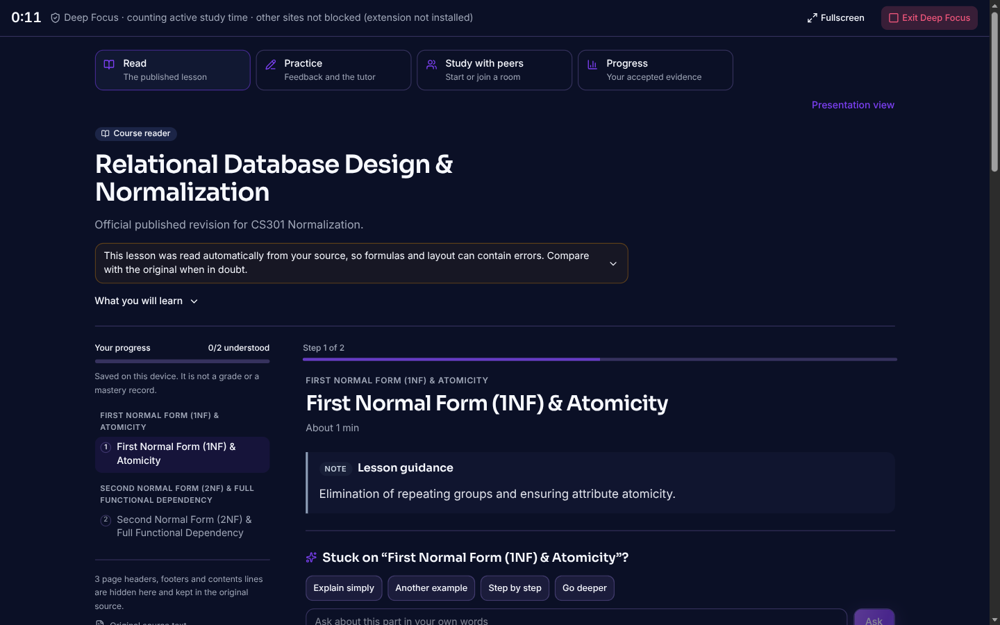
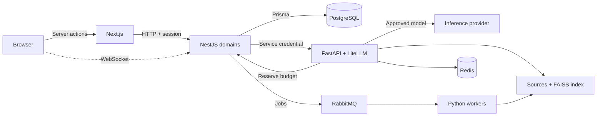

# Noveris

**Learn Together. Grow Further.**

Noveris is a GenAI peer-learning companion built for the **EdNova Challenge** (IEEE WIE ACT 5.0). It turns course documents into guided individual practice and structured peer study. The AI acts as tutor, facilitator and planner, while access control, grading and evidence stay in deterministic server code.

> **Naming.** *Noveris* is the product. *EdNova* is the name of the challenge. A few internal identifiers (database user, Docker/Compose project names, `EDNOVA_*` environment variables, `ednova-v1` contract names, demo e-mail domain) keep the old name for compatibility.

**Submission material:** [Technical report (PDF, 6 pages)](docs/submission/NOVERIS-TECHNICAL-REPORT.pdf) · [Submission checklist](docs/submission/README.md) · [Demo kit](demo/README.md) · [Demo video (90 s)](demo/output/noveris-demo-90s.mp4) · [Full walkthrough (4 min)](demo/output/noveris-demo-master.mp4) · [Business model](docs/business-model.md) · [Design system](design/README.md) · [All documentation](docs/README.md)



## Features

| Challenge goal | In Noveris |
| --- | --- |
| Peer learning | **Study Together** rooms (up to six peers): shared activity, private checks, group debrief, and a **peer-first facilitator** that asks and hints before answering. |
| Tutor behaviour | **Nardouch** course tutor: explain simply, another example, step by step, Socratic mode; **graduated hints before full explanations**; confusion signals from wrong attempts and hint escalation. |
| Personalisation | Six-question learning-style probe (visual, analogy, step-by-step, example, repetition, problem-solving) that changes explanation wording; provisional and never graded. |
| Multilingual | Darija (Arabizi or Arabic script), French, English and code-switching, with a glossary and an evaluation set. |
| Innovation | **Visual Learning Lab** (model proposes, trusted code computes), versioned **Course Studio** (upload → OCR → review → publish), instructor insights, progress and badges. |
| Capacity awareness | Budget ledger, deterministic-first design, response reuse and explicit execution modes. See below. |

## Two model categories, used deliberately

| Category | Tasks | Configured (development) |
| --- | --- | --- |
| Compact | coach, ingestion classification, Visual Lab engine selector, short tutor clarifications | `openai/gpt-oss-20b` |
| Capable | tutor explanations and misconception turns, Visual Lab planner, evaluator, facilitator proposals, course review | `openai/gpt-oss-120b` (search/reflection: `llama-3.3-70b-versatile`) |
| None | hint ladder, quiz grading, common facilitation cases, lab numerics | deterministic code |

Routing lives in [`apps/ai/litellm/config.yaml`](apps/ai/litellm/config.yaml) and can be pointed at the organiser-provided service by configuration. Groq is a declared external stand-in used during development. See [model configuration](docs/llm-config.md).

**Limited capacity.** Every real call needs an unexpired operator approval bound to the exact model; the API ledger reserves a request before dispatch. Router retries and silent cross-model fallback are disabled, eligible course-only calls are cached in Redis, and the interface shows labelled `UNAVAILABLE` / fallback states while preserving the learner's input. Automatic capable→compact fallback is **not** implemented (planned).

## Architecture



- `apps/web` Next.js 16 / React 19 UI, server actions, Better Auth endpoints
- `apps/api` NestJS domain modules, Prisma 7, resource grants, evidence, budget ledger
- `apps/ai` FastAPI service, agents, ingestion workers, FAISS retrieval (all-MiniLM-L6-v2, 200/50-word chunks, revision-pinned)
- `apps/extension` optional Deep Focus browser extension
- `deploy/` development and test infrastructure · `scripts/` setup and launch helpers · `docs/` guides

Details: [architecture](docs/architecture.md), [data model](docs/data-model.md), [roles and permissions](docs/roles-and-permissions.md), [privacy and security](docs/security.md).

## Quick start

Requirements: Node 24+, pnpm 11.3.0, Docker Compose, Python 3.11–3.14 with Poetry 2.

```bash
pnpm install --frozen-lockfile
pnpm dev:setup            # creates missing .env files from the templates; never overwrites
pnpm dev:infra:up         # PostgreSQL, RabbitMQ, Redis, Mailpit
pnpm dev:doctor           # checks configuration
pnpm --filter api db:setup
(cd apps/ai && poetry install)
pnpm dev:ai               # Python AI service (separate terminal)
pnpm dev:workers          # ingestion and other workers (separate terminal)
ALLOW_DEMO_COURSES=1 pnpm seed   # synthetic demo users and courses
pnpm dev
```

Open <http://localhost:3000/login> and sign in with the accounts in the [demo guide](docs/demo/DEMO-GUIDE.md). Fresh setup uses **explicit mock inference**, so no key is needed. For real inference put a provider key in `apps/ai/.env` and add a bounded approval ([how](docs/llm-config.md)). Credentials stay in untracked `.env` files; only `.env.example` templates are committed.

| Service | Port |
| --- | --- |
| Web / API / AI | 3000 / 3001 / 8000 |
| PostgreSQL / Redis | 5433 / 6381 |
| RabbitMQ (AMQP / UI) | 5673 / 15673 |
| Mailpit (SMTP / UI) | 1026 / 8026 |

Use a fresh database: one migrated with an older schema fails seeding with `LengthMismatch` (see [development](docs/development.md)).

## Verification

```bash
pnpm typecheck && pnpm lint && pnpm build
pnpm --filter api test           # 1,351 tests
pnpm --filter web test           # 286 tests
pnpm test:e2e                    # Playwright: auth, workspace, two-user room (needs infra)
cd apps/ai && poetry run pytest  # 1,294 pass; 15 need a private reference PDF not in the repo
```

Results recorded on 10 November 2026 are in the [technical report](docs/submission/NOVERIS-TECHNICAL-REPORT.pdf). A live Groq probe (compact 4.95 s / capable 2.08 s, single observations) is in [`docs/submission/evidence`](docs/submission/evidence/LIVE-INFERENCE-EVALUATION.json).

## Known limitations

- No testing with real learners or teachers yet; Darija quality has an evaluation set but has not been scored by native speakers.
- Mapping to the organiser-provided inference platform and its real quota behaviour has not been verified by us.
- No automatic PII detection: use synthetic or anonymised course material.
- Realtime delivery is verified for a single API instance only.
- Business model is a plan to validate, not a measured result.

## Business model (summary)

Institutions (B2B2C) buy cohort or annual access with an AI allowance; independent learners (B2C) start free and upgrade to Pro. Adoption starts with a free single-course pilot. See [business model](docs/business-model.md).
