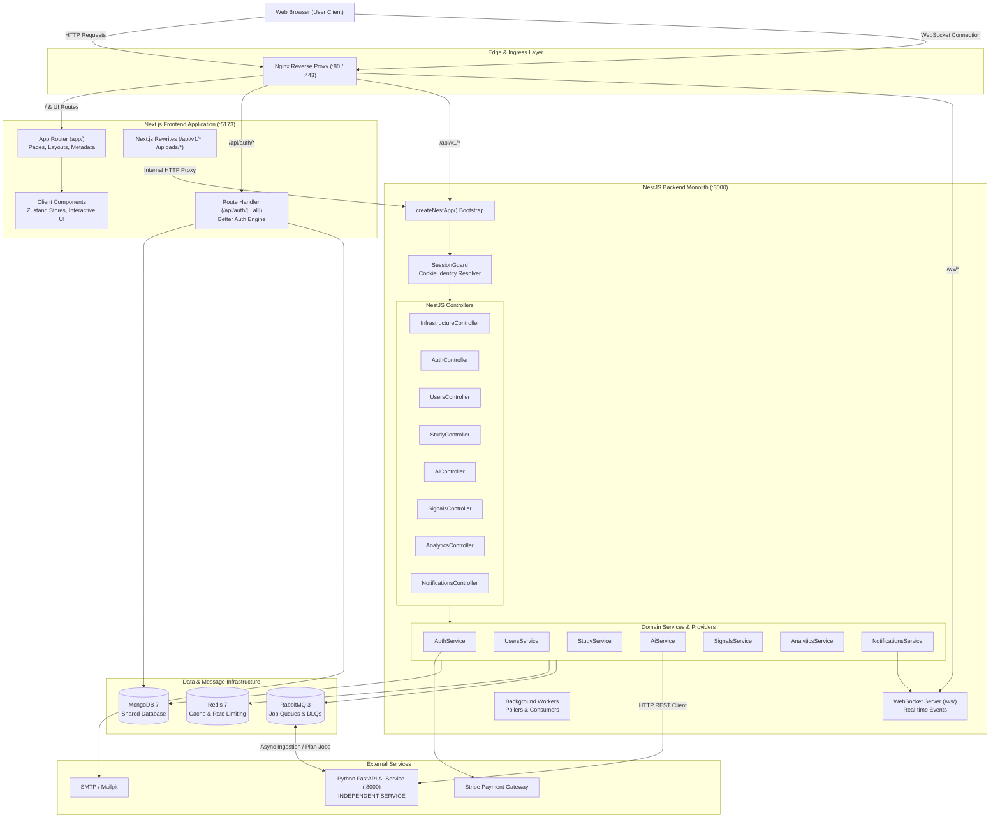

# Target Architecture: Next.js + NestJS Modular Monolith

Status: **IMPLEMENTED & VERIFIED**

---

## 1. High-Level Architecture Diagram

---

## 2. Key Architectural Tenets

1. **Modular Monolith**:
   - The entire backend is consolidated into a single deployable application with a single server entrypoint (`study-partner-api/src/main.js`).
   - Domain modules (`auth`, `users`, `study`, `ai-orchestrator`, `signal-processing`, `analytics`, `notification`) maintain strict domain boundaries without running independent microservice processes.
2. **Next.js App Router**:
   - The frontend leverages modern Next.js conventions with file-system routing, Server Components where appropriate, and selective `'use client'` interactive component leaves.
   - Built-in rewrites transparently route API traffic to NestJS while maintaining cookie credentials.
3. **Independent Python AI Service**:
   - The Python AI service in `study-partner-ai` is intentionally **NOT** merged into NestJS.
   - It maintains its own runtime, dependencies, database connections, and RabbitMQ message consumers.
   - Communication between NestJS and the AI service occurs strictly over an abstracted HTTP client and asynchronous message queues.
4. **Authoritative Security**:
   - Authentication is unified around HTTP-only session cookies via Better Auth.
   - Authorization is strictly enforced in the NestJS backend via `SessionGuard` and domain policies.
5. **pnpm Workspace Monorepo**:
   - Monorepo dependencies are strictly managed with `pnpm 11.3.0` and `pnpm-workspace.yaml`.
   - Node packages link via `workspace:*` references; all npm lockfiles are eliminated.
