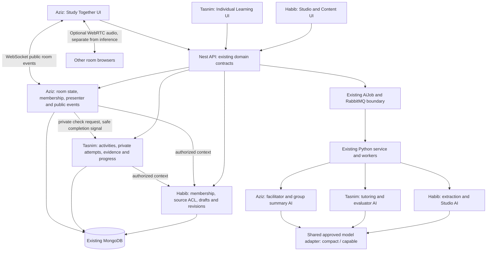

# TARGET EdNova architecture — PLANNED

This is a team proposal derived from the [v1.2 brief](docs-repo/docs/reference/ednova-brief-v1.2.md). No component below is marked implemented merely because it appears here. See [CURRENT architecture](ARCHITECTURE.md) for source evidence.

Retain Next, the Nest modular API, MongoDB, existing contracts, Redis/RabbitMQ and independent Python workers. Reuse the smallest suitable existing path; add no new database/framework, microservice fleet, knowledge graph prerequisite or custom training pipeline.

| Responsibility | Reuse CURRENT | Required adaptation (PLANNED) | Backlog |
|---|---|---|---|
| Identity/workspace | Better Auth and domain User | Scoped institution membership; one learner identity with personal and institutional contexts | ED-04 |
| Courses/materials | Subject/Course, files, ingest/status | Instructor ownership, reviewed publication, enrollment, provenance, source ACLs | ED-05, ED-06 |
| Individual learning | Evaluator, objectives, competencies, search/retrieval | Course-grounded tutor, brief diagnostic, hints and tentative next steps | ED-08, ED-10, ED-11 |
| Rooms | StudySession/team invites and WS | Shared text/resource/exercise state, replay/reconnect, ACLs; PDF page-following P1 | ED-02, ED-07 |
| Facilitation | Rules/coach and evaluator validation patterns | Explicit educational state and intervention policy; bounded group context | ED-09 |
| Private assistance | Individual evaluator/job scoping | Separate recipient-scoped room side channel, never group broadcast | ED-18 |
| Model execution | LiteLLM, aiClient, job/retry/result contracts | Organizer-service compact/capable mapping, visible waiting/fallback, inference budgets | ED-03, ED-12 |
| Voice (P1) | WebRTC, voice state and signaling | Consent, network reliability, TURN/provider decision, real-browser verification | ED-17 |
| Instructor insight (P1) | Analytics and evaluation evidence | Scoped aggregates with suppression and no transcript/private-file access | ED-19 |

## Proposed flows and boundaries

Authorize identity -> resolve personal/institution/course/room scope -> select allowed source IDs -> retrieve bounded passages -> choose intervention and model category -> execute asynchronously -> validate structured result -> deliver to authorized recipient(s) -> persist minimal evidence. Never let prompts decide access. Explicit room sharing must not override official-course enrollment.

Room synchronization carries presence, text, selected source/context, exercise and phase; full PDF page-following is P1. Audio uses separate WebRTC transport and remains usable while AI queues/fails. No recording or inference access to spoken discussion by default. Continuous transcription, diarization and TTS are separate P2 experiments requiring organizer clarification and all-participant consent.

The proposed facilitator progresses through setup, check-in, shared challenge, peer explanation/critique, hint/verification, individual check and group debrief. Compact tasks handle intent, short summaries and simple grounded hints; capable tasks handle complex reasoning and candidate misconception verification. Unavailable verification stays pending; do not silently assert that the compact model certified it. [AI policy](docs-repo/docs/ai-specification.md) defines states, schemas, context, budgets and safeguards.

## Reliability and implementation gates

Reuse correlation IDs and existing idempotency mechanisms. Bound retries, context, calls and output sizes. Group chat and materials must continue while an AI job is slow, quota-limited or failed. Namespace caches by authorized source/version and recipient scope. Cross-process evaluator resume needs configured durable state, not the in-memory default.

Gate 1: fix baseline and confirm allowed service. Gate 2: scoped content-to-real-inference vertical slice. Gate 3: two-browser text/shared-exercise facilitation. Gate 4: private final checks/debrief and capacity fallback. Gate 5: reproducible privacy/security/browser evidence and deliverables. Add P1 only after these gates pass. Institutional governance, billing, SSO, graph infrastructure and speech analytics are post-hackathon concerns. Full ordered tasks are in the [backlog](docs-repo/docs/sprint-backlog.md).

## v1.2 integrated architecture — TARGET / TODO

Keep the existing service/database/queue boundaries. Extend existing job contracts/types only where needed; no new broker/service/database is assumed. CURRENT ingestion/evaluator/gamification are REUSABLE, not an implemented Studio/activity/evidence-reward engine.

```text
PDF -> existing ingest worker -> source-linked draft sections -> instructor edit/approval
    -> published immutable revision -> same activity definitions for solo and room
    -> AI selector returns validated allowlisted activity -> trusted React component
    -> private submission -> server validation/evaluation -> accepted learning evidence
    -> private progress/next step -> optional P1 validated XP/achievement event
Room: public activity/presenter state only; private attempts and results separate
```

- Member Habib owns Course Studio, Content and Access end-to-end, **including** extraction/OCR/enrichment/indexing AI, editor UI, source/membership/revision APIs and tests.
- Member Tasnim owns Individual Learning and Progress end-to-end, **including** tutor/selector/evaluator AI, trusted renderer, private attempts/evidence, recommendations and reward processing/UI/tests.
- Member Aziz owns Study Together and Collaboration end-to-end, **including** facilitator/private-help/summary AI, rooms/chat/voice/presenter UI, APIs/WS and tests.
- No separate AI member. Habib supplies authorized source context; Tasnim supplies reusable activity/attempt/evaluation interfaces to Habib preview and Aziz rooms; Aziz owns public group state and requests Tasnim private checks. Tasnim stewards the common inference adapter while Habib/Tasnim/Aziz each own their domain prompts, category policy, validation and fallback. No duplicate model clients or activity/evidence engines.

`ActivityDefinition` public projection includes type/version/instructions/bounded data/source refs; evaluation keys/rubrics are server-only. Each attempt pins course revision/activity version/learner; learner text is untrusted. Teacher preview must be authorized separately. Source revisions stay stable for active sessions. Invalid schema/version/source yields safe text without state mutation. Group presenter control changes view, not others' private answers or grading state. P0 shares exercise/context and a source pointer; synchronized PDF viewer/page-following is P1.

Use existing correlation/job/idempotency patterns for submission and acceptance. An accepted-evidence marker and recoverable reward effect need durable, per-learner completion uniqueness; event-ledger insertion alone is insufficient if profile update fails. Reuse the current ranking ledger patterns after testing; ranking KP dedup does not prove XP safety. These are proposed adaptations, not schema changes performed here.

Contracts, response examples, version rules and handoff gates are defined in the [team plan](docs-repo/docs/team-delivery-plan.md). ED-26 must freeze them before concurrent implementation. The [AI specification](docs-repo/docs/ai-specification.md) and [data model](docs-repo/docs/data-model.md) describe validation/ownership; ED-27–ED-35 cover v1.2 additions without duplicating ED-04–ED-12.

## Recommended implementation architecture — technical decisions to review

This section is **TARGET guidance**, based on checked repository code and current blockers, not a new implementation or a statement that these contracts already exist. The confirmed owners are Habib (Course Studio/Content/Access), Tasnim (Individual Learning/Progress), Aziz (Study Together/Collaboration), each across UI/API/Python AI. Retain the [CURRENT architecture](ARCHITECTURE.md); improve its correctness before increasing its feature surface.



Boxes are logical responsibilities inside current processes, not instructions to deploy one service/container per box. Solo and rooms use the same Tasnim activity/attempt/evidence service; official and private content use the same Habib source engine with different scopes.

### Decision record and tradeoffs

| Area | Recommendation / rationale | Current limitation / implementation gate | Owner / task |
|---|---|---|---|
| Application stack | Keep Next/React + Nest/Express contract shell + independent Python; reuse current UI and validators | Build/startup currently fails; compatibility fixes first, no framework migration | Habib coordinates ED-01, everyone repairs own module |
| Domain boundaries | Three product modules across languages; expose named contracts rather than direct cross-module model writes | Current shared model/adapter files need symbol ownership and serialized edits | All, ED-26 |
| Authentication | Keep Better Auth cookie identity and domain account IDs; add scoped memberships/enrollments alongside it | Frontend teacher helper is not server role; no institutional authorization exists yet | Habib ED-04; consumers ED-02 |
| Storage | Keep Mongo/Mongoose, explicit version refs and existing upload/index storage | No new database; do not assume transactions on standalone Mongo or automatic cross-service source-ID parity | Habib content, Tasnim learning, Aziz room models |
| Fast actions | Draft edits, membership checks, room commands and status reads stay request/response or WS ACK | Authorize/validate/version-check before mutation; keep handler latency independent of model calls | Module owner |
| Slow inference | Reuse AiJob/RabbitMQ workers/status polling for ingest, evaluation and facilitator jobs | FastAPI HTTP health does not prove workers/model readiness; wire only needed long jobs and document launch | Module owner, ED-03/06/09/12/29 |
| Realtime | Use current WS attachment for public room state; persist authoritative snapshot/sequence and ACK commands | Current SessionChat is search-style history, not complete peer text/facilitation; broadcasts need membership tests | Aziz ED-07/02 |
| Media | Keep peer WebRTC for P1 feasibility; decide TURN/provider only from real network failures and rules | STUN-only source does not prove reliable calls; no recording/transcription/default AI listening | Aziz ED-17; ED-25 later |
| Content grounding | Reuse source extraction/embeddings/FAISS with stable source/revision metadata | Authorize before lookup; current planner RAG is not a finished course tutor; citation pages may be unavailable | Habib ED-06 + Tasnim ED-10 |
| Interactive UI | P0 shipped quiz and guided-problem components via validated type/version/bounded data | No model-produced executable HTML/JS/JSX/CSS/formulas; answer key/rubric absent from public payload | Tasnim ED-27/28/29; Habib/Aziz consumers |
| Model routing | One approved transport/config and finite request budget; compact for bounded tasks, capable for warranted reasoning | Existing provider aliases/fallback mocks do not establish organizer compliance; avoid nested retry amplification | Tasnim adapter stewardship ED-03/12; all own operations |
| Evidence and rewards | One private accepted-evidence writer, stable completion identity and recoverable effects | Existing bounded competency history and ranking KP dedup are not blanket XP exactly-once guarantees | Tasnim ED-29/33; Aziz group signal |
| Testing/operations | All owners test UI/API/Python/browser/security; shared integration gate before feature/demo claims | Preserve skipped/failed results and independent source/recipient/recovery tests; no global QA-only person | Aziz coordinates ED-14, all contribute |

### Proposed interface catalogue — not existing APIs

Prefer current domain namespaces/contract registration. The following names are concrete proposals for ED-26 review; they are not public API changes made by documentation. Keep existing endpoint compatibility; normalize parameter validation in generated Nest bindings instead of embedding unsupported regex in public decorator paths.

| Proposed operation | Transport / owner | Input and output / access |
|---|---|---|
| Read authorized course context | `GET /api/v1/study/courses/:courseId/context` — Habib | Requested approved revision/section -> permitted source/objective/activity refs. Owner/instructor/enrollment or explicit personal room grant checked; no draft/foreign source leakage |
| Read/update draft | `GET/PATCH /api/v1/study/courses/:courseId/draft` — Habib | Validated hierarchy + expectedRevision; source provenance retained, assigned instructor or personal owner only; stale edit -> conflict/current version |
| Publish reviewed revision | `POST /api/v1/study/courses/:courseId/revisions/:revisionId/publish` — Habib | Explicit review/version command; validate prepared source/activity refs, then conditional published-pointer update; old version remains on failure |
| Request activity | `POST /api/v1/study/activities` — Tasnim | Authorized context + objective/level/preference -> existing async job reference or validated stored definition. Server evaluation policy private; generated content labeled/versioned |
| Create/submit own attempt | `POST /api/v1/study/activities/:activityId/attempts`; `POST /api/v1/study/attempts/:attemptId/steps` — Tasnim | Server actor + pinned revision; learner input/step/idempotency token -> own pending/feedback/result. Client cannot set grade/actor/XP; job status linked to attempt |
| Read own outcome | `GET /api/v1/study/attempts/:attemptId` — Tasnim | Own result/evidence/next step only; separately defined internal completion projection for Aziz, never a peer-readable private result |
| Create/join room | Existing team-session route family adapted — Aziz | Authorized activity/course refs plus invite. Validate room AND source access; use current identity, not supplied userId |
| Public room snapshot/command | Existing WS transport adapted — Aziz | roomId, commandId, expectedVersion and allowed public payload; authenticate member/presenter, persist/ACK new version and broadcast permitted audience |
| Ask facilitator/private help | Existing AI-job boundary plus room adapter — Aziz | Bounded public or recipient-private context + source revision + explicit action; validate returned action/version/recipient before any room transition |
| Emit reward | Internal accepted-evidence consumer — Tasnim | Stable completion identity and deterministic rule version -> pending/applied own reward projection. No browser-facing grant-arbitrary-XP endpoint |

UI status/error names are domain semantics to agree once, with existing HTTP behavior preserved where required. Forbidden source is denial before inference; malformed/unsupported activity gives safe text without state mutation; stale edit returns recoverable conflict; delayed grading stays pending with no reward; duplicate request returns the original operation/result. Private result delivery rechecks recipient/source access.

### Data consistency and recovery design

**Publication:** keep original source and candidate draft artifacts. Prepare/validate an immutable revision and approved activity refs, then atomically switch the course's active revision pointer using expected draft/version. Old sessions continue using old pinned revisions. Failed preparation leaves the previous publication in place; late AI output is a reviewable stale candidate, not an automatic overwrite. Exact storage shape follows existing models; no migration performed here.

**Attempts:** distinguish request idempotency token, private attempt ID, AI correlation ID and logical completion/evidence identity. Actor and source/rubric/activity versions are server-issued or resolved. A repeated callback may return the same result but cannot append evidence or complete a group twice. If a process crashes after evidence acceptance but before competency application, a recoverable replay mechanism must converge. Current competency history caps evidence at 20, so old replay guarantees need durable acceptance identity, not only scanning the retained window.

**Rewards:** apply only accepted eligible evidence using a deterministic rule. Existing ranking KP eventKey is not an XP transaction guarantee. Choose a Mongo-compatible atomic effect or recoverable state machine with explicit claim/apply/confirm/retry semantics; a claimed event must not permanently suppress missing profile updates. Rule-version changes are metadata/policy changes, not permission to re-award an already completed activity by default. Keep pending reward separate from successful learning evidence.

**Rooms:** room state/version is authoritative server-side. Command IDs dedup delivery; expectedVersion prevents stale presenter mutation; reconnect fetches snapshot/sequence. Learner answer input goes directly to Tasnim private attempt API; the room sees public contributions and a privacy-reviewed completion signal only. Member revocation must restrict outgoing delivery as well as inbound commands. If an AI result arrives for an obsolete phase/source revision, discard/review it safely, not silently advance state.

**Workers:** preserve current envelope/version/topology/leases/DLQ and model-error classification. Long capable calls can outlive a fixed lease; align operation timeout, lease renewal and retry budget so workers do not create concurrent effective writes. Duplicate inference may still happen under at-least-once delivery; target one accepted application effect through idempotent consumers, not an unsupported claim of exactly-once model execution.

**Caches and prompts:** scope by authorized audience, course/source/activity version and operation; never reuse private answers in a shared prompt/result cache. Uploaded material and chat are untrusted data. Bounded prompt guard is defense-in-depth, not source ACL enforcement. No default learner PII, raw audio or private institutional records are sent to provided inference.

### Improvements I recommend before broad feature work

1. **Establish a bootable baseline:** fix generated Nest route normalization and narrow shared-export/Next compatibility; repair stale fixtures against intended policies and run strict type/lint/build/auth checks. Do not spend a sprint on UI polish while the application cannot start.
2. **Close isolation paths:** course lookup/file/static URL, HTTP chat/voice and outgoing WS revocation, then authorization-aware retrieval/cache/result delivery. This prevents building new features over an unsafe sharing assumption.
3. **Freeze the minimum contracts:** one source revision, two activity types, private attempt/evidence projection, room command/version and whole-response AI status. Use current Joi/Pydantic/TS patterns; avoid a new validation service or dependency without demonstrated need.
4. **Get one source-grounded vertical slice working:** one synthetic PDF/topic, manual correction/approval, quiz/guided check with real approved inference and a private next step. Measure actual latency and source/answer-key correctness before claiming learning quality.
5. **Add the peer differentiator:** two/three real browsers using the same activity with typed reasoning, peer-first prompt, supported misconception check, private final checks and safe public debrief. Keep group data private and group transport usable during capability outage.
6. **Then P1:** Tasnim evidence-based XP/2–3 achievements and one deterministic visualizer; Habib richer Studio/aggregate insight; Aziz voice/private help after rules/reliability. Defer rich LMS, shops, graph infrastructure and always-listening speech.

### Decisions still requiring team/organizer input

| Decision | Recommended default to discuss | Confirmation needed before |
|---|---|---|
| Task hours and feature scope | Relative S/M/L, one small course/topic; no invented sprint dates | Calendar commitments or additional P1 |
| Service IDs/format/quota/retry | Use approved operational service, one central mapping, explicit real/mock/unavailable | Real-inference compliance gate ED-03 |
| Minimal content/interaction | Synthetic normalization chapter, two component types, 2–4 learners, typed peer reasoning | Fixture/answer-key contract freeze |
| Retention and revocation | Minimal private retention, explicit per-room source grants, outgoing delivery rechecked | New data capture/sharing fields |
| Achievement/reward policy | Conservative measurable completions, current XP formula, no causal peer-help reward claim | ED-33 production policy |
| Voice and external media | P1 only, no recording/transcription, text always available | Media demo/ED-17; organizer privacy clarification |
| Schema/route limits | Versioned finite payload/source/step/item limits; preserve current API contracts | ED-26 sign-off and implementation |

These are technical recommendations and open decisions, not approvals received or feature code delivered. [Named task execution notes](docs-repo/docs/sprint-backlog.md) translate them into per-owner implementation steps; [team plan](docs-repo/docs/team-delivery-plan.md) defines contract handoffs.
