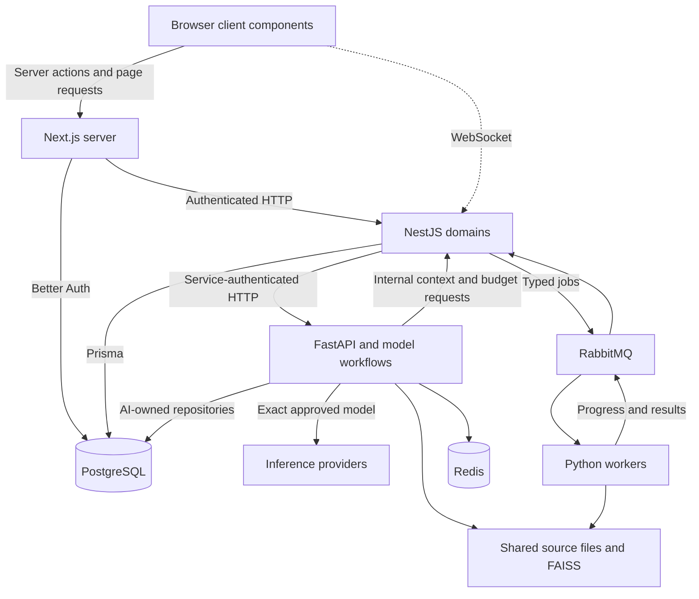

# Noveris implementation architecture

The application consists of a Next.js web experience, a NestJS control plane, a Python AI HTTP service and background workers. Product contexts and subscriptions are described separately in [product architecture](product-specification.md) and [business model](business-model.md).

## Runtime entrypoints

| Component | Entrypoint | Responsibility |
| --- | --- | --- |
| Web | `apps/web/src/app` and `src/proxy.ts` | App Router, server actions, page rendering, security headers and auth HTTP boundary |
| API | `apps/api/src/main.ts` and `src/framework/bootstrap.ts` | Nest lifecycle, persistence, domain contracts, realtime and result consumers |
| AI HTTP | `apps/ai/services/api/main.py` | FastAPI routers protected by service authentication |
| Workers | `apps/ai/workers/*_worker.py` | Ingestion, planning, scheduling, coaching, evaluation and search jobs |
| Local launcher | `scripts/run-ai.mjs` | HTTP service, a selected worker or all configured workers |

## Frontend boundary

Server Components load protected data through `src/lib/api.ts`. The adapter resolves identity, forwards the session and requests uncached responses. Feature-local server actions validate form input and issue mutations. Client components own interactive activities, lab controls, status, room sockets and form transitions. Better Auth web endpoints use the shared auth implementation and PostgreSQL session state.

The source uses Next.js 16 and React 19. The landing page and application metadata use Noveris branding. Package and configuration identifiers may retain historical names.

## Control-plane domains

NestJS loads generated domain adapters over the repository's existing route contracts. `src/domain-definitions.ts` and generated framework modules establish endpoint registration. `shared/moduleClient.ts` supports in-process module calls. These are domain boundaries inside the API process rather than an independent microservice fleet.

Study owns subjects, courses, publication, institution contexts, assignment/enrollment, activities, room commands, private attempts and evidence. Auth owns account/session integration, roles and account entitlement surfaces. Notifications attaches realtime transports and peer-message delivery. AI orchestration consumes job results and exposes actor-scoped jobs. Other existing domains cover profile, availability, signals and analytics.

## Domain versus inference authority

The API resolves the actor, current resource grant, source revision and authoritative application state. It sends a minimized request to Python. The AI service validates input, assembles task-specific context, resolves a model alias and requests budget reservation through authenticated internal API routes. A model proposes data or language. The application validates the projection before using it in a state change.

A facilitator proposal cannot independently advance a room. A lab plan cannot introduce an executable component. An answer cannot create learning evidence merely by being generated. The private assessment boundary decides eligible evidence using the stored activity and server evaluation.

## Persistence ownership

Prisma manages application and auth records. Python repositories manage AI-owned tables in PostgreSQL's `ai` schema, including operational history and embedding storage. `AI_DATABASE_URL` may select the configured PostgreSQL deployment; schema ownership remains separate even when connection URLs match.

The API owns the LLM approval ledger. Python calls its internal budget endpoints instead of independently writing application budget records. Shared originals and FAISS artifacts require filesystem access in both services. Course and revision identity plus hashes protect source association. Redis cache data is a reusable projection rather than the durable accepted-evidence record.

## Synchronous and asynchronous work

HTTP supports bounded request/response paths such as tutor and lab planning. RabbitMQ handles background jobs and results with message/correlation identity, progress and failure classification. Worker retries and dead-lettering are a separate recovery mechanism from model-client retries. The shared LiteLLM router disables transparent model retries and provider fallbacks under exact-model approvals.

WebSockets deliver room state, presence and facilitator events. Persisted room command receipts and peer history recover accepted operations after delivery uncertainty. This design still needs multi-instance realtime and production-capacity validation.

## Consistency mechanisms

| Operation | Identity and guard | Durable outcome |
| --- | --- | --- |
| Draft edit/publication | Expected version, revision tag and source identity | Published or updated revision |
| Room command | Stable command ID and expected room sequence | Command receipt and new room state |
| Peer send | Stable submission ID and peer sequence | Bounded durable message journal |
| Private attempt | Actor, attempt ID, activity pin and payload hash | Resumable receipt and eligible evidence |
| AI request | Approval identity, task/model, expiry and limits | Conditional request reservation and usage |

These are operation-specific boundaries. Authorization and final delivery can still occur across multiple steps. Existing tests exercise selected revocation, replay and isolation cases. They do not certify every deployment topology.

See [data model](data-model.md), [workflows](workflows.md), [AI specification](ai-specification.md) and [evidence](submission/evidence/EDNOVA-CLAIM-TRACEABILITY.md).
