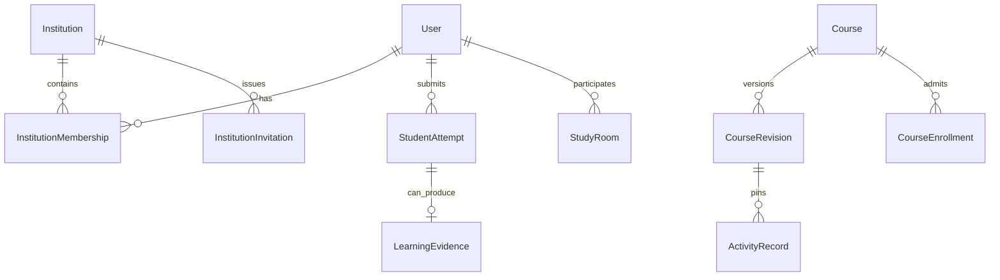

# Noveris data architecture

Application models are defined in `apps/api/prisma/schema.prisma`. Domain adapters under `apps/api/modules/*/src/models` preserve service-level contracts over Prisma. Python owns a separate set of operational repositories in the PostgreSQL `ai` schema. Database/table identifiers retain historical names where required by the running code.

## Identity and institutions

Better Auth stores authentication users, accounts, sessions and verification state. The domain User retains application roles, profile and tier information. The auth hook aligns its identity with the domain record.

Institution identifies a learning organisation and its active state. InstitutionMembership links an account to an institution with a unique institution/user pair and scoped role. InstitutionInvitation stores the token hash, requested role, expiry and acceptance/revocation state. One account can have multiple institutional contexts.

## Course ownership and access

Course records `scope`, `visibility`, `userId`, `ownerUserId`, `institutionId`, `assignedInstructorIds` and the active revision reference. Personal ownership is checked separately from institutional role. CourseEnrollment records a student's course-specific grant. CourseInvitation provides the distinct course acceptance workflow. PublicCourseJoin supports the learner's catalog list without creating an institution enrollment.

Course visibility enables private, institution-scoped or explicitly public access. Public reading requires a publication and the applicable active-institution check. Content authority and roster administration use separate policies.

## Revision and source identity

CourseRevision holds a unique course/revision tag, content hash, draft/published/deprecated status, source manifest and digest, optional content document, index and artifact hashes, activation state, approved activities and an optimistic version counter. Revocation and deprecation have separate source-read implications.

Source files live in the configured upload area. Revision artifacts associate indexed passages with source identities and metadata. Their hashes protect the association between the publication and what retrieval reads. An index path by itself is insufficient provenance.

## Activities and attempts

ActivityRecord pins course, revision, content hash, objective, activity ID/revision and type. `publicDefinition` is the learner-facing contract and `serverEvaluation` is the private assessment contract. Their separation supports trusted rendering without leaking answer keys through the ordinary public payload.

StudentAttempt uses a unique actor/attempt identity and retains the activity pin, submitted answers, payload hash, status, assessment and optional room context. Receipt and prepared-evidence state allow recovery after partial completion. Duplicate submission handling depends on identity and matching payload rather than accepting arbitrary overwrites.

LearningEvidence has a unique evidence ID and actor/attempt pair, objective, activity projection, score, Bloom information and evaluator metadata. CompetencyProfile and competency processing records are derived views. Reward state follows accepted evidence through its own idempotent identity. A projection failure does not require deleting valid evidence.

LearningSupport tracks private hint level for an actor and activity revision. Preference/diagnostic cues are distinct from accepted assessment evidence. Visual Lab checks remain practice-only and do not automatically write mastery evidence.

## Rooms and collaboration

StudyRoom records participants, host and presenter, source/revision pin, active activity, round, phase, sequence and command receipts. A command sequence belongs to room state. SessionChat's peer journal has its own sequence and bounded message list, with stable submission IDs for retries and history recovery. These sequences solve different ordering problems.

FacilitatorIntervention stores strategy, trigger, target, message, status and execution source. A proposed UI command requires application authorization. Room private-help and private-attempt data retain their recipient boundary. A group debrief combines a shared recap with the requester's own result rather than broadcasting all grades.

## AI state and budget ownership

The API-owned LlmApprovalBudget binds an approval ID to task, model, expiry and limits. Request reservation is a conditional update. Usage, revocation and token allowance operations are separate supported actions. Experience planning also has its own reservation identity and lifecycle.

Python repositories store AI-owned history, pacing, schedules, signals and embeddings in the `ai` schema. API-owned context is requested over the internal HTTP boundary. FAISS artifacts remain on disk and can be revision-specific. Redis cache entries are disposable reuse state rather than the durable source of accepted evidence.

## Relationship overview

This diagram shows conceptual relationships. Some references are scalar IDs or JSON projections enforced by services rather than Prisma foreign keys. Inspect the schema before relying on a database-level cascade or transaction guarantee.

## Consistency and commercial scope

Revision guards, command receipts, peer journal comparisons, unique attempt/evidence constraints and approval reservations are operation-specific consistency mechanisms. Some workflows complete across multiple writes and use retry/recovery logic. Organisation subscriptions, commercial seats and customer AI allowance allocation remain planned integrations. Existing domain references should not be interpreted as implemented institution billing.

See [permissions](roles-and-permissions.md), [workflows](workflows.md) and [business model](business-model.md).

## Core Prisma field reference

This field inventory is generated from the repository schema for documentation. Regenerate it after schema changes and apply the migrations before relying on the corresponding database shape. Types preserve Prisma optional and list markers. Service policies described above govern references that are stored as strings or JSON.

### Course

| Field | Prisma type | Schema attributes |
| --- | --- | --- |
| `id` | `String` | `@id @db.Uuid` |
| `userId` | `String` | — |
| `scope` | `CourseScope` | `@default(personal)` |
| `visibility` | `CourseVisibility?` | — |
| `institutionId` | `String?` | `@db.Uuid` |
| `ownerUserId` | `String?` | — |
| `assignedInstructorIds` | `String[]` | `@default([])` |
| `activeRevisionId` | `String?` | — |
| `subjectId` | `String` | — |
| `title` | `String` | — |
| `description` | `String?` | — |
| `status` | `CourseStatus` | `@default(processing)` |
| `jobId` | `String?` | — |
| `correlationId` | `String?` | — |
| `ingestStage` | `IngestStage?` | — |
| `ingestProgress` | `Float` | `@default(0)` |
| `ingestDetail` | `String` | `@default("")` |
| `ingestError` | `String` | `@default("")` |
| `topics` | `Json` | `@default("[]")` |
| `files` | `Json` | `@default("[]")` |
| `processedAt` | `DateTime?` | — |
| `aiCourseId` | `String?` | — |
| `createdAt` | `DateTime` | `@default(now())` |
| `updatedAt` | `DateTime` | `@updatedAt` |
| `revisions` | `CourseRevision[]` | — |
| `enrollments` | `CourseEnrollment[]` | — |

Constraint `@@index([userId])`.

Constraint `@@index([subjectId])`.

Constraint `@@index([jobId])`.

Constraint `@@index([correlationId])`.

Constraint `@@index([aiCourseId])`.

Constraint `@@index([institutionId, scope])`.

Constraint `@@index([ownerUserId])`.

Constraint `@@index([visibility, updatedAt])`.

Constraint `@@index([assignedInstructorIds])`.

Constraint `@@map("courses")`.

### CourseRevision

| Field | Prisma type | Schema attributes |
| --- | --- | --- |
| `id` | `String` | `@id @db.Uuid` |
| `courseId` | `String` | `@db.Uuid` |
| `revisionTag` | `String` | — |
| `contentHash` | `String` | — |
| `status` | `CourseRevisionStatus` | `@default(draft)` |
| `publishedByUserId` | `String?` | — |
| `publishedAt` | `DateTime?` | — |
| `summary` | `String?` | — |
| `topics` | `Json` | `@default("[]")` |
| `contentDocument` | `Json?` | — |
| `formulaPublication` | `Json?` | — |
| `contentDocumentHash` | `String?` | — |
| `vectorIndexRef` | `String?` | — |
| `isInstructorReviewed` | `Boolean` | `@default(false)` |
| `sourceManifest` | `Json?` | — |
| `sourceManifestDigest` | `String?` | — |
| `indexHash` | `String?` | — |
| `artifactHash` | `String?` | — |
| `activationState` | `ActivationState?` | — |
| `expectedActiveRevisionId` | `String?` | — |
| `approvedActivities` | `Json?` | — |
| `revokedAt` | `DateTime?` | — |
| `version` | `Int` | `@default(0) @map("__v")` |
| `createdAt` | `DateTime` | `@default(now())` |
| `updatedAt` | `DateTime` | `@updatedAt` |
| `course` | `Course` | `@relation(fields: [courseId], references: [id], onDelete: Cascade)` |

Constraint `@@unique([courseId, revisionTag])`.

Constraint `@@index([courseId, status])`.

Constraint `@@map("course_revisions")`.

### CourseEnrollment

| Field | Prisma type | Schema attributes |
| --- | --- | --- |
| `id` | `String` | `@id @db.Uuid` |
| `courseId` | `String` | `@db.Uuid` |
| `institutionId` | `String?` | `@db.Uuid` |
| `userId` | `String` | — |
| `status` | `CourseEnrollmentStatus` | `@default(active)` |
| `enrolledAt` | `DateTime` | `@default(now())` |
| `enrolledByUserId` | `String?` | — |
| `revokedAt` | `DateTime?` | — |
| `createdAt` | `DateTime` | `@default(now())` |
| `updatedAt` | `DateTime` | `@updatedAt` |
| `course` | `Course` | `@relation(fields: [courseId], references: [id], onDelete: Cascade)` |

Constraint `@@unique([courseId, userId])`.

Constraint `@@index([courseId])`.

Constraint `@@index([institutionId])`.

Constraint `@@index([userId])`.

Constraint `@@index([userId, status])`.

Constraint `@@index([institutionId, status])`.

Constraint `@@map("course_enrollments")`.

### CourseInvitation

| Field | Prisma type | Schema attributes |
| --- | --- | --- |
| `id` | `String` | `@id @db.Uuid` |
| `courseId` | `String` | `@db.Uuid` |
| `institutionId` | `String?` | `@db.Uuid` |
| `role` | `CourseInvitationRole` | `@default(student)` |
| `tokenHash` | `String` | `@unique` |
| `recipientEmail` | `String?` | — |
| `status` | `CourseInvitationStatus` | `@default(pending)` |
| `issuedByUserId` | `String` | — |
| `acceptedByUserId` | `String?` | — |
| `acceptedAt` | `DateTime?` | — |
| `revokedAt` | `DateTime?` | — |
| `expiresAt` | `DateTime` | — |
| `createdAt` | `DateTime` | `@default(now())` |
| `updatedAt` | `DateTime` | `@updatedAt` |

Constraint `@@index([courseId])`.

Constraint `@@index([institutionId])`.

Constraint `@@index([expiresAt])`.

Constraint `@@index([recipientEmail, status, expiresAt])`.

Constraint `@@index([courseId, status, expiresAt])`.

Constraint `@@map("course_invitations")`.

### Institution

| Field | Prisma type | Schema attributes |
| --- | --- | --- |
| `id` | `String` | `@id @db.Uuid` |
| `name` | `String` | `@db.VarChar(120)` |
| `slug` | `String` | `@unique @db.VarChar(80)` |
| `domain` | `String?` | `@db.VarChar(253)` |
| `isVerified` | `Boolean` | `@default(false)` |
| `status` | `String` | `@default("active")` |
| `createdByUserId` | `String` | — |
| `createdAt` | `DateTime` | `@default(now())` |
| `updatedAt` | `DateTime` | `@updatedAt` |
| `memberships` | `InstitutionMembership[]` | — |
| `invitations` | `InstitutionInvitation[]` | — |

Constraint `@@map("institutions")`.

### InstitutionMembership

| Field | Prisma type | Schema attributes |
| --- | --- | --- |
| `id` | `String` | `@id @db.Uuid` |
| `institutionId` | `String` | `@db.Uuid` |
| `userId` | `String` | — |
| `role` | `InstitutionMembershipRole` | — |
| `status` | `InstitutionMembershipStatus` | `@default(active)` |
| `invitedByUserId` | `String?` | — |
| `createdAt` | `DateTime` | `@default(now())` |
| `updatedAt` | `DateTime` | `@updatedAt` |
| `institution` | `Institution` | `@relation(fields: [institutionId], references: [id], onDelete: Cascade)` |

Constraint `@@unique([institutionId, userId])`.

Constraint `@@index([institutionId])`.

Constraint `@@index([userId])`.

Constraint `@@map("institution_memberships")`.

### InstitutionInvitation

| Field | Prisma type | Schema attributes |
| --- | --- | --- |
| `id` | `String` | `@id @db.Uuid` |
| `institutionId` | `String` | `@db.Uuid` |
| `role` | `InstitutionInvitationRole` | — |
| `tokenHash` | `String` | `@unique` |
| `status` | `InstitutionInvitationStatus` | `@default(pending)` |
| `issuedByUserId` | `String` | — |
| `acceptedByUserId` | `String?` | — |
| `acceptedAt` | `DateTime?` | — |
| `revokedAt` | `DateTime?` | — |
| `expiresAt` | `DateTime` | — |
| `createdAt` | `DateTime` | `@default(now())` |
| `updatedAt` | `DateTime` | `@updatedAt` |
| `institution` | `Institution` | `@relation(fields: [institutionId], references: [id], onDelete: Cascade)` |

Constraint `@@index([institutionId])`.

Constraint `@@index([expiresAt])`.

Constraint `@@index([institutionId, status, expiresAt])`.

Constraint `@@map("institution_invitations")`.

### ActivityRecord

| Field | Prisma type | Schema attributes |
| --- | --- | --- |
| `id` | `String` | `@id @db.Uuid` |
| `courseId` | `String` | — |
| `revisionId` | `String` | — |
| `contentHash` | `String` | — |
| `activityId` | `String` | — |
| `activityRevision` | `String` | — |
| `activityType` | `String` | — |
| `objectiveId` | `String` | — |
| `publicDefinition` | `Json` | — |
| `serverEvaluation` | `Json` | — |
| `createdAt` | `DateTime` | `@default(now())` |
| `updatedAt` | `DateTime` | `@updatedAt` |

Constraint `@@unique([courseId, revisionId, activityId])`.

Constraint `@@index([courseId])`.

Constraint `@@index([revisionId])`.

Constraint `@@index([activityId])`.

Constraint `@@index([objectiveId])`.

Constraint `@@map("activity_records")`.

### StudentAttempt

| Field | Prisma type | Schema attributes |
| --- | --- | --- |
| `id` | `String` | `@id @db.Uuid` |
| `userId` | `String` | — |
| `attemptId` | `String` | — |
| `courseId` | `String` | — |
| `revisionId` | `String` | — |
| `contentHash` | `String` | — |
| `activityId` | `String` | — |
| `activityRevision` | `String` | — |
| `activityType` | `String` | — |
| `roomId` | `String?` | — |
| `timeSpentSeconds` | `Int` | — |
| `answers` | `Json` | — |
| `payloadHash` | `String` | — |
| `status` | `String` | `@default("submitted")` |
| `submittedAt` | `DateTime` | `@default(now())` |
| `assessmentResult` | `Json?` | — |
| `evidenceId` | `String?` | — |
| `protocolVersion` | `Int?` | — |
| `processingState` | `String?` | — |
| `submission` | `Json?` | — |
| `preparedEvidence` | `Json?` | — |
| `createdAt` | `DateTime` | `@default(now())` |
| `updatedAt` | `DateTime` | `@updatedAt` |

Constraint `@@unique([userId, attemptId])`.

Constraint `@@index([userId])`.

Constraint `@@index([attemptId])`.

Constraint `@@index([courseId])`.

Constraint `@@index([activityId])`.

Constraint `@@index([courseId, revisionId, activityId, userId])`.

Constraint `@@map("student_attempts")`.

### LearningEvidence

| Field | Prisma type | Schema attributes |
| --- | --- | --- |
| `id` | `String` | `@id @db.Uuid` |
| `evidenceId` | `String` | `@unique` |
| `evidenceVersion` | `String` | `@default("1.0.0")` |
| `userId` | `String` | — |
| `attemptId` | `String` | — |
| `activity` | `Json` | — |
| `objectiveId` | `String` | — |
| `status` | `String` | `@default("accepted")` |
| `bloomLevel` | `String` | — |
| `score` | `Float` | — |
| `masteryAchieved` | `Boolean` | — |
| `evaluator` | `Json` | — |
| `rewardReference` | `Json?` | — |
| `timestamp` | `DateTime` | `@default(now())` |
| `createdAt` | `DateTime` | `@default(now())` |
| `updatedAt` | `DateTime` | `@updatedAt` |

Constraint `@@unique([userId, attemptId])`.

Constraint `@@index([evidenceId])`.

Constraint `@@index([userId])`.

Constraint `@@index([attemptId])`.

Constraint `@@index([objectiveId])`.

Constraint `@@index([userId, objectiveId, masteryAchieved])`.

Constraint `@@map("learning_evidences")`.

### LearningSupport

| Field | Prisma type | Schema attributes |
| --- | --- | --- |
| `id` | `String` | `@id @db.Uuid` |
| `userId` | `String` | — |
| `courseId` | `String` | — |
| `revisionId` | `String` | — |
| `activityId` | `String` | — |
| `activityRevision` | `String` | — |
| `hintLevel` | `Int` | `@default(0)` |
| `createdAt` | `DateTime` | `@default(now())` |
| `updatedAt` | `DateTime` | `@updatedAt` |

Constraint `@@unique([userId, courseId, revisionId, activityId, activityRevision])`.

Constraint `@@map("learningsupports")`.

### StudyRoom

| Field | Prisma type | Schema attributes |
| --- | --- | --- |
| `id` | `String` | `@id @db.Uuid` |
| `createCommandId` | `String?` | — |
| `roomId` | `String` | `@unique` |
| `inviteCode` | `String` | `@unique` |
| `courseId` | `String?` | — |
| `revisionId` | `String?` | — |
| `hostUserId` | `String` | — |
| `presenterUserId` | `String` | — |
| `title` | `String` | `@db.VarChar(200)` |
| `maxParticipants` | `Int` | `@default(6)` |
| `moderatorMode` | `ModeratorMode` | `@default(guided)` |
| `facilitatorActive` | `Boolean` | `@default(false)` |
| `activeActivityId` | `String?` | — |
| `activePin` | `Json?` | — |
| `activityRound` | `String?` | — |
| `visualizationState` | `Json?` | — |
| `currentPhase` | `RoomPhase` | `@default(idle)` |
| `status` | `RoomStatus` | `@default(active)` |
| `seq` | `Int` | `@default(1)` |
| `commandReceipts` | `Json` | `@default("[]")` |
| `participants` | `Json` | `@default("[]")` |
| `createdAt` | `DateTime` | `@default(now())` |
| `closedAt` | `DateTime?` | — |

Constraint `@@index([courseId])`.

Constraint `@@index([hostUserId])`.

Constraint `@@index([presenterUserId])`.

Constraint `@@index([status])`.

Constraint `@@index([createdAt])`.

Constraint `@@index([inviteCode, status])`.

Constraint `@@index([hostUserId, status])`.

Constraint `@@index([courseId, status])`.

Constraint `@@map("study_rooms")`.

### SessionChat

| Field | Prisma type | Schema attributes |
| --- | --- | --- |
| `id` | `String` | `@id @db.Uuid` |
| `sessionId` | `String` | — |
| `userId` | `String` | — |
| `messageType` | `String` | — |
| `content` | `String` | — |
| `peerSeq` | `Int` | `@default(0)` |
| `peerMessages` | `Json` | `@default("[]")` |
| `searchQuery` | `String` | `@default("")` |
| `searchResults` | `Json` | `@default("[]")` |
| `createdAt` | `DateTime` | `@default(now())` |
| `updatedAt` | `DateTime` | `@updatedAt` |

Constraint `@@index([sessionId])`.

Constraint `@@index([userId])`.

Constraint `@@index([sessionId, createdAt])`.

Constraint `@@map("sessionchats")`.

### FacilitatorIntervention

| Field | Prisma type | Schema attributes |
| --- | --- | --- |
| `id` | `String` | `@id @db.Uuid` |
| `interventionId` | `String` | `@unique` |
| `roomId` | `String` | — |
| `strategy` | `String` | — |
| `trigger` | `String` | `@default("explicit_ask")` |
| `targetUserId` | `String?` | — |
| `targetSpeakerName` | `String?` | — |
| `reasoning` | `String` | — |
| `message` | `String` | — |
| `executionMode` | `String` | `@default("UNKNOWN")` |
| `proposedUICommand` | `Json?` | — |
| `status` | `String` | `@default("delivered")` |
| `cooldownSeconds` | `Int` | `@default(15)` |
| `createdAt` | `DateTime` | `@default(now())` |

Constraint `@@index([roomId])`.

Constraint `@@index([createdAt])`.

Constraint `@@index([roomId, createdAt])`.

Constraint `@@map("facilitatorinterventions")`.

### CompetencyProfile

| Field | Prisma type | Schema attributes |
| --- | --- | --- |
| `id` | `String` | `@id @db.Uuid` |
| `userId` | `String` | — |
| `topicId` | `String` | — |
| `knowledgeType` | `String` | — |
| `bloomLevel` | `String` | — |
| `score` | `Float` | `@default(0)` |
| `confidence` | `Float` | `@default(0)` |
| `evidence` | `Json` | `@default("[]")` |
| `version` | `Int` | `@default(0) @map("__v")` |
| `createdAt` | `DateTime` | `@default(now())` |
| `updatedAt` | `DateTime` | `@updatedAt` |

Constraint `@@unique([userId, topicId, knowledgeType, bloomLevel])`.

Constraint `@@index([userId, topicId])`.

Constraint `@@map("competency_profiles")`.

### LlmApprovalBudget

| Field | Prisma type | Schema attributes |
| --- | --- | --- |
| `id` | `String` | `@id // the approval id` |
| `task` | `String` | — |
| `model` | `String` | — |
| `limitRequests` | `Int` | — |
| `maxTokens` | `Int?` | — |
| `maxCostUsd` | `Float?` | — |
| `expiresAt` | `Float` | `// epoch seconds, as carried by the approval` |
| `used` | `Int` | `@default(0)` |
| `usedTokens` | `Int` | `@default(0)` |
| `usedCostUsd` | `Float` | `@default(0)` |
| `revokedAt` | `Float?` | — |
| `revocationReason` | `String?` | — |
| `releaseMarkers` | `String[]` | `@default([])` |
| `createdAt` | `DateTime` | `@default(now())` |
| `updatedAt` | `DateTime` | `@updatedAt` |

Constraint `@@map("llm_approval_budgets")`.
