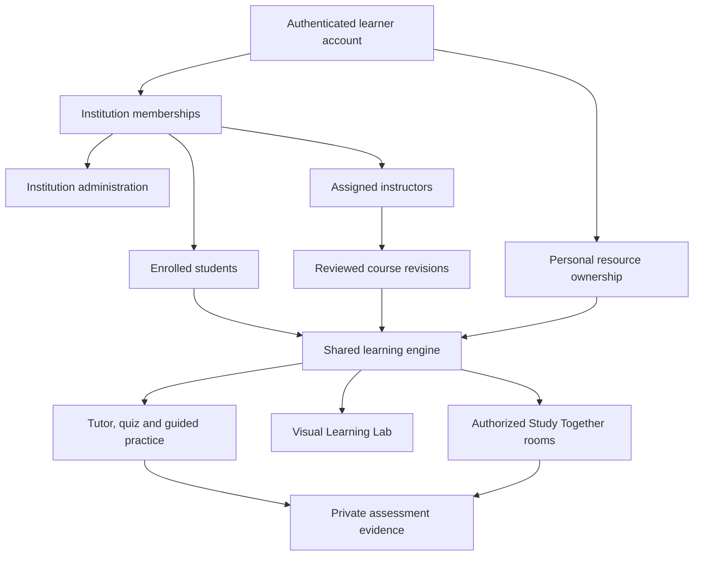

# Noveris product architecture

Noveris supports institutional and independent learning through one account system and a shared course, tutoring, practice and collaboration engine. This guide describes source-backed product behavior. Commercial packaging is proposed in [the business model](business-model.md). Test scope is recorded in [the evidence dossier](submission/evidence/EDNOVA-CLAIM-TRACEABILITY.md).

## Contexts of one identity

A global account authenticates through Better Auth. InstitutionMembership gives that account an active institutional context and scoped role. Course ownership provides a personal resource context. A learner may hold multiple institutional memberships while retaining personally owned courses and private evidence. The application evaluates the grant required for each resource.

## Institutional operation

### Establish the institution

The current `/institutions/bootstrap` route requires platform-admin authority. It creates an Institution and its first university_admin membership. This is an administered setup route. A commercial self-service organisation signup and billing journey remains planned.

### Manage membership

An active institution administrator manages institution metadata, issues or revokes instructor/student membership invitations and can suspend supported memberships. Invitation acceptance uses a token hash, expiry and a conditional claim. Membership state is scoped to the institution. An invitation is not a course enrollment.

### Assign teaching authority

Course assignment stores instructor IDs on the institutional Course. An assigned instructor also needs active instructor membership in the active institution. Instructor authority governs content authoring, review and publication. Administrative authority governs metadata and enrollment separately.

Institutional creation currently accepts an active instructor or institution administrator in the requested institution, verifies the actor's subject ownership and records the creator in the course context. Resource policies remain authoritative for subsequent authoring and administrative operations.

### Enroll students

Student membership alone does not expose all institutional material. The course invitation or direct administrative enrollment creates the separate CourseEnrollment. The published learning context resolves a current course grant. Course enrollment can be withdrawn or revoked. Source-backed rooms also check the participant's source grant.

## Independent operation

A learner registers directly, verifies the account and opens a personal workspace. Personal subject and course creation require the actor's ownership context. Document ingestion and draft review use the same source pipeline as institutional content. The owner can practise against published personal material, ask the tutor, create supported labs and maintain private attempts and evidence.

A learner can create or join a room through its own participant context. Joining a room that uses another person's private course requires an independently valid source grant. Connections, groups, invite codes and presenter authority do not silently share personal material.

## Course discovery and public access

Course visibility can be private, institution-scoped or public. A public read grant requires a published revision and an active institution for institutional material. It allows signed-in read access. A catalog join records inclusion in the learner's learning list separately from institutional enrollment and roster membership. Public visibility does not grant content editing or institution administration.

## Learning surfaces

| Surface | Read context | Output or state |
| --- | --- | --- |
| Course Studio | Owner or assigned teaching authority | Draft, source review, publication and activity registration |
| Course reader | Authorized published revision | Lesson blocks and source references |
| Activity practice | Pinned ActivityRecord | Private attempt receipt and accepted evidence where eligible |
| Nardouch | Authorized course and bounded context | Generated assistance with validated source references |
| Source hints | Verified activity source passage | Deterministic graduated support and tentative confusion cue |
| Visual Lab | Topic or authorized course excerpts | Validated plan for a registered deterministic engine |
| Study Together | Active room membership and applicable source grant | Shared state, peer text, proposals and private check projections |
| Progress | Actor's accepted evidence and derived competency | Personal progress and next-step surfaces |

## Delivery classification

Source and selected tests support institutional membership, assignments, enrollment, personal ownership, public course access and room boundaries. Real compact/capable Visual Lab calls have been observed. A complete browser course-to-peer journey with real inference remains unverified. Visual Lab checks are practice and do not become accepted mastery evidence. Voice features have separate integration and verification requirements.

## Implementation anchors

- `apps/api/modules/study/src/services/institutions.ts` implements institution context and invitations.
- `apps/api/modules/study/src/services/enrollments.ts` implements assignments, course invitations and student enrollment.
- `apps/api/modules/study/src/services/resourceAccess.ts` defines read, content and administrative grants.
- `apps/api/modules/study/src/routes/courses.ts` handles course creation, uploads and visibility surfaces.
- `apps/web/src/features` contains the corresponding product interfaces and server actions.

See [permissions](roles-and-permissions.md), [workflows](workflows.md) and [data model](data-model.md) for the detailed boundaries.
