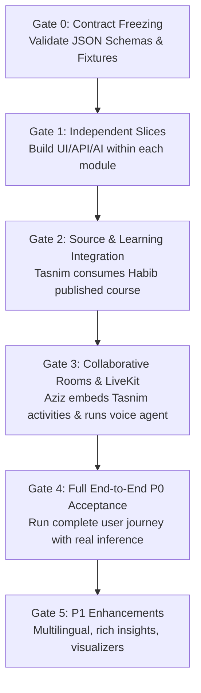

# EdNova — Team Delivery Plan & Engineering Blueprint

**Status:** Authoritative / Approved Plan  
**Date:** 18 October 2026  
**Context:** IEEE Women in Engineering Annual Congress of Tunisia (WIE ACT 5.0) — GenAI Peer Learning Companion Challenge.

---

## 1. Team Ownership Philosophy: Vertical Full-Stack Ownership

The EdNova engineering team rejects the traditional horizontal split ("one frontend dev, one backend dev, one AI dev"). Such splits create communication bottlenecks, handoff delays, and integration mismatches.

Instead, **all three team members own an entire product domain end-to-end**:
- **Frontend UI & Components** (Next.js 16, React 19, Server Actions, Tailwind CSS 4, shadcn/ui)
- **Backend API & Data Logic** (NestJS domain modules, Mongoose schemas, access guards)
- **AI Prompts, Workers & Agent Policies** (Python FastAPI, LiteLLM, LiveKit Agents, RabbitMQ workers)
- **Integration & Unit Testing** (Vitest, Jest, Playwright E2E)

```
┌─────────────────────────────────────────────────────────────────────────────┐
│ Habib: Course Studio, Content Ingestion & Access Control                    │
│ Full-stack: PDF upload, extraction worker, Studio UI, revision immutability │
├─────────────────────────────────────────────────────────────────────────────┤
│ Tasnim: Individual Learning, Socratic Tutoring & Evidence Engine            │
│ Full-stack: Intelligent UI registry, Socratic agent, attempts, XP ledger    │
├─────────────────────────────────────────────────────────────────────────────┤
│ Aziz: Study Together, Realtime Rooms & Voice AI Moderator                   │
│ Full-stack: LiveKit audio, Python voice agent, peer facilitation, debrief   │
└─────────────────────────────────────────────────────────────────────────────┘
```

---

## 2. Detailed Member Responsibilities & Domain Deliverables

### 2.1. Habib — Course Studio, Content Ingestion & Access Control
* **Primary Scope**:
  1. **Course Ingestion Pipeline**:
     - Multipart upload validation (size limits, MIME checks).
     - RabbitMQ job dispatch (`study.ingest.course`) using Contract 01.
     - Document extraction worker: PyPDF/Tesseract parsing, Bloom Taxonomy classification (`docs/contracts/bloom-fixture.json`), and FAISS dense vector chunking.
     - Provenance tracking: Every learning objective stores `{ documentId, pageNumber, charStart, charEnd, sourceExcerpt }`.
  2. **Course Studio (Authoring UI & Immutability)**:
     - Next.js Course Studio interface (`study-partner-web/src/features/courses/studio`): Hierarchical tree editor (Chapters -> Topics -> Learning Objectives).
     - Instructor review workflow: Edit statements, assign Bloom levels, reorder topics, or discard AI proposals.
     - Immutable Publication Gate: Publishing computes a SHA-256 content hash, creates an immutable `CourseRevision` record, and freezes the version for student enrollment.
  3. **Access Control & Permissions**:
     - Institutional vs. Personal course access control.
     - University memberships (`university_admin`, `instructor`, `university_student`).
     - Course enrollment verification before document retrieval.
     - Instructor Aggregate Insight: Non-invasive analytics aggregating topic difficulty without reading private student answers.

### 2.2. Tasnim — Individual Learning, Socratic Tutoring & Evidence Engine
* **Primary Scope**:
  1. **Intelligent Interactive UI**:
     - Pre-compiled React activity registry (`study-partner-web/src/features/learning/activity-renderer.tsx`):
       - `InteractiveQuiz` (multiple-choice / multi-select with server validation).
       - `GuidedProblem` (step-by-step Socratic reasoning).
       - `StepByStepVisualizer` (state-driven algorithmic progression).
       - `ParameterExplorer` (interactive bounded sliders/inputs).
     - Enforces Contract 04: Public schemas **never expose answer keys or rubrics**.
  2. **Course-Grounded Socratic Tutor**:
     - Interactive tutor interface restricted strictly to published course revision context.
     - Multi-turn dialogue with prompt guardrails and Bloom-aware questioning.
     - LiteLLM multi-provider routing (Compact model for quick hints; Capable model for complex misconceptions).
  3. **Private Attempt & Evidence Engine**:
     - Private attempt submission (Contract 05) and server-side evaluation (Contract 06).
     - Immutable `LearningEvidence` generation (Contract 07) linking verified mastery to specific Bloom levels.
     - Cumulative competency tracking in `competencies` collection (Contract 08).
  4. **Anti-Farming Gamification Ledger**:
     - Deterministic reward processing: Only verified `LearningEvidence` triggers XP awards.
     - Append-only `RankEventLedger` with compound unique keys (`xp:{userId}:{evidenceId}`).
     - Enforces a 300 XP daily cap per topic to prevent click-farming.

### 2.3. Aziz — Study Together, Realtime Rooms & Voice AI Moderator
* **Primary Scope**:
  1. **LiveKit Cloud Media Plane Integration**:
     - WebRTC audio room infrastructure via LiveKit Cloud.
     - NestJS token issuance endpoint (Contract 11) validating course enrollment and voice consent.
     - Client WebRTC audio component with mute, deafen, and speaking indicators.
  2. **Study Room Synchronization**:
     - Virtual room lifecycle (Contract 10): 6-character alphanumeric invite codes, participant presence, presenter role delegation.
     - WebSocket room synchronization (`/ws/realtime`) carrying authoritative room state (Contract 13): active activity, current phase, public submission counts.
  3. **Python LiveKit Voice AI Moderator**:
     - Implemented using the Python LiveKit Agents SDK.
     - Attentive multi-speaker moderation with Voice Activity Detection (VAD) and speaker-attributed transcripts (Deepgram Nova-3 STT).
     - Peer-First Facilitation Policy: Detects misconceptions and prompts peers to reason together before offering hints. Direct answers forbidden.
     - Voice synthesis via streaming Cartesia Sonic 3.6 TTS.
     - Moderator modes: Guided (default), On Demand, and Muted.
  4. **Room-Private Tutor Side-Channel**:
     - Private slide-out tutor panel allowing students to ask questions privately during a group session (Contract 18).
     - Private messages never leak to the group chat or LiveKit audio stream.
  5. **Collaborative Group Debrief**:
     - Synthesizes end-of-session achievements (Contract 17) based on public discussion and aggregate submission counts.

---

## 3. Integration Gates & Phased Delivery Milestones



### Gate 0: Contract Freezing (Prerequisite)
* **Objective**: All 3 engineers review and lock the 18 shared technical contracts in `docs/contracts/technical-contracts.md`.
* **Deliverable**: Pinned JSON schemas, request/response fixtures, and status enums committed.

### Gate 1: Independent Minimum Slices
* **Habib**: PDF upload -> RabbitMQ ingest -> draft hierarchy editor -> immutable published revision with verified FAISS index.
* **Tasnim**: Intent-to-activity -> declarative React quiz renderer -> private attempt evaluation -> learning evidence record.
* **Aziz**: Room creation -> invite code join -> LiveKit audio connection -> WebSocket state synchronization -> basic voice agent join.

### Gate 2: Source & Learning Integration
* **Habib & Tasnim**:
  - Tasnim's Socratic Tutor queries Habib's authorized published course revision and retrieves relevant FAISS chunks.
  - Habib's Course Studio embeds Tasnim's activity renderer for instructor interactive preview.
  - Test: Personal course materials cannot be retrieved by unauthorized learners.

### Gate 3: Collaborative Group & Voice Integration
* **Aziz, Tasnim & Habib**:
  - Aziz's Study Room displays Tasnim's shared activity on all peer screens.
  - When students submit answers, they use Tasnim's private submission endpoint.
  - Aziz's room state updates public submission count (`1/3 submitted`) without leaking peer answers.
  - LiveKit Voice Agent observes speech and intervenes with peer-first prompts.

### Gate 4: Full End-to-End P0 Acceptance
* **Full Team**:
  - Execute complete journey: Instructor publishes course -> Student completes solo diagnostic -> Student creates study room with peer -> Voice agent facilitates problem solving -> Both submit private answers -> Session debrief generated -> XP awarded in ledger.
  - Verify error handling: LiveKit voice offline, LLM quota exceeded (compact model fallback), corrupt PDF upload.

### Gate 5: P1 Enhancements (Post-P0)
* **Habib**: Instructor aggregate insight dashboard.
* **Tasnim**: Multilingual Socratic tutoring (French, Arabic) & Step-by-Step Visualizer.
* **Aziz**: Room-private tutor side-channel & voice speaking analytics.

---

## 4. Cross-Cutting Collaboration Rules

1. **Strict Symbol Ownership**:
   - Habib owns `Course`, `CourseRevision`, `Document`, `InstitutionMembership`.
   - Tasnim owns `LearningActivity`, `ActivityAttempt`, `LearningEvidence`, `Competency`, `RankEventLedger`.
   - Aziz owns `StudyRoom`, `StudyRoomParticipant`, `FacilitatorIntervention`, `LiveKitToken`.
   - Neither developer modifies another owner's database model without explicit sign-off.
2. **Serialized Edits to Shared Files**:
   - Files shared across domains (`shared/domainContracts.ts`, `src/domain-definitions.ts`, root `package.json`, `pnpm-lock.yaml`) must be modified in serialized edit windows to prevent git merge conflicts.
3. **No Direct Microservice Calls**:
   - Modules interact within NestJS via `module://` protocol dispatch (`shared/moduleClient.ts`). No internal HTTP loops between NestJS modules.
4. **No LLM Direct State Mutations**:
   - AI outputs are strictly untrusted proposals. All database mutations (XP awards, competency increments, room phase advances) must be executed by authenticated NestJS handlers.

---

*This delivery plan is binding for Habib, Tasnim, and Aziz.*
