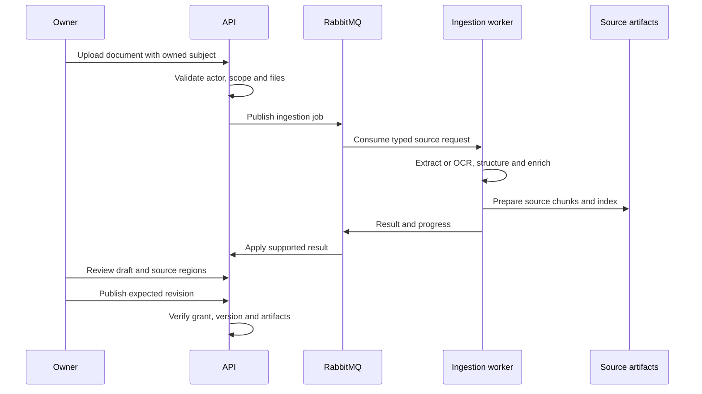
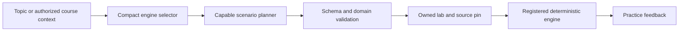

# Noveris end-to-end workflows

This guide traces current source paths. The evidence dossier distinguishes executed checks from complete browser acceptance. Optional voice designs remain in the target architecture and contracts rather than the verified text-learning workflow.

## Institution setup and membership

1. A platform administrator calls the institution bootstrap route.
2. The service creates the Institution and initial university_admin membership, with supported compensation if setup fails.
3. The institution administrator issues an instructor or student membership invitation.
4. The recipient signs into the existing account and accepts the token.
5. Conditional invitation state and a unique institution/user pair constrain acceptance and retries.
6. The actor now has an institution context. Course assignment or enrollment is a separate operation.

Entrypoints are `routes/institutions.ts` and `services/institutions.ts`. Commercial signup, subscription purchase and institution entitlement activation are proposed work.

## Institutional course and access

An eligible institution actor creates the course in an owned subject. Instructor assignment records the supported teaching grant for that institution. Student membership must be followed by a course invitation acceptance or direct enrollment. Active course access is resolved by `resourceAccess.ts`, and learner content additionally resolves the publication.

An institution administrator manages administrative access and metadata. Assigned instructors manage supported content operations. Suspending a membership, revoking an assignment or removing enrollment changes the applicable future grant.

## Personal course ingestion and publication

Institutional courses use the same source machinery with institution and teaching policies. Automatic review/publish is an explicit browser opt-in. Course revisions carry source and content identity. The learner-facing context resolves a publication rather than an arbitrary mutable draft.

## Individual practice and evidence

1. Resolve actor, course grant and the published revision.
2. Select a stored reviewed activity with a public definition and private server evaluation.
3. Render InteractiveQuiz or GuidedProblem through the trusted component path.
4. On supported hint requests, verify the source artifact and persist private hint state. Require a hint before full source explanation.
5. Submit an actor/attempt identity, pinned activity and answers. Compute or verify the payload identity.
6. Evaluate against the stored activity. Persist a recoverable receipt and eligible prepared evidence.
7. Recheck access, insert stable accepted evidence and expose the private result.
8. Update derived competency and reward state through their supported idempotent paths.

A repeated matching attempt may reuse the receipt. A conflicting payload must not replace it. Tentative confusion and preference cues affect help rather than directly producing mastery.

## Tutor and source-grounded generation

The frontend asks for help with course context. The API resolves the grant and source identity, then the AI service retrieves authorized passages and builds a bounded prompt. The model client checks the exact approval and reserves budget through the API. The resulting answer returns through output and citation validation. The user sees the execution mode and either supported help or an unavailable state.

A citation check constrains source identity and response structure. It does not prove the semantic accuracy of every claim. The recorded real Visual Lab calls are separate evidence from the tutor path.

## Visual Lab selection, execution and feedback

The four registered engines cover graphs, parameter models, spatial scenarios and functions. The model produces constrained configuration. Code computes the visualization and check. Unsupported concepts may be refused or use a supported labelled built-in example. Course-based lab reads recheck source access. The check response remains `recordedAsEvidence=false`.

## Peer room and private understanding check

A learner creates a room or joins by code. The API validates the actor, participant status and source grant when relevant. Shared activity selection pins a reviewed course context. Presenter/host commands include expected room sequence and command identity. Stale changes are rejected and receipts support replay.

Peer text uses its own bounded journal. An accepted message carries a stable submission ID and sequence. Reconnect recovery fetches ordered history and reconciles repeated delivery. An accepted durable message may outlive a missed WebSocket event.

An explicit facilitator action or supported observation invokes rules first. An eligible unmatched request can invoke the capable model. The proposal returns to the API for recipient, schema, current membership and room-sequence checks. The saved execution source distinguishes model guidance from built-in recovery. Ordinary peer chat is not automatically monitored.

Learners submit individual private checks. Group debrief returns a shared recap and the recipient's outcome. A peer who has not attempted the activity remains untested and receives no other learner's score or evidence ID.

## Failure and recovery

| Boundary | Supported behavior |
| --- | --- |
| Invalid source or grant | Reject before disclosing protected content |
| Source revision changes | Require the appropriate pin/version; retain supported stable historical context |
| Approval missing, expired or revoked | Fail closed rather than dispatching unauthorized inference |
| Model failure | Caller-specific labelled built-in guidance or unavailable status |
| Cache outage | Normal approved provider path where supported |
| Invalid plan/proposal | Reject or perform the workflow's bounded repair policy |
| Worker failure | Retryable/terminal classification, delayed queue handling and result identity |
| Missed room delivery | Current-state and durable-history recovery |
| Derived progress/reward failure | Preserve accepted evidence and allow supported projection recovery |

Queue retries and model retries are separate mechanisms. Cross-provider replacement is not transparently dispatched by the shared exact-model approval client. See [AI engineering](ai-specification.md).

## Evidence and next acceptance work

Recorded verification includes privacy-preserving debrief, activity receipt replay, institution enrollment boundaries, public-course policy and live two-tier Visual Lab planning. A complete source-to-peer browser journey with real inference, provider quota behavior and broad pedagogical quality remain to be verified. Use the [evidence dossier](submission/evidence/EDNOVA-CLAIM-TRACEABILITY.md) for exact suite scope.
