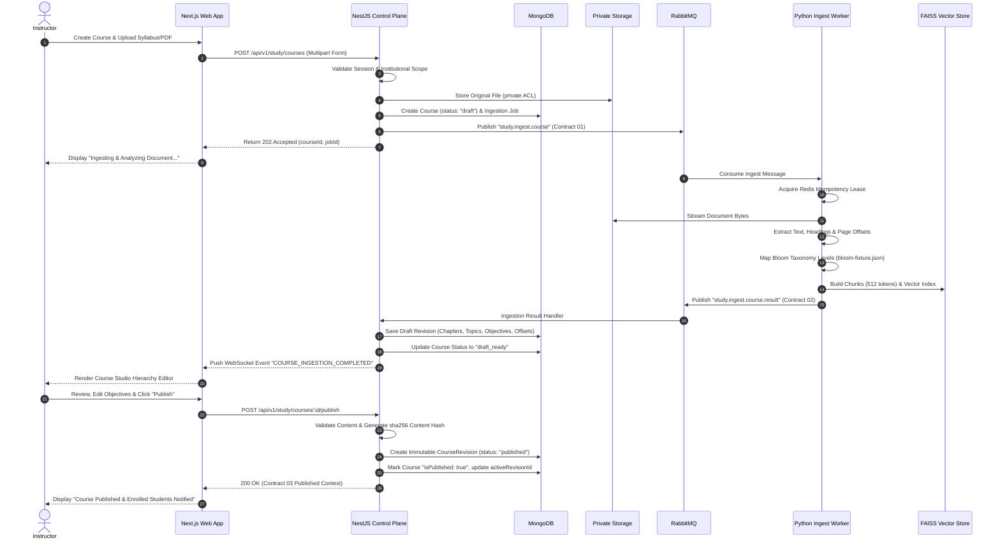
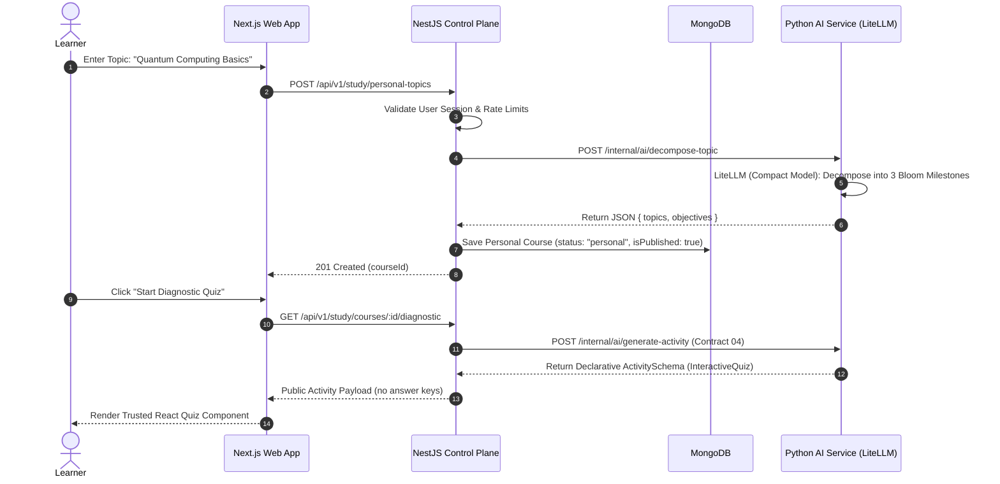
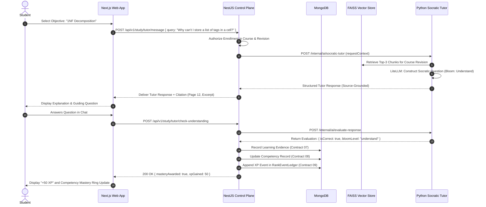
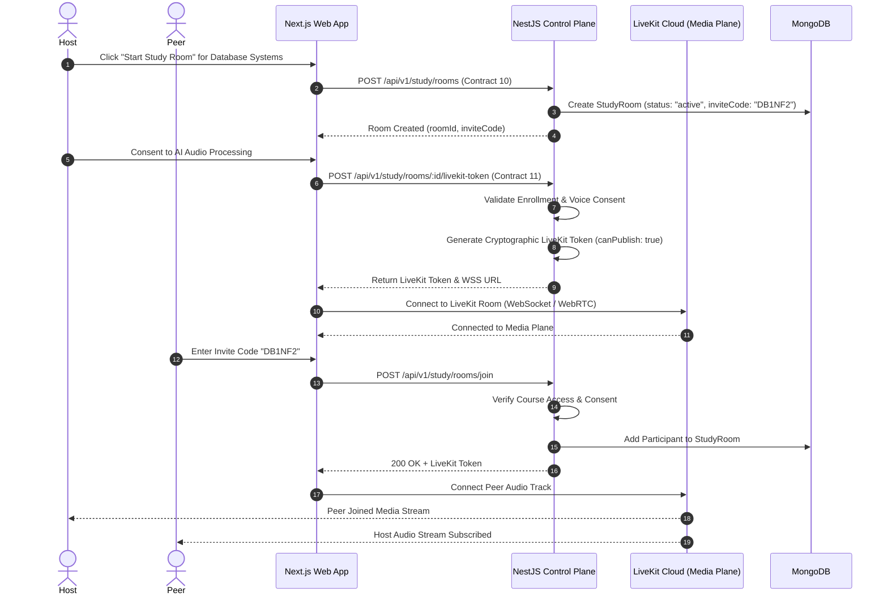
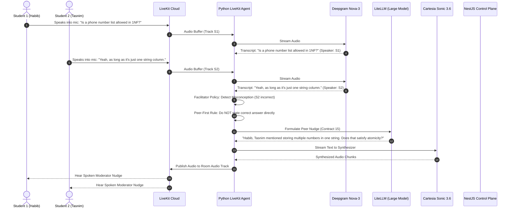
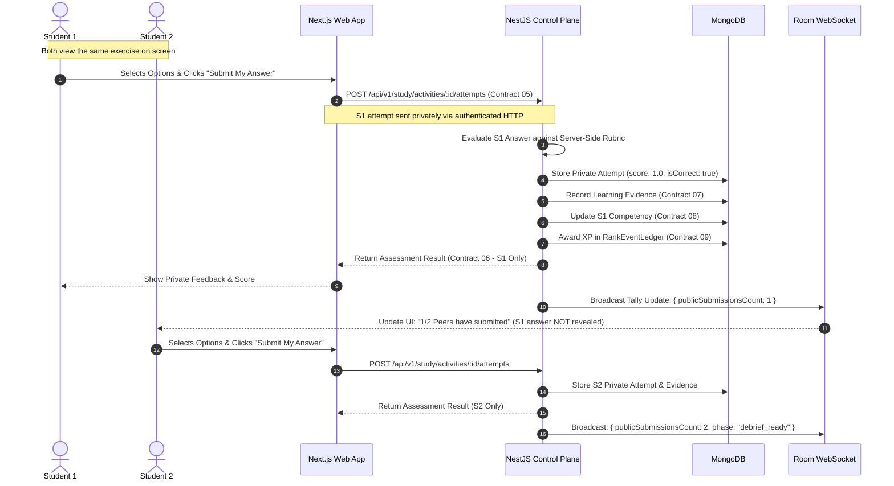
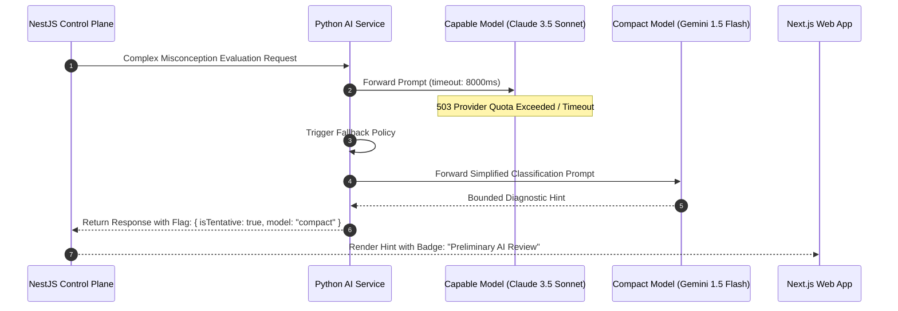

# EdNova — End-to-End Workflow Specifications

**Status:** Authoritative / Implementation-Ready  
**Date:** 18 October 2026  
**Context:** IEEE Women in Engineering Annual Congress of Tunisia (WIE ACT 5.0)

This document specifies the 8 canonical end-to-end workflows of the EdNova platform, covering institutional content management, independent study, Socratic tutoring, realtime collaborative rooms, live AI voice facilitation, intelligent UI execution, and failure recovery.

---

## Workflow Index

* [Workflow A: University Course Creation, Ingestion & Publication](#workflow-a-university-course-creation-ingestion--publication)
* [Workflow B: Independent Learner Personal Course & Open Topic Study](#workflow-b-independent-learner-personal-course--open-topic-study)
* [Workflow C: Enrolled Student Socratic Learning & Competency Progression](#workflow-c-enrolled-student-socratic-learning--competency-progression)
* [Workflow D: Collaborative Study Room Lifecycle & LiveKit Audio Connection](#workflow-d-collaborative-study-room-lifecycle--livekit-audio-connection)
* [Workflow E: Multi-Speaker Realtime AI Voice Moderation](#workflow-e-multi-speaker-realtime-ai-voice-moderation)
* [Workflow F: AI-Triggered Intelligent UI Synchronization](#workflow-f-ai-triggered-intelligent-ui-synchronization)
* [Workflow G: Individual Evaluation & Evidence Generation After Group Study](#workflow-g-individual-evaluation--evidence-generation-after-group-study)
* [Workflow H: Resilient Failure Recovery & Degraded Operation](#workflow-h-resilient-failure-recovery--degraded-operation)

---

## Workflow A: University Course Creation, Ingestion & Publication

### Preconditions
- User is authenticated with verified email and holds an `instructor` or `university_admin` role scoped to the target institution.

### Actors
- **Instructor** (Human)
- **Control Plane** (NestJS `study` module)
- **Asynchronous Broker** (RabbitMQ)
- **Ingestion Worker** (Python `agents.course_ingestion`)
- **Document Storage** (Private object storage / Volume)

### Sequence Diagram


### Happy Path
1. Instructor navigates to `/courses/new`, provides metadata, and selects a 25MB course syllabus PDF.
2. NestJS validates authorization, streams the PDF to private storage, creates a draft course in MongoDB, and enqueues `study.ingest.course`.
3. The Python worker extracts structure, tags learning objectives with Bloom verbs, builds FAISS embeddings, and returns Contract 02.
4. Instructor previews the draft in Course Studio, edits two learning objectives, and clicks **Publish**.
5. NestJS locks the revision into an immutable `CourseRevision` record and activates student access.

### Failure Paths
- **Invalid File Type/Corrupt PDF**: Ingestion worker identifies corrupt syntax; emits status `failed` with sanitized error. NestJS marks draft as `error_needs_reupload`. Previous published versions (if any) remain active.
- **Worker Crash During Processing**: RabbitMQ unacknowledged message timeout returns message to queue; consumer uses `messageId` to prevent duplicate writes.

### Data & Authorization Checks
- **Auth**: Must have valid `auth_session` and `role: "instructor"` in target `institutionId`.
- **Data Mutations**: Insert `courses` (status: `draft`), insert `documents`, insert `course_revisions`, insert `learning_objectives`.

---

## Workflow B: Independent Learner Personal Course & Open Topic Study

### Preconditions
- User has an active personal account (B2C learner).

### Actors
- **Independent Learner**
- **Next.js Web Client**
- **NestJS Control Plane**
- **Python Interactive AI Service** (LiteLLM)

### Sequence Diagram


### Happy Path
1. Learner enters an open topic without uploading a document.
2. System decomposes the topic into structured learning objectives labeled as **AI-Generated**.
3. Learner immediately receives a validated diagnostic quiz to establish baseline competency.

### Failure Paths
- **AI Service Timeout**: NestJS returns fallback pre-structured topic template from cache.
- **Malformed LLM Output**: NestJS schema validator rejects output; requests retry with deterministic temperature 0.

---

## Workflow C: Enrolled Student Socratic Learning & Competency Progression

### Preconditions
- Student is enrolled in an approved institutional course.

### Actors
- **Student**
- **Next.js Web App**
- **NestJS Control Plane**
- **Python Socratic Tutor Agent** (LiteLLM + FAISS)

### Sequence Diagram


### Happy Path
1. Student asks for conceptual clarification on a specific course objective.
2. The Socratic tutor retrieves verified excerpts from the published syllabus.
3. The tutor guides the student with questions rather than giving direct answers.
4. Upon demonstrating understanding, the backend creates an immutable `LearningEvidence` record, updates competency, and grants XP.

---

## Workflow D: Collaborative Study Room Lifecycle & LiveKit Audio Connection

### Preconditions
- Host and participants hold valid accounts and are enrolled in the course.

### Actors
- **Host Student**
- **Peer Students**
- **Next.js Web App**
- **NestJS Control Plane**
- **LiveKit Cloud (Media Plane)**

### Sequence Diagram


---

## Workflow E: Multi-Speaker Realtime AI Voice Moderation

### Preconditions
- Study room active with 2+ participants connected to LiveKit Cloud with granted voice consent.

### Actors
- **Students (Habib & Tasnim)**
- **LiveKit Cloud**
- **Python LiveKit Agent** (Deepgram STT, Cartesia TTS, LiteLLM)
- **NestJS Control Plane**

### Sequence Diagram


---

## Workflow F: AI-Triggered Intelligent UI Synchronization

### Preconditions
- Study room active; students discuss a problem where visual or interactive support is requested.

### Actors
- **Students in Study Room**
- **Python LiveKit Agent**
- **NestJS Control Plane**
- **Room WebSocket Server**
- **Next.js React Client**

### Sequence Diagram
```mermaid
sequenceDiagram
    autonumber
    actor Student
    participant Agent as Python LiveKit Agent
    participant Nest as NestJS Control Plane
    participant WS as Room WebSocket (/ws/realtime)
    participant Web as Next.js React UI

    Student->>Agent: Spoken: "Can you give us a practice exercise on this?"
    Agent->>Agent: Intent: Request Practice Exercise
    Agent->>Nest: POST /internal/rooms/:id/propose-action (Contract 16)
    Note over Agent,Nest: AI proposes action; NestJS validates authority
    Nest->>Nest: Validate Activity Schema (Contract 04)
    Nest->>Nest: Update Room State: activeActivityId = "act_01HXYZ9999"
    Nest->>WS: Broadcast ROOM_STATE_SYNC (Contract 13)
    WS-->>Web: Deliver Synced State to all connected clients
    Web->>Web: Mount Trusted React Interactive Component (Quiz/Guided Problem)
    Web-->>Student: UI Displays Interactive Exercise Simultaneously
```

---

## Workflow G: Individual Evaluation & Evidence Generation After Group Study

### Preconditions
- Study room currently presenting a shared activity; students submit answers individually.

### Actors
- **Student 1** & **Student 2**
- **Next.js Web App**
- **NestJS Control Plane**
- **Evidence & Gamification Engine**

### Sequence Diagram


---

## Workflow H: Resilient Failure Recovery & Degraded Operation

### Scenario 1: Voice Media / STT / TTS Outage
```mermaid
sequenceDiagram
    autonumber
    actor Student
    participant LK as LiveKit Cloud
    participant Agent as Python LiveKit Agent
    participant Web as Next.js Web App
    participant Nest as NestJS Control Plane

    Note over Agent: Deepgram STT or Cartesia TTS times out
    Agent->>Nest: POST /internal/rooms/:id/moderator-status { status: "degraded_text_only" }
    Nest->>Web: WebSocket: "AI Voice offline; text chat assistant active"
    Web-->>Student: Display Non-blocking Status Banner
    Note over Student,LK: Student-to-student WebRTC audio CONTINUES UNINTERRUPTED
    Student->>Web: Types question in Room Chat
    Web->>Nest: Dispatches text query to Socratic Tutor
    Nest-->>Web: Delivers text response; room proceeds normally
```

### Scenario 2: Large LLM Provider Outage (Compact Model Fallback)


---

*These 8 workflows represent the complete functional behavior of EdNova.*
