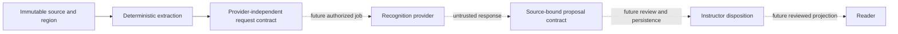

# Batch 2: Gemini integration continuation

**Status: incomplete; NO-GO for integration.** The earlier three-crop Gemini experiment is research evidence, not an operational ingestion/review pipeline. This continuation adds a provider-independent proposal contract and tests. No new provider calls, database writes, production job integration, UI controls or published-revision changes were performed.

## Architecture and changes

Solid lines represent the available contracts; dotted steps are not implemented. `apps/ai/agents/course_ingestion/enrichment/recognition_provider.py` defines an asynchronous provider protocol, bounded source-crop request, response identity, and pure projection function. The proposal hash includes course ID, revision-bound source, image hash, provider, model, model version and response. The existing response validator keeps every proposal pending and mathematically unverified. `apps/ai/agents/course_ingestion/tests/test_recognition_provider.py` checks binding and malformed image rejection. These structures do not establish source authorization: callers must validate all identity and geometry against a trusted revision and verified manifest.

## API, database, and safeguards

No API, database schema, job queue, or reader was modified in this continuation. The existing Gemini research runner is restricted to three fixed benchmark crops, with an operator attestation, approval and durable budget. It is not a general service: a local process lock cannot provide distributed concurrency and its conservative token reservation is not a hard provider-side input cap. There is no authenticated per-document consent record, revision-bound job, persistence, stale-revision review API, or safe review projection. Enabling it on ordinary courses would bypass important boundaries. No additional document was sent externally.

The earlier run made three Gemini 2.5 Flash requests with 1,681 provider-reported total tokens, returning three structured proposals. The proposal review states are all pending. Their source mapping is fixture-based, not validation against a persisted course revision. Provisional crop comparison suggested reasonable formula structures, but no independent expert verified them. Individual processing latency was not recorded. See [the Gemini research report](EDNOVA-BATCH2-GEMINI-HYBRID.md) for original outputs and limitations.

## Testing and remaining work

The provider-contract, response-validation and research-adapter suites passed **12 tests** locally. These are offline tests, including a mocked SDK. No new live API, browser, MongoDB persistence, asynchronous job, review, reader or publication test was performed. Previous reports contain separate earlier tests; they do not demonstrate this requested integration.

Required work remains: implement authenticated owner consent bound to immutable source and provider; build an idempotent revision-bound asynchronous job with distributed concurrency, cancellation, bounded retry and durable request/token reservations; implement a provider with reliable timeout, usage and failure handling; persist immutable proposals and revision-bound authorized dispositions; expose original crops for draft reviewers; add safe Studio comparison and review; project only reviewed content into the reader without changing original evidence or retrieval; test stale revisions, authorization, source mapping and concurrent publication; verify free-tier eligibility and model quota before each authorized evaluation. Additional challenging regions have not been sent because the preceding approval covered only the three benchmark crops.

## Rollback and decision

The new contract is unused by existing production paths and can be removed without migration. Preserve source PDFs, course revisions, previous proposal research results and durable budget audit records. **NO-GO** until the missing implementation and controlled end-to-end checks pass; Batch 2 remains open. Do not start Batch 3.
