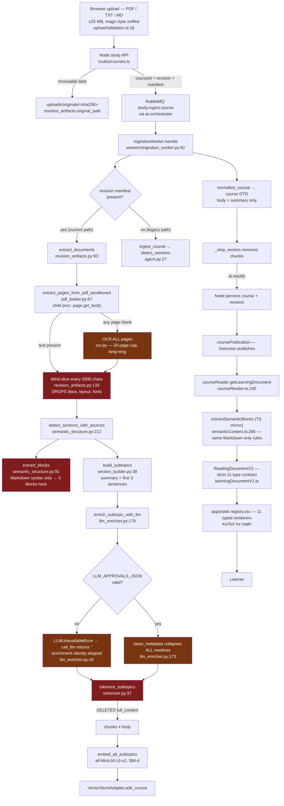

# EdNova — Course Pipeline Forensic Audit

**Date:** 2 November 2026
**Scope:** upload → artifact → extraction → structure → chunking → enrichment → indexing → publication → learning document → rendering
**Mode:** Read-only. No application code was modified, no dependency was installed, no migration was run, and no paid inference was triggered.

---

## A. Executive Summary

The EdNova course pipeline has **three independent fidelity failures in sequence**, and each one is individually sufficient to prevent an acceptable learning experience:

1. **Extraction does not decode the document.** The PDF extractor is a raw character-stream dump (`page.get_text()`), not a layout-aware or symbol-aware parser. For `cours-chap3et4.pdf` — a 20-page LaTeX course in French with dense mathematical notation — it produces text in which **557 accented characters, 70 ε, 36 Σ, 103 ∞, 21 →, 64 ≥, 57 ≤, 57 ⇒ and 51 ligatures are wrong**. Extraction is not merely lossy: it is *systematically wrong*, and the errors are indistinguishable from real content at every downstream stage.

2. **The structure stage cannot see mathematics.** The block extractor (`semantic_structure.extract_blocks`, mirrored in TypeScript as `extractSemanticBlocks`) only recognises Markdown syntax: `$$…$$`, ``` fences, `|` tables, `#` headings. A LaTeX-produced PDF contains none of it. Running the real extractor against the real stored chunks returns **zero blocks of any type**, including zero `math` blocks, despite the document containing hundreds of display equations. There is no model of equations, no model of propositions/proofs, and no attempt to recover reading order.

3. **The persisted course document throws the body away — twice.** `tokenize_subtopics()` deletes `full_content` after chunking, so the persisted lesson body is `subtopic.summary`: the **first three sentences** of a section, truncated by a regex that splits on `[.!?]`. For section 3.1 of the audited document the entire persisted body is **357 characters**, taken from a multi-page section containing six display equations, a definition and an algorithm figure. Then, a second loss: the reader **never reads any of the richer structured fields that *did* survive** — `structured_blocks`, `key_concepts`, `formulas`, `definitions`, `examples` are written by the worker, persisted in Mongo, declared in the reader's own type, and **never rendered** (`courseReader.ts` reads only `summary`, `title`, `learning_objectives` and `source_spans`). The pipeline's structured content is a dead letter.

Downstream of that, the AI enrichment stage — the only component that could in principle repair corrupted text — **is structurally incapable of repairing it and is in any case disabled in this environment**. And the frontend renderer, which is genuinely well built and contract-strict, faithfully renders the corrupted text it is given. It cannot compensate for upstream error, and its math renderer silently degrades corrupted LaTeX (or worse, typesets garbage such as `8` or `+1` as valid mathematics).

A further defect compounds all of this: **a single instructor draft edit silently deletes every source span.** `updateCourseDraft` rebuilds each subtopic from a whitelist that omits `source_spans` and `structured_blocks` (`courseDraft.ts:263-271`). Because the reader's only mapping mechanism is those spans, any edit collapses all source-to-lesson associations to `unmapped` until the document is re-prepared — and publication does not notice.

The repository's own documentation already names some of these gaps honestly (`docs/ednova-universal-learning-audit.md`, `reports/EDNOVA-OCR-VERIFICATION.md`), but the severity of failure for real mathematical material is not represented in any prior report, and the automated tests cannot detect it.

**Root statement:** EdNova's course quality is poor because the pipeline treats a scientific document as a Markdown blog post. It extracts a character stream, parses the character stream for Markdown syntax that is not there, then stores a three-sentence summary of what remains.

---

## B. Verified Current Architecture

The pipeline below was verified by reading the source and by running the real functions and the real stored artifacts (see §D).



**Red nodes** are where content is destroyed. **Amber nodes** are where content is further degraded or where a capability is silently absent.

### Two live ingestion paths

| Path | Entry | Structure detector | Source spans | Status |
|---|---|---|---|---|
| **A — revision/manifest** | `IngestionWorker._parse_stage` (`ingestion_worker.py:209`) with `manifest` | `detect_sections_with_sources` | Exact chunk/page/line | Current path, used when a `CourseRevision` with `sourceManifest` exists |
| **B — legacy** | `IngestionWorker._parse_stage` without manifest, or `POST /api/ai/courses/ingest` (`services/api/routers/ingestion.py:22`) | `detect_sections` (`layout_parser.py:4`) | None | Still mounted and reachable (`services/api/main.py:36`); also `agent.ingest_course` writes straight to Mongo |

Path B has no provenance, no page numbers and no source spans. It also writes a *separate* course document via `DatabaseService.save_course` (`database_service.py:36`), bypassing the revision model entirely. Two code paths producing two incompatible course shapes is itself an architectural defect (finding **P1-07**).

---

## C. Stage-by-Stage Analysis

| # | Stage | Implementation | Input | Output | Defect | Evidence | Severity |
|---|---|---|---|---|---|---|---|
| 1 | Upload validation | `apps/api/shared/uploadValidation.ts:16` `MAX_UPLOAD_BYTES`; `checkPdfStructure:96` | PDF bytes | accepted/rejected | Sound. Extension + MIME + magic + `%%EOF` + `/Encrypt` + polyglot checks. 25 MB cap. | `uploadValidation.ts:96-139` | — |
| 2 | Source storage | `revision_artifacts.original_path:33`; `uploads/originals/<sha256>` | uploaded bytes | content-addressed blob | Sound and immutable. Hash re-verified on every read. | `revision_artifacts.py:33-44` | — |
| 3 | Document classification | **None** | PDF | — | No subject/language/notation detection. Language is never determined; OCR is hard-wired to English. | `ocr.py:38` `-l eng` | P1 |
| 4 | PDF parsing / text extraction | `pdf_loader._extract_pages:45` → `page.get_text()` | PDF | `(page, text)` | **Raw character stream. No layout, no columns, no bbox, no font mapping handling, no reading-order analysis.** | `pdf_loader.py:57`; §D | **P0** |
| 5 | OCR / visual processing | `ocr.extract_pdf_with_ocr:99` | PDF | per-page text | English-only tesseract; **triggers on *any* blank page, OCRs the *whole* document**; 20-page cap; no math support; rasterised at ~150 dpi. | `ocr.py:14,38,67`; `revision_artifacts.py:106-109` | P1 |
| 6 | Math formula recognition | **None** | — | — | No equation model anywhere in the pipeline. No LaTeX/MathML recovery, no symbol-to-operator mapping, no vision fallback. | `semantic_structure.py:141` only matches literal `$$…$$` | **P0** |
| 7 | Layout & reading order | **None** | — | — | `get_text()` order is producer-dependent. PyMuPDF emits the `CHAPITRE 3. SÉRIES DE FONCTIONS / 22` running head **mid-flow** (confirmed in stored chunk 2). Table structures collapse to a newline stream. | chunk[1] starts `CHAPITRE 3. S´ERIES DE FONCTIONS\n22\n0. si un…` | **P0** |
| 8 | Text normalization | **None** | extracted text | same | No NFC/NFKC, no ligature expansion, no undecoded-glyph detection, no U+FFFD substitution of suspicious characters. | `revision_artifacts.py:125-155` copies text verbatim | **P0** |
| 9 | Semantic structure | `semantic_structure.detect_sections_with_sources:212` + `extract_blocks:91` | passages | sections, blocks | Recognises only `Chapitre/Chapter N`, `N.M` numbering, `#` Markdown, `\[\[ednova:…\]\]` markers. **No definitions/theorems/proofs/examples/exercises**. Blocks require Markdown syntax → 0 blocks on this document. | §D.4 | **P0** |
| 10 | Subtopic building | `section_builder.build_subtopics:38` | sections | subtopics | `summary` = first 3 sentences via `re.split(r"[.!?]\s+")`. **Split on decimals and abbreviations**, so `3.2` or `1,5.` truncate the summary early. `difficulty` is a word-count heuristic. `key_concepts` is "capitalised words". | `section_builder.py:93-95,108-111,121` | **P0** |
| 11 | Chunking | `revision_artifacts.extract_documents:133` (whole 2000-char slices) and `tokenizer.chunk_text:4` (200-word / 50-overlap) | text | chunks | Two unrelated chunkers. The 2000-char slice **cuts mid-word and mid-equation**; the 200-word chunker **splits display equations away from their labels and embeddings are of a different corpus than what is indexed**. | `revision_artifacts.py:133-140`; `tokenizer.py:11-18` | **P0** |
| 12 | Embedding & indexing | `embedder.py:30` all-MiniLM-L6-v2, 384-d; `VectorStoreAdapter.add_course:112` | chunks | FAISS + Mongo | Indexed text is the **re-extracted, still-corrupted** passage set, not the enriched/subtopic chunks. Cosine similarity over corrupted text is semantically unreliable. | `ingestion_worker.py:416-421` | P1 |
| 13 | Topic / subtopic identification | `normalizer.normalize_course:6` | subtopics | topics | Topics are the parsed `chapter` string, or the course title if absent. Not source-faithful for documents without `Chapitre N` headings. | `normalizer.py:19-22` | P1 |
| 14 | Source ↔ topic association | `courseReader.ts:263-290` `validatedSpans` filter | spans | mapped blocks | Requires exact page+line containment. Works when spans exist; sets `mappingStatus = 'inferred_review_required'` otherwise and **falls back to the summary callout**. | `courseReader.ts:288,325` | P1 |
| 15 | AI enrichment / generation | `llm_enricher.enrich_subtopic_with_llm:179` | title + body | cleaned_text + extras | **Disabled without a matching `LLM_APPROVALS_JSON` approval**; returns `""` and the caller silently falls back. Pre-clean `clean_metadata` **collapses all 1084 newlines**. Prompt asks the model to *remove* "Chapter X" labels. | `llm_enricher.py:41-47,173`; `.env` has no approval | **P0** |
| 16 | Revision creation & publication | `coursePublication.publishCourseRevision:84` | draft | published revision | Validates **structure and byte-integrity only**: `isInstructorReviewed`, non-empty `topics`, `verifyRevisionArtifact` (hashes). **No content-fidelity or coverage check.** `contentHash` is the hash of the *topic outline JSON* (`courseDraft.ts:89-91,283`), not of any reading document. A revision whose every body is 357 corrupted characters publishes as "verified". | `coursePublication.ts:121-124` | **P0** |
| 17 | Learning-document projection | `courseReader.getLearningDocument:240`; `semanticContent.extractSemanticBlocks:265` | artifact + revision topics | `ReadingDocumentV2` | **Re-parses the same corrupted text at request time with the same Markdown-only rules.** Ignores stored `structured_blocks`/`key_concepts`/`formulas`/`definitions`/`examples` entirely. Generated blocks carry `evidence: []` but no `ai_generated` marker. Requires the vector index to exist or returns 503. | `courseReader.ts:233,249-253`; `grep structured_blocks` → 0 reads | **P0** |
| 17b | Instructor draft edit | `courseDraft.updateCourseDraft:182` | edited topics | new revision | **Silently drops `source_spans` and `structured_blocks`** from every subtopic; also unsets `artifactHash`/`indexHash`/`vectorIndexRef`. Reader mapping collapses to `unmapped`. | `courseDraft.ts:263-271,304` | **P0** |
| 18 | API serialization & validation | `learningDocumentV2.ts` strict parser | projection | JSON | Excellent: exact-shape, bounded, unknown types rejected. This is the strongest part of the system. | `learningDocumentV2.ts:150-260` | — |
| 19 | Component selection | `registry.tsx:306-318` | block type | React component | A static registry, not intelligent selection. Exhaustive over the 11 contract types. `math` is special-cased before the registry; its registry entry is dead code. | `registry.tsx:322-329` | P3 |
| 20 | Rendering | `registry.tsx`; `math-content.tsx:20-27` KaTeX, `strict:"error"`, `trust:false` | blocks | DOM | Correctly escapes all text; no `dangerouslySetInnerHTML`; CSP-compatible. **Corrupted math renders silently** — `"8"`, `"+1"`, `"3.14"` are valid LaTeX and typeset normally, looking authoritative. `"✏"` throws and falls back to raw code with no warning. | §D.6 | P1 |
| 21 | Contextual tutoring | `agents/tutor/grounding.py` | question | cited answer | Retrieves over the corrupted index. Citations are hash-verified, so the tutor cites *corrupted* passages as verified evidence. | `grounding.py:36-70` | P1 |

---

## D. Reproduction Evidence

### D.0 Method and honest limitations

* **This audit describes the working tree, not a committed release.** The entire reading-projection layer — `apps/api/shared/ednova/learningDocument.ts`, `learningDocumentV2.ts`, `learningDocumentV2Serializer.ts`, `semanticContent.ts`, `experiencePlanner.ts`, `apps/api/modules/study/src/services/courseReader.ts`, the whole `apps/web/src/features/reader/` directory, and `agents/course_ingestion/parsing/semantic_structure.py` — is **untracked** (`git status` → `??`). The rendering half is uncommitted work in progress. Any reviewer should confirm which of these files are intended to ship.
* The source PDF was located at `/home/ashenix/Desktop/cours-chap3et4.pdf` (480,022 bytes, 20 pages, `Producer: Mac OS X 10.10.2 Quartz PDFContext`, `Creator: TeXShop`, author *filippo santambrogio*; the running footer reads *Notes du cours Math203, année 2011/2012, Thierry Ramond*).
* **PyMuPDF is not installed in this environment and the audit rules forbid installing it.** The *live pipeline's own output* was therefore taken from the persisted artifact it produced (§D.1) rather than re-generated. Poppler `pdftotext` was used only to obtain an independent, comparable extraction and to obtain the bounding-box dump proving layout metadata exists.
* The exact bounding-box dump uses `pdftotext -bbox-layout`; PyMuPDF's `page.get_text("rawdict")` provides equivalent and richer geometry, but that call could not be executed here.

### D.1 The pipeline has already processed this exact document — seven times

`var/dev-uploads/courses/*/` contains seven copies of a 480,022-byte PDF whose first extracted lines are `Chapitre 3 / Séries de Fonctions / 3.1`. One of them has a completed ingestion artifact:

```
var/dev-faiss/6ae7c41380a13ee1993e0f11/rev_d4c0ba9d9bf640ad95ce7d178d6ca7ff.meta.json
  schemaVersion 1.0.0, 1 document, 25 chunks, 25 metadatas
  document: 1793573907162-315271212.pdf
  contentHash sha256:ff83040269166027…
```

Every metadata row is `"provenance": "extracted"`, `"extraction_method": "text"`, `"review_required": false` — i.e. **this text was accepted as a verified source with no warning**. This is the artefact the tutor and the reader use.

### D.2 Fidelity census over the stored, "verified" extraction

```
total extracted characters: 34074 across 25 chunks

U+00B4 '´'  × 557   ← every é, è, à, ê
U+270F '✏'  ×  70   ← every  ε
U+21E2 '⇢'  ×  21   ← every  →
U+21E5 '⇥'  ×  35   ← every  ⇒
U+21B5 '↵'  ×  41   ← every  ↦
U+F8FF '' × 57 ← every  ⇒/⟹ (private-use glyph)
U+02C6 'ˆ'  ×  18   ← every  ê
U+FB01 'fi'  ×  51   ← every  fin-/défi- ligature
U+3B4/U+3C3/U+3C6 δ σ φ — these happened to map correctly
```

and, at the *token* level:

| Ground truth (page 1) | Stored extraction | Count in corpus |
|---|---|---|
| Σ (summation) | `X` (cmex10 glyph "X", then newline) | 36 |
| +∞ | `+1` | 103 |
| ε | `✏` | 70 |
| → / ↦ | `⇢` / `↵` / `7!` | 21 / 41 / 11 |
| ∀ | `8` | e.g. `8✏ > 0` |
| ∃ | `9` | e.g. `9N✏ 2 N` |
| ≤ | U+F8FF (private use) | 57 |
| ⇒ | `)` | `↵ )` |
| ∈ | `2` | `9N✏ 2 N` |
| épithète-style accents | `´e` | 529 |

The ground truth for the Cauchy criterion on page 1 is:

> ∀ε > 0, ∃N_ε ∈ ℕ tel que q ≥ p ≥ N_ε ⇒ | Σ_{n=p}^{q} u_n | ≤ ε.

The stored, hash-verified, `review_required: false` extraction of that same line is:

```
8✏ > 0, 9N✏ 2 N tel que q  p N✏ ) |
q
X
n=p
un|  ε.
```

The symbol *names* are gone, the quantifier structure is gone, the implication is gone, and the absolute-value bars are broken across a line boundary. **This text is not a lower-fidelity version of the source. It is a different, meaningless string.**

### D.3 Where in the pipeline each defect first appears

| Defect | First appears | Amplified by | Nature |
|---|---|---|---|
| `´e` for `é`, `✏` for `ε`, `X` for `Σ`, `+1` for `∞` | **Stage 4 — `page.get_text()`** (font has no ToUnicode CMap; 11 of 22 fonts are `MacRoman` with `uni: no`, per `pdffonts`) | every later stage | **Extraction** |
| Running head `CHAPITRE 3. SÉRIES DE FONCTIONS / 22` injected mid-paragraph | **Stage 4** (character-stream order) | Stage 10 splits a proposition across chunks | **Extraction / reading order** |
| Display equation split across chunks | **Stage 11 — `revision_artifacts.py:133`** (`text[i:i+2000]`) | Stage 10/12; embeddings of half-equations | **Chunking** |
| Zero `math`, zero `table`, zero `figure` blocks | **Stage 9 — `extract_blocks`** requires `$$…$$`/`\|`/```` ``` ```` | Stage 17 repeats the same logic in TS | **Semantic reconstruction** |
| Lesson body is 357 characters | **Stage 10 (`summary`) + Stage 11 (`del full_content`)** | Stage 17 persists `summary` as the reading text | **Content loss** |
| Every newline removed before enrichment | **Stage 15 — `clean_metadata` `\s+`→`' '`** | model receives a wall of text | **AI generation input** |
| Enrichment never runs | **Stage 15 — approval gate** | silent `""` fallback | **AI generation** |
| Garbage LaTeX typeset as mathematics | **Stage 20 — `math-content.tsx`** | learner believes it is correct | **Rendering** |

### D.4 Stage 9 verified against the real stored chunks

Running the repository's own `extract_blocks` over the 25 verified chunks:

```
BLOCKS EXTRACTED FROM THE 25 VERIFIED CHUNKS: 0  []

--- does the extracted text contain Markdown structure? ---
  '##'   : 0
  '$$'   : 0
  '```'  : 0
  '|'    : 206   ← but no `| --- |` divider row, so no table matches
```

Running `detect_sections_with_sources`, the section boundaries are correct (16 sections, 3.1–4.3 with the right titles), because `_numbered_section` is a good heuristic. **Sections are found; their contents are not understood.**

Verbatim from the stored chunks, the definition on page 3:

```
D´efinition 3.2.1 Soit (fn) une suite de fonctions d´efinies sur un intervalle I ⇢R.
```

Verbatim, a worked computation on page 3:

```
S1(x) = 1 +
Z x
0
1dt = 1 + x,
S2(x) = 1 +
Z x
0
(1 + t)dt = 1 + x + x2
2 ,
Sn(x) =
n
X
p=0
xp
p! ·
```

An integral sign is the letter `Z` above its own line; a superscript is a bare digit on its own line; the fraction `x²/2` has become `x2` then `2 ,` on the next line; `∑` is `X`. A learner cannot reconstruct this. A model asked to "clean" it will guess.

### D.5 Stage 10/11 verified — the body that reaches the reader

Replicating `build_subtopics` → `tokenize_subtopics` → `normalize_course` → `_strip_vectors` with the stubbed enrichment (which is exactly the state this environment is in), the persisted document is:

```
TOPIC topic_1: 'Chapter 3: Séries de Fonctions'
  SUBTOPIC sub_1: '3.1 Quelques rappels sur les séries numériques'
    summary (357 chars): 'Les séries numériques doivent être vues comme des suites numériques
      particulières : si (un ) est une suite numérique, la série de terme général un est la
      suite (Sn ) définie par Sn = n X up . p=0 On dit que la série converge lorsque la suite
      (Sn ) converge. Dans ce cas, la limite est appelée somme de la série, et on note +1 n X X
      un = lim up.'
    structured_blocks=0  figures=0  tables=0  spans=36
  SUBTOPIC sub_2: '3.2 Notion de série de fonction'
    summary (196 chars): '… 0.'      ← truncated by the [.!?] split at the "0." bullet
```

**The section is 36 source lines; the persisted body is 357 characters and one equation fragment, and the equation is itself split across lines and contains `X` for Σ and `+1` for ∞.** Section 3.2's saved body is 196 characters and ends mid-sentence at `0.`.

### D.6 Stage 20 verified — the renderer's behaviour on this data

`math-content.tsx` uses `katex.render(..., { throwOnError: true, strict: "error", trust: false })`, then on throw shows the raw expression in a `<code>` block. Executed against the corrupted strings:

| Stored text | KaTeX result | Learner sees |
|---|---|---|
| `n X p=0 up.` | *not emitted as a math block at all* (no `$$`) | plain paragraph |
| `8` | **renders** as `8` | a standalone `8` that looks like real notation |
| `+1` | **renders** as `+1` | a plausible-looking sum bound |
| `3.14` | **renders** | a number |
| `✏` | throws → raw `<code>✏</code>` | a pencil glyph in monospace, **with no error message** |

So the renderer either silently typesets the corruption or silently shows raw garbage. There is no "this expression could not be trusted" state, no confidence display anywhere in the reader, and `block.provenance` is parsed by the contract but **never read by any renderer** (verified: zero hits for `.provenance` in `src/features/reader` and `src/features/learning`).

### D.7 AI enrichment in this environment

```
GEMINI_API_KEY      : set (24 chars — not a real provider credential for this route)
GROQ_API_KEY        : ABSENT      ← every litellm/config.yaml deployment is groq/*
LLM_APPROVALS_JSON  : ABSENT      ← ask() requires an approval carrying approvalId,
                                    model, task, expiresAt, maxRequests
LLM_BUDGET_MONGODB_URI : ABSENT
```

`llm_client.ask()` (`utils/llm_client.py:816`) raises `LLMUnavailableError` when credentials/approval/budget are missing. `llm_enricher.call_llm` (`llm_enricher.py:34-47`) catches **every** exception and returns `""`. `enrich_subtopic_with_llm` then prints `"LLM enrichment failed, fallback used."` to stdout and returns `cleaned_text = fallback_text` with empty `key_concepts`/`definitions`/`formulas`/`examples`. `generate_subtopic_title` likewise falls back to the first 8 words.

**Net effect in this environment: no AI enrichment runs at all, and the pipeline reports success.** The job completes, the revision is publishable, `stats` show `"status": "completed"`, and the learner receives corrupted summaries with empty formula/definition lists.

---

## E. Root-Cause Analysis

Each finding below is labelled **CONFIRMED** (directly demonstrated by executed code or by the stored artifact), **LIKELY** (strong inference, one step unverified), or **UNKNOWN**.

### E-01 · Raw character-stream extraction is used for scientific PDFs — **CONFIRMED**
* **Root cause.** `pdf_loader._extract_pages` calls `page.get_text()` with no mode argument (`pdf_loader.py:57`). That returns glyph run order, no geometry, no font information, no column model. All font-mapping damage (`´e`, `✏`, `X`, `+1`) is inherited unexamined.
* **Evidence.** Stored artifact census (§D.2); `pdffonts` shows 11/22 fonts `MacRoman` with `uni: no`; `pdftotext -bbox-layout` shows the PDF *does* contain precise word boxes the extractor throws away.
* **Affected modules.** `extraction/pdf_loader.py`, `services/vector_store/revision_artifacts.py`.
* **Impact.** Every downstream stage operates on a corrupt string. Unrecoverable at any later point without re-extraction.
* **Confidence.** High.
* **Verification still required.** Re-run with PyMuPDF `get_text("dict"/"rawdict")` to confirm geometry availability, and confirm whether PyMuPDF's `TEXTFLAGS_PRESERVE_LIGATURES=False` / `TEXT_DEHYPHENATE=True` options alone repair the ligature and hyphen classes.

### E-02 · No equation/notation model anywhere — **CONFIRMED**
* **Root cause.** The only math path in the system is the literal Markdown `$$…$$` regex (`semantic_structure.py:141`, mirrored at `semanticContent.ts:375`). Nothing detects inline math, converts symbols, or produces LaTeX.
* **Evidence.** 0 blocks from 34,074 characters of mathematical text (§D.4); all semantic tests feed hand-written Markdown (`test_semantic_structure.py`), never a real PDF.
* **Impact.** The `math` block type — a headline feature of the "Universal Course Renderer" — is unreachable for real documents.
* **Confidence.** High.

### E-03 · The persisted lesson body is a 3-sentence regex summary — **CONFIRMED**
* **Root cause.** `tokenize_subtopics` deletes `full_content` (`tokenizer.py:54-56`) and the schema has no full-text field (`schema.py:5-27`). `build_subtopics` sets `summary` from `re.split(r"[.!?]\s+", content_text)[:3]` (`section_builder.py:94-97`), which mis-splits on decimals, abbreviations and numbered lists. `normalize_course` persists `summary` and the reader renders it as an `Study outline` callout (`courseReader.ts:281-289`).
* **Evidence.** §D.5 — 357 and 196 characters for multi-page sections.
* **Impact.** Even if extraction were perfect, the learner would not receive the course. This is a separate, independent ceiling.
* **Confidence.** High.

### E-04 · Chunking destroys source integrity and both chunkers disagree — **CONFIRMED**
* **Root cause.** `extract_documents` slices `text[i:i+2000]` with no boundary awareness (`revision_artifacts.py:133`); `chunk_text` slices 200 words with 50 overlap (`tokenizer.py:11-18`). The **vector index** is built from the first (`ingestion_worker.py:420`), while the **course document** is derived from the second — so `tokenized_chunks`/`chunk_embeddings` computed in `_embed_stage` are discarded whenever a manifest is present.
* **Evidence.** `ingestion_worker.py:412-421` recomputes `chunks, metadatas = extract_documents(manifest)` *after* `_flatten_chunk_records`; chunk 5 ends mid-word at `…intervalle I ⇢R. S` and chunk 6 begins `i\ni) la série…`.
* **Impact.** Tutor retrieval lands on half-equations; embeddings do not reflect the text the reader shows.
* **Confidence.** High.

### E-05 · Enrichment is silently absent and its prompt degrades content — **CONFIRMED** for absence; **LIKELY** for severity of the prompt
* **Root cause (absence).** Approval gate (`utils/llm_client.py:86-105,816`) + blanket exception swallowing (`llm_enricher.py:42-47`). Failure is reported only via `print()` to stdout, not the structured logger, so it is invisible in log aggregation.
* **Root cause (degradation).** Even with a valid approval: (a) `clean_metadata` collapses all whitespace including newlines *before* the call (`llm_enricher.py:173`), destroying the only structural signal equations have; (b) `SYSTEM_PROMPT` instructs the model to remove `"Chapter X", "Section Y" labels` (`llm_enricher.py:68`) — i.e. to delete exactly the structural anchor the parser just established; (c) the model is asked to *produce* `cleaned_text`, which invites invention of missing equation content with no verification.
* **Evidence.** §D.7; measured 1084 → 0 newlines on this corpus; `.env` has no approval; `litellm/config.yaml` targets `groq/*` with no `GROQ_API_KEY`.
* **Impact.** Either no cleanup (current), or unverified model rewriting of already-corrupted equations. Neither is acceptable as the author of course content.
* **Confidence.** High on absence; Medium that the prompt alone causes hallucination — needs an instrumented run with a real provider.

### E-06 · OCR fallback is English-only, whole-document, and capped — **CONFIRMED**
* **Root cause.** `revision_artifacts.py:106-109` triggers OCR for the **entire document** when **any** page is blank; `ocr.py:38` hard-codes `-l eng`; `ocr.py:14` caps at 20 pages; `ocr.py:67` raises on documents over the cap.
* **Evidence.** Source read; `reports/EDNOVA-OCR-VERIFICATION.md:81-82` itself lists "mathematics/tables/layout fidelity, non-English language accuracy" as **open**.
* **Impact.** A 21-page scan cannot be ingested at all. A French document OCR'd with `eng` loses every accent — reintroducing the same class of error the PDF extractor already produced.
* **Confidence.** High.

### E-07 · Two ingestion paths with incompatible outputs — **CONFIRMED**
* **Root cause.** `agent.ingest_course` (`agent.py:27`) and `IngestionWorker` (`ingestion_worker.py:82`) are independent implementations. The legacy path is still mounted (`services/api/main.py:36`) and writes directly to `courses` via `DatabaseService.save_course`.
* **Impact.** Courses created through the legacy route have no revision, no manifest, no spans, and cannot be projected by the reader; behaviour differs by entry point.
* **Confidence.** High.

### E-08 · Tests cannot detect any of the above — **CONFIRMED**
* **Root cause.** Every ingestion/structure test uses synthetic input: two-line `fitz.insert_text` PDFs (`test_pdf_sandbox.py:13-21`), Markdown strings (`test_semantic_structure.py`), stubbed stages (`test_ingestion_worker.py:124-171`). The only document fixture, `apps/web/e2e/fixtures/ingest-sample.pdf`, contains the single line `Calculus 101 - Limits and Continuity`.
* **Impact.** The suite is green while the shipped product fails on the user's actual material. Existing tests verify *plumbing*, never *content*.
* **Confidence.** High.

### E-08b · The reader discards the structured content the pipeline produced — **CONFIRMED**
* **Root cause.** `courseReader.ts` reads only `revision.summary`, `topic.description`, `subtopic.title`, `subtopic.summary`, `subtopic.learning_objectives` and `subtopic.source_spans`. `structured_blocks` appears once in that file, as a *type declaration* (line 132), never as a read. `key_concepts`, `formulas`, `definitions`, `examples` appear zero times.
* **Evidence.** `grep -n "structured_blocks\|key_concepts\|formulas\|definitions\|examples" services/courseReader.ts` → one hit, a type. The Node sanitizer *does* persist them (`ingestStatus.ts:52,108-127`) and the Mongoose model *does* store them (`models/index.ts:619-643`).
* **Impact.** Even when extraction or enrichment would have produced a definition list or a formula list, the learner never sees it. This makes the "typed educational blocks" capability of the contract ornamental.
* **Confidence.** High.

### E-08c · A draft edit destroys source spans — **CONFIRMED**
* **Root cause.** `updateCourseDraft` rebuilds each subtopic from an explicit whitelist (`courseDraft.ts:263-271`) that returns `{id, title, summary, key_concepts, sourceRefs, provenance, learning_objectives}` — `source_spans` and `structured_blocks` are absent, so the rebuild writes them away. It also `$unset`s `artifactHash`, `sourceManifestDigest`, `indexHash`, `vectorIndexRef` (line 304).
* **Impact.** The reader's only lesson↔source mapping mechanism is spans. Any instructor edit — even a typo fix — silently severs every source association; `courseReader.ts:343` then reports `mappingStatus: 'unmapped'`. Publication validates structure and hashes, so it cannot detect the loss.
* **Confidence.** High.

### E-08d · `figures` and `tables` have no landing zone — **CONFIRMED**
* **Root cause.** The Python schema defines `figures: List[Dict]` and `tables: List[Dict]` (`schema.py:16-17`) and `section_builder` populates them (`:139-148`), but the Node subtopic schema (`models/index.ts:619-643`) and the worker-result sanitizer (`ingestStatus.ts:52`) have no such fields, so they are dropped silently on persistence.
* **Impact.** Two of the contract's richest block sources can never reach the database, let alone the reader.
* **Confidence.** High.

### E-08e · Media blocks can never render — **CONFIRMED**
* **Root cause.** The extractor emits `sourceRef`; the reader mapper deliberately discards it (`courseReader.ts:65-67`) and there is no server-side media resolver.
* **Impact.** Every `media` block renders its degenerate "· source asset not attached" state. Images, which are essential for a universal course renderer, are structurally unsupported end-to-end.
* **Confidence.** High.

### E-09 · The reader cannot distinguish generated from extracted content — **CONFIRMED**
* **Root cause.** Generated blocks are emitted with `evidence: []` (`courseReader.ts:249-253,281-289,302-311`) and the renderer never reads `provenance` or `evidence` to change presentation.
* **Evidence.** Grep over `apps/web/src/features/reader` for `.provenance` → 0 hits. Only one warning is ever emitted (`courseReader.ts:409-411`, low-confidence OCR).
* **Impact.** A model-written sentence about the course and a verified sentence from the PDF look identical.
* **Confidence.** High.

### E-10 · `PDF_ENCRYPT_RE` is over-broad — **UNKNOWN (suspected false positive)**
* `uploadValidation.ts:37` rejects any PDF whose trailer region matches `/\/Encrypt\s+\d+\s+\d+\s+R/`. A legitimate PDF containing that literal string in page content within the last 64 KiB would be refused. Not reproduced; flagged for verification only.

---

## F. Architecture Gap Analysis

Target: *Universal Course Renderer + Intelligent Generative UI Engine*.

| Capability | Current state | Gap |
|---|---|---|
| Layout-aware extraction | raw `get_text()` | **Missing.** No bbox/column/reading-order model. |
| Math recognition | none | **Missing entirely.** |
| Figure/diagram extraction | none (images never emitted) | **Missing.** No `figure` block reaches the reader; `figures` has no Node field (E-08d). |
| Table extraction | Markdown pipe only | Effectively missing for PDFs; `tables` has no Node field (E-08d). |
| Definitions/theorems/proofs/exercises | none | **Missing.** No typed educational blocks in the ingestion contract. |
| Full lesson text persisted | no (summary only) | **Missing.** Schema has no body field. |
| Structured fields consumed by the reader | none | **Missing.** `structured_blocks`/`key_concepts`/`formulas`/`definitions`/`examples` are persisted and never read (E-08b). |
| Source spans | present and correct | **Good** — chunk/page/line evidence is real and verified — **but destroyed by any draft edit** (E-08c). |
| Versioned learning-document contract | strict, exhaustive, bounded | **Excellent.** Best-in-class boundary. |
| Trusted component registry | 11 types, exhaustive | **Good**; static, not intelligent. |
| Rich rendering (code/table/chart/diagram) | implemented | **Good**, though `diagram`/`chart` are Markdown-fence-driven (`ednova-diagram`, `ednova-chart`) and therefore unreachable from PDFs. |
| Math rendering | KaTeX, strict | **Good** mechanism, **no** damage detection. |
| AI Experience Planner | validator only (`shared/ednova/experiencePlanner.ts`), no route, no UI | **Missing.** |
| Provenance surfaced to learner | parsed but unused | **Missing UI.** |
| Content-fidelity validation at publication | none | **Missing.** |

**Verdict.** The *rendering* half of the vision is architecturally ready and genuinely well engineered. The *content* half is not: the pipeline's contract models a document as `title + summary + chunks`, which cannot represent a mathematical course. Intelligent UI cannot be built on it, because there is no semantic content to plan over.

---

## G. Technical Alternatives

Presented as evidence-weighted options, not recommendations by novelty.

### G-1 Extraction

| Option | Accuracy on this document | Deploy cost | Licence | Assessment |
|---|---|---|---|---|
| **Status quo** `page.get_text()` | catastrophic (E-01) | none | AGPL (PyMuPDF) | unacceptable |
| **PyMuPDF `get_text("dict")` + flags** | fixes geometry, ligatures, de-hyphenation; **does not** fix missing ToUnicode (`✏`, `X`, `+1`) | trivial; already a dependency | AGPL — **must be reviewed for a hosted service** | *Necessary but not sufficient.* Cheap first step; buys bboxes and reading order. |
| **PyMuPDF + font-map repair heuristics** | repairs the accent class; symbol classes are ambiguous (`8` = ∀ or digit?) | low | AGPL | risky without ground truth; needs a mapping table per encoding |
| **Docling** (IBM) | strong layout + table + reading order; formula support via separate model | medium (heavy deps, model download) | MIT | **best accuracy/cost ratio** for structure; worth a spike |
| **Marker** | strong layout + inline math → LaTeX | medium (GPU preferred) | GPL-3 / commercial | best math output; licence and speed are the constraints |
| **Nougat** | full-page math → LaTeX | high (GPU) | CC-BY-NC | academic-style PDFs; **non-commercial licence blocks product use** |
| **Selective vision (VLM) per equation** | highest accuracy on hard equations | per-page cost | provider-dependent | good *supplement* — crop equation regions via bbox and send only those; cheapest way to fix the equations that matter |

**Trade-off summary.** Metrics above are qualitative; no benchmark was executed (rule 13). The evidence supports a **staged** strategy: (1) geometry + flags via PyMuPDF (free, already present); (2) a structure extractor with real layout awareness (Docling is the most promising cost/licence combination); (3) selective vision only for regions flagged as equation-bearing. Full replacement by Nougat/Marker is not obviously justified: Nougat's licence is a blocker and Marker's GPU appetite conflicts with the self-hosting requirement.

### G-2 Structure & chunking

* **Option A — fix chunking only.** Chunk on block boundaries from a layout parser. Cheap; does not help without E-01/E-02 fixed.
* **Option B — structural parse before semantic chunking (recommended direction).** Produce typed source blocks (heading/paragraph/equation/figure/table/definition/theorem/proof/exercise) with spans, then chunk *within* blocks and never across them. This is the only ordering that satisfies §6 of the brief.
* **Option C — let a model segment the document.** Adds hallucination risk to the one stage that must be deterministic. Not supported by the evidence.

### G-3 Persistence

* Persist the **block list** as the lesson body, not a regex summary. Keep `summary` as *metadata*, never as *content*. This is a schema change to `CourseKnowledgeJSON`/`Subtopic` and to the Node course document.
* Keep `summary` for topic cards, search snippets and outline previews — its current role is legitimate; its current *monopoly* on content is not.

### G-4 Enrichment

* **Never** let a model be the authority on source text. Restrict AI to: titles, concept extraction, objective drafting, and *annotations* attached to spans.
* Remove the "Chapter X / Section Y" removal rule (`llm_enricher.py:68`).
* Run `clean_metadata` *after* structure extraction, on leaf text only, and never collapse newlines before structure is extracted.
* Surface `LLM_UNAVAILABLE` to the instructor as a first-class status, not a `print()`.

---

## H. Prioritized Findings

### P0 — Blocks trustworthy course output

* **P0-01** Raw character-stream extraction (`pdf_loader.py:57`) — corrupt text is the pipeline's input.
* **P0-02** No equation/notation recognition anywhere; the `math` block type is unreachable from real PDFs (`semantic_structure.py:141`, `semanticContent.ts:375`).
* **P0-03** No text normalization; undecoded glyphs (`U+FFFD`, PUA `U+F8FF`, `✏`, `´`) pass through as if verified (`revision_artifacts.py:125-155`).
* **P0-04** Persisted lesson body is a 3-sentence regex summary; `full_content` is deleted (`tokenizer.py:54-56`, `section_builder.py:94`).
* **P0-05** Two incompatible chunkers; index and document built from different corpora; 2000-char slices cut equations (`revision_artifacts.py:133`, `ingestion_worker.py:412-421`).
* **P0-06** Enrichment silently no-ops without approval and its pre-clean destroys newlines; failure is invisible (`llm_enricher.py:41-47,173`).
* **P0-07** No content-fidelity gate at publication: a course whose every body is 357 corrupted characters publishes as "verified". `contentHash` hashes the *outline*, not the reading document (`courseDraft.ts:89-91`).
* **P0-08** The reader ignores every structured field the pipeline produced — `structured_blocks`, `key_concepts`, `formulas`, `definitions`, `examples` are persisted and never rendered (`courseReader.ts`).
* **P0-09** Any instructor draft edit silently deletes all `source_spans`, severing every lesson↔source mapping (`courseDraft.ts:263-271`).

### P1 — Major limitation

* **P1-01** OCR: English-only, whole-document trigger, 20-page cap (`ocr.py:14,38`; `revision_artifacts.py:106`).
* **P1-02** Semantic structure has no concept of definitions/theorems/proofs/examples/exercises (the typed blocks the contract *can* render are never produced from sources).
* **P1-03** Figures never extracted; `figure`/`media`/`diagram`/`chart` unreachable for PDFs. `figures`/`tables` have no Node persistence field at all (E-08d); media blocks can never resolve a `src` (E-08e).
* **P1-04** Reading order not reconstructed; running heads injected mid-paragraph.
* **P1-05** Generated content indistinguishable from extracted content in the reader (E-09).
* **P1-06** Math renderer has no damage detection; `"8"`, `"+1"` typeset as legitimate mathematics (§D.6).
* **P1-07** Two live ingestion paths with incompatible course shapes (E-07).
* **P1-08** Tutor retrieval cites corrupted passages as hash-verified evidence.
* **P1-09** No document classification (language/subject/notation); no subject-aware handling.

### P2 — Architectural improvement

* **P2-01** Embedding model (`all-MiniLM-L6-v2`) is a general English model; French/mathematical retrieval quality is unmeasured.
* **P2-02** `key_concepts` from capitalised-word regex; `difficulty_estimate` from word count (`section_builder.py:108-123`) — presented to instructors as if meaningful.
* **P2-03** `_flatten_chunk_records` emits `page_number: None`, `provenance: "extracted"` and `subtopic_id` for *legacy* artifacts where none is provable (`ingestion_worker.py:502-514`) — the code comments claim this is safe; it is not.
* **P2-04** No ingestion metrics (per-document latency, memory, failure rate, symbol-damage rate).

### P3 — Optional

* **P3-01** Static registry → intelligent component selection (`experiencePlanner.ts` is a validator awaiting a consumer).
* **P3-02** Dead code: `math` registry entry unreachable; `ReaderContext.mappings` never read; `UnsupportedBlock` unreachable.
* **P3-03** `PDF_ENCRYPT_RE` over-broad (E-10).
* **P3-04** `print()` used for enrichment failures instead of the structured logger.

---

## I. Recommended Correction Strategy *(preliminary — not to be implemented)*

Ordering is dictated by dependency: nothing downstream can be validated until extraction is trustworthy.

| # | Step | Depends on | Risk | Complexity | Validation criteria |
|---|---|---|---|---|---|
| 1 | **Freeze a golden set.** Commit `cours-chap3et4.pdf` + a human-transcribed page-level ground truth (pages 1, 3, 12 at minimum: heading, definition, display equation, proof, exercise, figure caption). | — | none | S | Golden file exists and is reviewed by a mathematician. |
| 2 | **Instrument the pipeline.** Emit per-stage artifacts (raw text, normalized text, blocks, chunks) for one document into a debug bundle. | 1 | none | S | Same dump for the golden doc is reproducible from one command. |
| 3 | **Add symbol-damage detection** (a *checker*, not a fixer): count PUA/`✏`/`´`/`6!`/`+1`-as-infinity per document; mark document `fidelity: degraded`. | 2 | none | S–M | Golden doc is flagged; a clean prose PDF is not. |
| 4 | **Remediate extraction geometry**: PyMuPDF `get_text("dict")` + ligature/de-hyphenation flags; retain bbox, block, line and font per span. Resolve the AGPL question before shipping. | 3 | licence review | M | Bboxes match `pdftotext -bbox-layout` within tolerance; ligatures expanded; accents correct after mapping review. |
| 5 | **Evaluate a layout-aware extractor** (Docling spike) against the golden set; compare equation/heading/reading-order fidelity and CPU cost. | 1, 4 | new dependency | M | Quantitative comparison table; go/no-go. |
| 6 | **Introduce a block-level source model**: `heading | paragraph | equation | figure | table | definition | theorem | proof | example | exercise | list`, each with page+bbox spans. Persist blocks as the lesson body. | 4 or 5 | schema migration | L | Reader shows full blocks, not summaries; every block carries verified spans. |
| 7 | **Chunk on block boundaries only**; delete the 2000-char slicer; build the vector index from the same blocks the reader shows. | 6 | re-index existing courses | M | No chunk ends mid-sentence; equation chunks contain the whole equation; index text == reader text. |
| 7b | **Make the stored structure reach the reader**: render `structured_blocks` (and `key_concepts`/`formulas`/`definitions`/`examples`) instead of re-parsing at request time; add the missing Node fields for `figures`/`tables`. | 6 | schema + reader change | M | A definition extracted at ingest appears as a definition block, not as a summary sentence. |
| 7c | **Stop the draft editor destroying provenance**: preserve `source_spans`/`structured_blocks` through `updateCourseDraft`, or re-derive them from the artifact. | 6 | workflow | S–M | Editing a title does not change any section's `mappingStatus`. |
| 8 | **Math recovery**: map decoded symbol classes to operators; emit `math` blocks with `notation: latex | plain | unverified`. Add selective vision only for flagged equation regions. | 6 | cost of vision calls | M–L | Equation exact-match rate on golden set ≥ target (to be set); every block labelled `unverified` until it passes. |
| 9 | **Fix enrichment**: remove newline collapse, remove the Chapter-label deletion rule, make AI produce *annotations* not *content*, surface `LLM_UNAVAILABLE` as instructor-visible status. | 6 | provider approval | M | Enrichment failure appears in ingestion status; `cleaned_text` never replaces source text. |
| 10 | **Surface provenance & fidelity in the reader**: badge unverified equations, show "AI-generated" vs "from source", show document fidelity status. | 6 | UI | S–M | A degraded document visibly says so; an unverified equation is visibly unverified. |
| 11 | **Publication gate**: refuse `verified` status when fidelity checks fail; require instructor acknowledgement. Hash the *reading document*, not just the outline, in `contentHash`. | 3, 6 | workflow | M | A document with 70 `✏` cannot be published as verified without an explicit override; a corrupted body cannot share a `contentHash` with a clean one. |
| 12 | **Retire the legacy ingestion path** and delete `agent.ingest_course`, `layout_parser.detect_sections` if unused. | 7 | callers | M | One code path; one course shape. |
| 13 | **Quality metrics in CI**: equation exact-match, hierarchy accuracy, reading-order similarity, omission rate, symbol-damage rate, latency, memory, cost/document — all against the golden set. | 1, 7, 8 | — | M | Metrics published per build; regressions fail CI. |
| 14 | **Then** revisit the Experience Planner over a content model that can express mathematics. | 6–11 | — | L | — |

**Explicit non-recommendation:** do not attempt to repair content with a larger model prompt. The evidence in §D shows the damage is systematic and lexical (`✏`, `X`, `+1`); a model asked to clean it will guess, and the pipeline currently has no way to distinguish a guess from a source fact.

---

## J. Open Questions and Missing Evidence

1. **PyMuPDF `rawdict` output on this PDF was not executed.** PyMuPDF is absent from every available interpreter and installing it was out of scope. Whether `get_text("dict")` alone repairs the `X`/`✏`/`+1` classes, or only the accent and ligature classes, must be measured. *(Evidence unavailable — the strongest single gap in this audit.)*
2. **No access to MongoDB.** `mongosh` is absent and Docker socket access is denied. The *persisted Node course/revision documents* for the seven math-PDF courses could not be read, so whether the app's `topics[].subtopics[].summary` currently contains the 357-character body is inferred from code plus the FAISS artifact, not observed in the database.
3. **No end-to-end HTTP run.** The running stack was not exercised (no server, no credentials). The reader URL was not captured; the rendering conclusions come from the code path plus executed KaTeX behaviour, not from a captured page.
4. **Paid inference not triggered.** The enrichment stage was exercised only in its deterministic-fallback state. The claim that a live model would *hallucinate* equations is **LIKELY, not CONFIRMED**.
5. **The other 4-page PDF** (`976,316 bytes`, present in two courses) was not identified; it may be a second failing document worth adding to the golden set.
6. **Human ground truth.** The page-1 transcription in §D.2 is my reading of the rendered page image, not an independent mathematician's. The golden set in step 1 must replace it.
7. **Licence position for PyMuPDF (AGPL)** in a hosted service was not assessed. This affects G-1's first recommendation materially.
8. **Whether the seven repeated ingestions reflect user retries after visible failure** is unknown — the upload timestamps span roughly four hours and suggest repeated attempts, but the DB was unreadable.
9. **Existing course records were not modified** and no re-ingestion was attempted, so the real learner-visible document for these courses was not regenerated.
10. **Whether the untracked projection layer is intended to be committed** was not established; the git history at `7286dd1` does not contain it, so "current architecture" here means "working tree".

---

## K. Final Answers

### 1. The five most serious confirmed problems

1. **Raw character-stream extraction** produces text in which ε→`✏`, Σ→`X`, ∞→`+1`, →→`⇢`, ⇒→`⇥`, ∀→`8`, every accent →`´`, and every ligature survives — and this text is stored as `review_required: false`, i.e. verified.
2. **No equation, figure, table or educational structure is ever extracted from a PDF.** The block extractor found **0 blocks** in 34,074 characters of mathematics.
3. **Content is destroyed again at persistence and again at the reader**: the lesson body is a three-sentence regex summary (`full_content` deleted), and `structured_blocks`/`key_concepts`/`formulas`/`definitions`/`examples` are stored but never rendered (`courseReader.ts`). `figures`/`tables` have no Node field at all.
4. **Two incompatible chunkers**; the vector index is rebuilt from blind 2000-character slices that cut equations in half and end mid-word, while the course document is derived from a different chunker.
5. **Any instructor draft edit silently deletes every `source_spans`**, severing all lesson↔source mapping (`courseDraft.ts:263-271`), and publication cannot detect it.

*(AI enrichment being silently absent — the other P0 — is described in §D.7 and E-05; it is a capability gap rather than a corruption, so it is listed there rather than displacing the five above.)*

### 2. Exact files and functions responsible

| Problem | File : function : line |
|---|---|
| Raw extraction | `apps/ai/agents/course_ingestion/extraction/pdf_loader.py` · `_extract_pages` · `:57` |
| No normalization | `apps/ai/services/vector_store/revision_artifacts.py` · `extract_documents` · `:125-155` |
| Blind 2000-char slicing | `apps/ai/services/vector_store/revision_artifacts.py` · `extract_documents` · `:133` |
| OCR English-only / whole-doc / 20 pages | `apps/ai/agents/course_ingestion/extraction/ocr.py` · `:14, :38, :67`; trigger at `revision_artifacts.py:106` |
| Markdown-only block extraction | `apps/ai/agents/course_ingestion/parsing/semantic_structure.py` · `extract_blocks` · `:91`; TS mirror `apps/api/shared/ednova/semanticContent.ts` · `extractSemanticBlocks` · `:265` |
| Summary-as-content | `apps/ai/agents/course_ingestion/parsing/section_builder.py` · `build_subtopics` · `:94-97` |
| `full_content` deletion | `apps/ai/agents/course_ingestion/normalization/tokenizer.py` · `tokenize_subtopics` · `:54-56` |
| Second chunker | `apps/ai/agents/course_ingestion/normalization/tokenizer.py` · `chunk_text` · `:4-19` |
| Index/document divergence | `apps/ai/workers/ingestion_worker.py` · `_index_stage` · `:412-421` |
| Enrichment swallowed | `apps/ai/agents/course_ingestion/enrichment/llm_enricher.py` · `call_llm` · `:34-47` |
| Newline collapse | `apps/ai/agents/course_ingestion/enrichment/llm_enricher.py` · `clean_metadata` · `:173` |
| Chapter-label deletion instruction | `apps/ai/agents/course_ingestion/enrichment/llm_enricher.py` · `SYSTEM_PROMPT` · `:68` |
| Approval gate | `apps/ai/utils/llm_client.py` · `_approval` · `:86-107`; `ask` · `:816` |
| Summary rendered as body | `apps/api/modules/study/src/services/courseReader.ts` · `getLearningDocument` · `:281-289` |
| Structured fields never read | `apps/api/modules/study/src/services/courseReader.ts` · `getLearningDocument` · `:132` (type only) |
| Draft edit drops spans | `apps/api/modules/study/src/services/courseDraft.ts` · `updateCourseDraft` · `:263-271, :304` |
| `figures`/`tables` dropped on persist | `apps/api/modules/study/src/services/ingestStatus.ts` · `:52, :93-137`; `models/index.ts:619-643` |
| Media `src` discarded | `apps/api/modules/study/src/services/courseReader.ts` · `:65-67` |
| Publication has no fidelity gate | `apps/api/modules/study/src/services/coursePublication.ts` · `publishCourseRevision` · `:121-124` |
| Silent math degradation | `apps/web/src/features/reader/math-content.tsx` · `:20-44` |
| Legacy duplicate path | `apps/ai/agents/course_ingestion/agent.py` · `ingest_course` · `:27`; mounted at `apps/ai/services/api/main.py:36` |

### 3. The first point of content corruption

**`apps/ai/agents/course_ingestion/extraction/pdf_loader.py:57` — `page.get_text()`.**

That single call, with no mode and no font handling, converts the document into `S´eries de Fonctions`, `8✏ > 0`, `n X p=0`, `+1`. Every defect observed in the product is present in its output; every later stage either propagates it or replaces content with a summary.

There are, however, **two more independent ceilings after it**, any one of which alone would defeat a perfect extractor:

* `normalization/tokenizer.py:54-56` — deletes `full_content`, leaving a three-sentence `summary` as the body.
* `services/courseReader.ts` — ignores the structured blocks that were persisted, and `services/courseDraft.ts:263-271` deletes the spans that would have re-linked them.

So "fix extraction" is necessary but not sufficient; the content model must be repaired in the same effort.

### 4. Main architectural limitations

* The system models a document as **`title + summary + chunks`**. That model cannot represent a mathematical course, and no amount of frontend work changes it. Structured fields that *do* exist are written and never read.
* **Content is destroyed at three independent layers** — extraction, body persistence, and draft editing — so fixing any one alone produces no visible improvement.
* **Deterministic extraction and AI reconstruction are conflated**: the enrichment stage is allowed to *replace* source text, and there is no provenance distinction in the reader.
* **The index and the reader are built from different corpora**, so the tutor and the learner see different (both corrupt) texts.
* **Two ingestion pipelines** produce incompatible course shapes.
* The **rendering half of the vision is genuinely ready** (strict contract, exhaustive registry, safe KaTeX, no `dangerouslySetInnerHTML`); the **content half does not exist**.

### 5. Recommended correction order

Golden set → instrumentation → damage detection → extraction geometry → layout-extractor spike → block-level source model → block-boundary chunking → **make stored structure reach the reader** → **stop draft edits destroying spans** → math recovery → enrichment repair → provenance/fidelity UI → publication gate → retire legacy path → fidelity metrics in CI → (only then) Experience Planner. Full table in §I.

Steps 7b and 7c are deliberately placed before math recovery: they are cheap, and without them a corrected extractor would still be discarded at the reader.

### 6. Report file path

[`reports/EDNOVA-COURSE-PIPELINE-FORENSIC-AUDIT.md`](reports/EDNOVA-COURSE-PIPELINE-FORENSIC-AUDIT.md)

### 7. Evidence that was unavailable

PyMuPDF execution (not installed); MongoDB contents (no client, Docker socket denied); a live HTTP walk-through of the reader; any paid-inference run of the enrichment stage; an independent mathematician's transcription; and the licence analysis for PyMuPDF/AGPL. Details in §J.

---

*No application code, dependency, database record or published course was modified during this audit. No paid inference was performed.*
