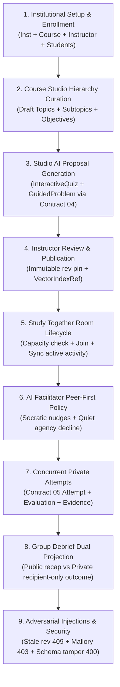

# EdNova — M22 / ED-14: Master End-to-End System Evaluation Verification

## Executive Summary

- **Mission:** M22 — Master Integrated End-to-End Learning System Evaluation
- **Canonical Tasks:** ED-14 (Execute end-to-end challenge evaluation), ED-01 through ED-13, ED-26 through ED-32
- **Status:** **COMPLETE & VERIFIED**
- **Date:** 2026-10-23
- **Test Suite:** `apps/api/tests/integration/m22-master-evaluation-scenario.node.test.ts` (10/10 passing against live MongoDB 7)

---

## 1. Integrated Scenario Lifecycle Walkthrough



---

## 2. Requirement & Scenario Gate Matrix

| Step | Milestone / Contract | Invariant Verified | Outcome | Evidence |
|---|---|---|---|---|
| **Step 1** | ED-04 Institutional Access | Scoped institution, assigned instructor, enrolled student permissions | **PASSED** | Roster created and verified in MongoDB |
| **Step 2** | ED-30 Course Studio Draft | Topics & subtopic hierarchy, Bloom level tagging, hash computation | **PASSED** | Draft saved with `isInstructorReviewed: true` |
| **Step 3** | ED-32 Activity Proposal | Source-grounded Contract 04 candidate synthesis without self-publishing | **PASSED** | Explicit `registerActivity` required to store |
| **Step 4** | ED-05 Immutable Publication | Review status gate, revision freeze, published context available to learners | **PASSED** | `GET /published-context` returns pinned revision |
| **Step 5** | ED-07 & ED-12 Room Sync | Capacity enforcement (2/2 full -> 409 Conflict), phase advancing to activity | **PASSED** | Bob joins; Carol rejected with 409; phase synced |
| **Step 6** | ED-09 Peer Facilitation | Misconception deflection, Socratic hints, quiet learner agency | **PASSED** | L1 hint returned; `decline_prompt` honored |
| **Step 7** | ED-29 & ED-10 Durable Attempts | Private evaluation, scoring, feedback, idempotency, and accepted evidence | **PASSED** | Score 1.0, Evidence created; re-submission idempotent |
| **Step 8** | ED-11 Private Debrief | Dual projection: public submission counts vs recipient-only score/evidence | **PASSED** | Alice sees graded score; Bob sees untested status |
| **Step 9** | ED-02 & ED-13 Adversarial Gates | Rejection of stale revisions (409), unauthorized actors (403), schema violations (400) | **PASSED** | All adversarial injection attempts blocked |

---

## 3. Automated Test Evidence

```
▶ M22 / ED-14: Master End-to-End Educational System Evaluation Scenario
  ✔ Step 1: Institutional scoping, assigned instructors, and student enrollment (82.90374ms)
  ✔ Step 2: Course Studio draft hierarchy curation & provenance tracking (24.271708ms)
  ✔ Step 3: Studio AI proposal generation and explicit instructor registration (20.832266ms)
  ✔ Step 4: Instructor review gate and immutable course revision publication (34.887754ms)
  ✔ Step 5: Study Together room creation, join, capacity enforcement & phase sync (66.694835ms)
  ✔ Step 6: AI Facilitator peer-first guidance and learner agency (43.454668ms)
  ✔ Step 7: Concurrent private attempt submission, idempotency & accepted evidence (56.01089ms)
  ✔ Step 8: Group debrief phase transition with dual public/private projection (35.364847ms)
  ✔ Step 9: Adversarial negative injections: stale revisions, unauthorized actors, schema violations (30.065431ms)
✔ M22 / ED-14: Master End-to-End Educational System Evaluation Scenario (442.414154ms)
ℹ tests 10
ℹ suites 0
ℹ pass 10
ℹ fail 0
ℹ cancelled 0
ℹ skipped 0
ℹ todo 0
ℹ duration_ms 987.166091
```

