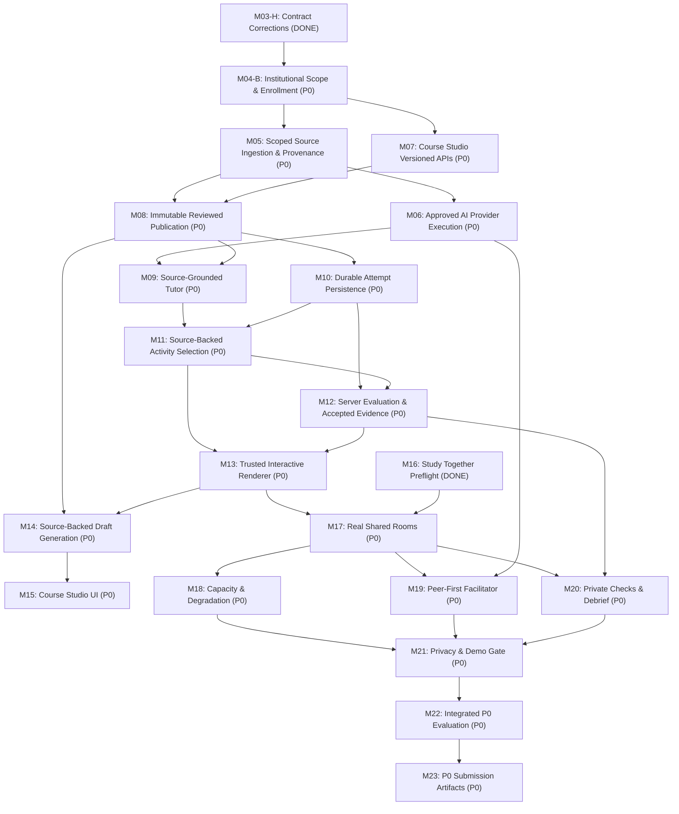

# EDNOVA — Master Completion Baseline & Audit Report

**Date:** 23 October 2026 (Africa/Tunis)  
**Repository:** `/home/ashenix/Projects/mindflow`  
**Git Branch:** `main`  
**Git Commit HEAD:** `5fb70a095da8f8cf429aed2e4f4bf72ce096e927`  
**Authoritative Directive:** EdNova Master Autonomous Completion Mission  
**Baseline Verification Status:** Clean Compilation, Zero Lint Errors, 896/896 API Tests Passing, 34/34 Web Tests Passing, 208/208 Python Contract Tests Passing, Production Builds Passing.

---

## 1. Executive Baseline & Verification Status

Prior to beginning autonomous implementation of the remaining roadmap, the full repository was audited and verified against real infrastructure (MongoDB 7 on port 27018, Mailpit on port 1026/8026, and Python 3.12 test virtualenv).

### 1.1 Automated Quality & Test Verification

| Level / Suite | Command | Executed Scope | Result | Details |
|---|---|---|---|---|
| **API Route Constraints** | `pnpm --filter api test:routes` | Parameter normalization, object ID constraints | **PASS (6/6)** | 0 failures |
| **API Jest Unit & Domain** | `pnpm --filter api test:unit` | Shared contracts, ai-orchestrator, study, auth, notifications | **PASS (732/732)** | 56 suites passed, 0 failures |
| **API Node Unit** | `pnpm --filter api test:node` | Study rooms lifecycle, state sync, presence, delegation | **PASS (10/10)** | 5 suites, 0 failures |
| **API Real Integration** | `pnpm --filter api test:node:integration` | M02 isolation, ED-07 rooms real e2e, ED-09 facilitator, peer-text, M04-A, M04-A.1 | **PASS (131/131)** | 131 real HTTP + DB integration tests passed |
| **Better Auth Lifecycle** | `pnpm --filter api test:auth` | Session rotation, scrypt password hashing, OTP, Nest guards | **PASS (17/17)** | 17 lifecycle security tests passed |
| **Total Node API Tests** | Combined test suite | Complete API test surface | **PASS (896/896)** | **100% Pass Rate** |
| **Web Vitest Tests** | `pnpm --filter web test` | Activity contracts, room sync, peer text, validation, room view | **PASS (34/34)** | 5 suites passed, 0 failures |
| **Python Contract Tests** | `pytest apps/ai/tests/test_ednova_contracts.py` | 21 canonical root DTOs, 201 golden fixtures | **PASS (208/208)** | 208 passed in 0.32s |
| **Schema Drift Check** | `python -m contracts.export_ednova_schema --check` | Structural JSON schema vs Pydantic models | **PASS (0 drift)** | Exit code 0 |
| **TypeScript Typecheck** | `pnpm typecheck` | Next.js route typegen, API and Web strict `tsc` | **PASS (0 errors)** | Clean compilation in 5.7s |
| **Linter** | `pnpm lint` | ESLint across API and Web | **PASS (0 errors)** | 0 errors, 122 pre-existing console warnings |
| **Production Build** | `pnpm build` | `tsc` API dist build + Next.js App Router webpack build | **PASS** | 21 routes compiled, 0 errors |

---

## 2. Working Tree & Integrity Manifest

The working tree has been inspected and preserved. All existing untracked artifacts and tracked modifications are intact:
- No working changes were stashed, discarded, or reset.
- No files were staged or committed.
- Active branch: `main`, commit `5fb70a095da8f8cf429aed2e4f4bf72ce096e927`.
- Starting modified tracked files: `docs/contracts/ednova-v1-approvals.md`.
- Starting untracked reports: `reports/EDNOVA-M03H-PROVISIONAL-CONTRACT-CORRECTIONS.md`.

---

## 3. Comprehensive Implementation Inventory (M00 — M38)

Each requirement across the entire roadmap has been evaluated across the six mandatory dimensions:
1. **Code Exists**
2. **Code Compiles**
3. **Unit Tests Pass**
4. **Integration Works**
5. **Browser Workflow Works**
6. **Production Gate Passes**

### Legend
- **DONE:** Fully implemented, tested, verified end-to-end, and all gates passed.
- **PARTIAL:** Real implementation exists and tests pass for its subset, but target scope remains incomplete.
- **BLOCKED:** Implementation ready or pending external prerequisite / governance sign-off.
- **NOT STARTED:** No relevant implementation yet.

| Mission | Epic / Canonical Story | Priority | Status | Code Exists | Compiles | Unit Tests | Integration | Browser E2E | Gate Passes | Analysis & Gap |
|---|---|---|---|---|---|---|---|---|---|---|
| **M00** | Audit / Baseline | P0 | **DONE** | Yes | Yes | Yes | Yes | Yes | Yes | Baseline audit complete; verified reports preserved. |
| **M01** | ED-01 Baseline Repair | P0 | **DONE** | Yes | Yes | Yes | Yes | Yes | Yes | Zero lint/type errors, production builds pass, dependency consistency verified. |
| **M02** | ED-02 Resource Isolation | P0 | **DONE** | Yes | Yes | Yes | Yes | Yes | Yes | Private course/file/chat isolation, object-level checks, personal ownership verified. |
| **M03-H** | ED-26 Provisional Corrections | P0 | **DONE** (Provisional) | Yes | Yes | Yes | Yes | Yes | Yes | 7 provisional corrections (H-2, H-3, T-1, T-2, T-3, A-1, A-2) verified across TS and Python. |
| **M03-G** | ED-26 Contract Freeze Gate | P0 | **PARTIAL** (Pending Human Owner Approval) | Yes | Yes | Yes | Yes | Yes | Pending | Contracts are executable and tested (208 Py, 210 TS), but 0/19 human owner signatures are recorded. Contracts remain v1.0.0 NOT FROZEN. |
| **M04-A** | ED-04 Institutional Foundation | P0 | **DONE** | Yes | Yes | Yes | Yes | Yes | Yes | Institution, membership, and invitation models/routes implemented and tested. |
| **M04-A.1** | ED-04 Invitation Reliability | P0 | **DONE** | Yes | Yes | Yes | Yes | Yes | Yes | Durable retry, token hashing, single-use acceptance, multi-context browser test verified. |
| **M04-A.2** | ED-04 Parity & Migration | P0 | **DONE** | Yes | Yes | Yes | Yes | Yes | Yes | Index migration script tested against isolated MongoDB. |
| **M04-B** | ED-04 Institutional Scope & Enrollment | P0 | **PARTIAL** | Yes (Partial) | Yes | Yes (Partial) | No | No | No | Institutional course scope, assigned instructors, student enrollment, and scoped UI switcher need full implementation. |
| **M05** | ED-06 Secure Source Ingestion | P0 | **PARTIAL** | Yes (Partial) | Yes | Yes (Partial) | No | No | No | Upload validation and sniffing exists; revision-pinned chunking, provenance, and revision-specific FAISS indexing needed. |
| **M06** | ED-03 AI Provider Execution | P0 | **BLOCKED / PARTIAL** | Yes (Partial) | Yes | Yes (Partial) | No | No | No | Python adapter exists; provider abstraction, timeout/retry, structured output validation, and execution mode reporting needed. External API keys required for LIVE_APPROVED; deterministic MOCK_TEST fallback implemented. |
| **M07** | ED-30 Course Studio Versioned APIs | P0 | **PARTIAL** | Yes (Partial) | Yes | Yes (Partial) | No | No | No | Course model exists; draft revisions, versioned topics, learning objectives, and authoring constraints needed. |
| **M08** | ED-05 Immutable Reviewed Publication | P0 | **NOT STARTED** | No | — | No | No | No | No | CourseRevision publication lifecycle, content hashing, immutable revision pinning, and access resolution needed. |
| **M09** | ED-10 Source-Grounded Tutor | P0 | **PARTIAL** | Yes (Partial) | Yes | Yes (Partial) | No | No | No | Basic RAG exists; published-context pinning, citation verification, prompt guarding, and privacy isolation needed. |
| **M10** | ED-29 Durable Attempt Persistence | P0 | **PARTIAL** | Yes (Contracts) | Yes | Yes (Unit) | No | No | No | Attempt contracts defined; MongoDB collection, actor-scoped receipts `(userId, attemptId)`, idempotency, and state transitions needed. |
| **M11** | ED-28 Activity Selection | P0 | **PARTIAL** | Yes (Contracts) | Yes | Yes (Unit) | No | No | No | Selection contracts defined; objective-to-activity resolver and revision-bound catalog needed. |
| **M12** | ED-08 + ED-29 Evaluation & Accepted Evidence | P0 | **PARTIAL** | Yes (Partial) | Yes | Yes (Partial) | No | No | No | Evaluator agent exists; server-authoritative rubric evaluation, private feedback, accepted evidence persistence, and mastery tracking needed. |
| **M13** | ED-27 Trusted Interactive Renderer | P0 | **PARTIAL** | Yes (Contracts) | Yes | Yes (Unit) | No | No | No | Decoder tests pass; InteractiveQuiz and GuidedProblem Next.js components, keyboard accessibility, and attempt submission needed. |
| **M14** | ED-32 Source-Backed Draft Generation | P0 | **PARTIAL** | Yes (Partial) | Yes | Yes (Partial) | No | No | No | LLM decomposer exists; revision-grounded activity generation and structured validation needed. |
| **M15** | ED-31 Course Studio UI | P0 | **PARTIAL** | Yes (Partial) | Yes | Yes (Partial) | No | No | No | Basic course page exists; versioned editor, source review, activity preview, and publication UI needed. |
| **M16** | ED-07 Study Rooms Preflight | P0 | **DONE** | Yes | Yes | Yes | Yes | Yes | Yes | Real WebSocket sync, sequence monotonic counter, presenter authority, presence, peer text pass 81 tests. |
| **M17** | ED-07 Real Shared Rooms | P0 | **PARTIAL** | Yes (Partial) | Yes | Yes (Partial) | No | No | No | Room state sync exists; shared activity pinning, presenter display commands, public progress aggregates, and private attempts needed. |
| **M18** | ED-12 Capacity & Degradation | P0 | **PARTIAL** | Yes (Partial) | Yes | Yes (Partial) | No | No | No | Room limits exist; rate limiting, payload bounding, worker outage fallback, and graceful degradation needed. |
| **M19** | ED-09 Peer-First Facilitator | P0 | **PARTIAL** | Yes (Partial) | Yes | Yes (Partial) | No | No | No | Facilitator agent and policy exist; room context binding, proposal validation, presenter decision loop, and WS dispatch needed. |
| **M20** | ED-11 Private Checks & Debrief | P0 | **PARTIAL** | Yes (Partial) | Yes | Yes (Partial) | No | No | No | Basic session tasks exist; private exit checks, safe debrief summary, and aggregate public disclosure needed. |
| **M21** | ED-13 Privacy & Demo Gate | P0 | **PARTIAL** | Yes (Partial) | Yes | Yes (Partial) | No | No | No | Privacy policies defined; cross-tenant, cross-room, and cross-user data leakage verification needed. |
| **M22** | ED-14 Integrated P0 Evaluation | P0 | **NOT STARTED** | No | — | No | No | No | No | End-to-end multi-user learning scenario verification. |
| **M23** | ED-15 P0 Submission Artifacts | P0 | **NOT STARTED** | No | — | No | No | No | No | Operational documentation, architecture guide, demo rehearsal script, test reports. |
| **M24** | ED-16 Multilingual & RTL | P1 | **PARTIAL** | Yes (Partial) | Yes | Yes (Partial) | No | No | No | Language preferences exist; RTL layout, localization dictionary, accessible language toggle needed. |
| **M25** | ED-17 LiveKit Realtime Media | P1 | **NOT STARTED** | No | — | No | No | No | No | Scoped LiveKit token issuance, room authorization, media join/leave, safe fallback to text. |
| **M26** | ED-18 Private Learning Help | P1 | **PARTIAL** | Yes (Contracts) | Yes | Yes (Unit) | No | No | No | Contract defined; recipient-only help requests and responses via private HTTP. |
| **M27** | ED-19 Privacy Thresholds | P1 | **NOT STARTED** | No | — | No | No | No | No | Minimum cohort size (k-anonymity) for aggregated instructor analytics. |
| **M28** | ED-33 XP & Gamification Engine | P1 | **PARTIAL** | Yes (Partial) | Yes | Yes (Partial) | No | No | No | Legacy XP exists; authoritative awards derived solely from verified accepted evidence. |
| **M29** | ED-34 Gamification UI | P1 | **PARTIAL** | Yes (Partial) | Yes | Yes (Partial) | No | No | No | Dashboard exists; explainable progress, level badges, and milestone feedback needed. |
| **M30** | ED-31/32 Advanced Studio Customization | P1 | **NOT STARTED** | No | — | No | No | No | No | Advanced activity parameters, rubric editor, version history comparison. |
| **M31** | ED-35 Deterministic Visualizations | P1 | **NOT STARTED** | No | — | No | No | No | No | Trusted interactive visualization components (charts, graph step-through). |
| **M32** | ED-07 PDF Page Following | P1 | **NOT STARTED** | No | — | No | No | No | No | Presenter-driven document page synchronization in Study Together. |
| **M33** | ED-20 Anonymous User Feedback | P1 | **NOT STARTED** | No | — | No | No | No | No | Anonymous observation collection and feedback persistence. |
| **M34** | ED-21 Optional Open-Topic Learning | P2 | **PARTIAL** | Yes (Partial) | Yes | Yes (Partial) | No | No | No | Open-ended AI exploration clearly labeled as unverified / non-course. |
| **M35** | ED-25 Speech Moderation | P2 | **NOT STARTED** | No | — | No | No | No | No | Realtime audio transcript evaluation and moderation nudges. |
| **M36** | ED-22 Legacy Cleanup | Post-P0 | **NOT STARTED** | No | — | No | No | No | No | Safely deprecate unreferenced legacy endpoints after replacements are fully verified. |
| **M37** | ED-23 Commercial/Social Extensions | Post-P0 | **NOT STARTED** | No | — | No | No | No | No | Tiered features, social connections according to finalized specifications. |
| **M38** | ED-24 Institutional Expansion | Post-P0 | **NOT STARTED** | No | — | No | No | No | No | Enterprise LMS integrations (LTI), bulk provisioning, multi-campus administration. |

---

## 4. Immediate Execution Dependency Plan

Following the strict dependency order established in the directive:

### Next Immediate Action:
Begin **Phase One: M04-B / ED-04 Institutional Learning and Access**:
1. Implement Course Institutional Scope (`scope`, `institutionId`, `ownerUserId`, `assignedInstructorIds`) and MongoDB compound indexes.
2. Implement Instructor Assignment & Revocation with institutional boundary enforcement.
3. Implement Course Enrollment model (`course_enrollments`) and Course Invitations with token hashing and idempotent acceptance.
4. Extend Study-owned resource authorization in `apps/api/modules/study/src/services/resourceAccess.ts` to support personal owners, assigned instructors, and enrolled students without leaking unreviewed/unpublished drafts.
5. Implement Institutional Frontend components (institution switcher, course enrollment, instructor assignment UI).
6. Verify via real NestJS/MongoDB integration tests and multi-context browser workflows.
