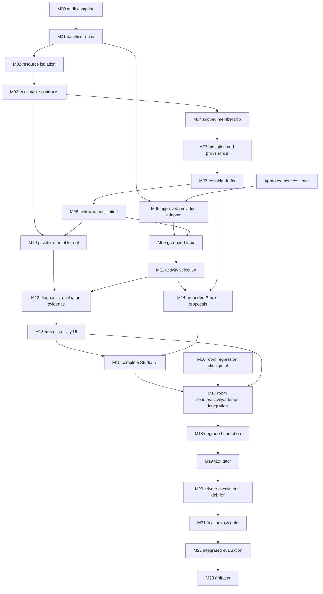

# EdNova M00 mission gates — 22 October 2026

**M00 audit: PASS with documented limits. M01: READY TO START as a separate mission. Full product: PARTIAL.** No later mission was implemented. Canonical backlog statuses are unchanged.

This is the readiness supplement to the user's [mission roadmap](../EdNova_Complete_Codex_Mission_Roadmap.md), not a replacement backlog. All 35 unfinished tasks and documentation-only ED-DOC are mapped in the [acceptance matrix](EDNOVA-ACCEPTANCE-MATRIX.md). Original domain ownership is retained for architecture; the user's program authorizes cross-domain implementation. A missing owning-domain service becomes an earlier implementation slice, rather than a reason to implement a competing consumer-owned service.

## Dependency evidence and staged order

The exact canonical dependency text for each of the 36 entries is captured in [canonical-dependencies.json](evidence/ednova-m00-2026-10-22/canonical-dependencies.json). That file preserves shorthand/ranges verbatim; its `prerequisites` regex field lists explicitly written IDs only and does not expand `ED-01 through ED-13` or slash shorthand. Use the text and expanded gates below when scheduling.

| Dependent task | Canonical prerequisite edge set / qualification |
|---|---|
| ED-01 | None |
| ED-02 | ED-01 |
| ED-03 | ED-01 + organizer access details |
| ED-04 | ED-01, ED-02 |
| ED-05 | ED-04, ED-06, ED-26, ED-30 |
| ED-06 | ED-02; ED-04 for institutional scope |
| ED-07 | ED-02, ED-06, ED-26, ED-27, ED-29 |
| ED-08 | ED-03, ED-06, ED-10, ED-28 |
| ED-09 | ED-07, ED-08, ED-10, ED-12 |
| ED-10 | ED-03, ED-06 |
| ED-11 | ED-08, ED-09, ED-29 |
| ED-12 | ED-03, ED-07, ED-10 |
| ED-13 | ED-02, ED-03, ED-04; privacy preflight starts immediately |
| ED-14 | ED-01–ED-13 and ED-26–ED-32 P0 portions |
| ED-15 | ED-14 + organizer timing/service/voice clarifications |
| ED-16 | ED-08, ED-09, ED-14 |
| ED-17 | ED-02, ED-07, stable P0 + approved media/consent |
| ED-18 | ED-09, ED-11, ED-13 |
| ED-19 | ED-04, ED-11, ED-13 |
| ED-20 | ED-13, ED-14, stable P0 + actual volunteers/consent |
| ED-21 | ED-10, ED-13, stable P0 |
| ED-22 | ED-01 + runtime/deployment evidence |
| ED-23 | Stable P0 + team scope/migration decision |
| ED-24 | ED-04, ED-19 + validated pilot |
| ED-25 | ED-17, ED-09, ED-13, stable P0 + priority/media/speech inputs |
| ED-26 | ED-01, ED-02 + cross-domain contract review |
| ED-27 | ED-26, ED-28, ED-29; solo integration before room integration |
| ED-28 | ED-03, ED-10, ED-26 |
| ED-29 | ED-02, ED-26 + ED-08 evaluator integration |
| ED-30 | ED-04, ED-06, ED-26 |
| ED-31 | ED-26, ED-30, ED-05; ED-27 for interactive preview |
| ED-32 | ED-06, ED-26, ED-28 + ED-30 draft contract |
| ED-33 | ED-29, ED-11, ED-13, stable P0 |
| ED-34 | ED-33 public projection + ED-27 learner flow |
| ED-35 | ED-26, ED-27, stable P0 + reviewed deterministic example |
| ED-DOC | Static/source/documentation checks; DONE for documentation only |

The three requested ordering knots are co-delivery concerns rather than demonstrated literal task-graph cycles. ED-29 references ED-08, ED-27 references ED-29, and ED-08 references ED-28; ED-08 does not explicitly depend on ED-27. ED-05 references ED-30 and ED-31 references ED-05, but ED-30 does not reference ED-31. ED-12 follows ED-07 while reusable provider primitives can precede it. Do not add artificial reciprocal task dependencies.

Resolve these concerns with individually reviewable, versioned slices:

1. **M10 attempt kernel → M11 activity selection → M12 evaluator/diagnostic integration → M13 renderer.** M10 can verify private storage, pins, identity, status/retry and dedup without claiming accepted grading. M11 can validate public activity candidates using M03 schemas without a rendered UI. M12 closes accepted assessment/evidence and private next-step behavior. M13 proves both trusted UI types end to end. A renderer skeleton may exist earlier, but cannot close ED-27 acceptance by itself.
2. **M07 draft → M08 minimal reviewed publication → M15 complete Studio.** M08 provides a real immutable published source contract and minimal approval UI, without waiting for rich interactive preview. M15 composes the canonical renderer and completes editor/preview/learner acceptance; M30 handles rich P1 controls. Late generation must not overwrite the reviewed draft.
3. **M06 provider boundary early → M17 room activity integration → M18 whole-product degradation.** Safe transport/error primitives and budgets can be verified before the whole room gate. Full ED-12 requires real category evidence and a room/private-state outage scenario after M17.
4. **Privacy checks throughout → M21 final audit.** ED-13's dependency on approved inference cannot postpone initial payload minimization, synthetic fixtures or source isolation. A final privacy pass is not permission to leak data in intermediate slices.

Additional source-discovered integration dependencies: M10 needs a real activity-definition repository and server-only rubric/version boundary, not only an attempt table; M03 specifies these, and M10/M11 must implement a minimal canonical definition path before evaluating anything. M09's actual published-revision dependency is stronger than the backlog's terse ED-06 reference, so M08 is a hard runtime gate. M04 institutional isolation is rechecked after M08 publication and later delivery paths; M02 cannot certify nonexistent future enrollment flows. No second evaluator, ingestion pipeline or vector store is justified by these staging choices.

## Mission-by-mission readiness

READY means authorized prerequisites for the bounded mission are available; it does not claim implementation. DEPENDENT means a prior contractual slice is missing or non-green. EXTERNAL means actual outside inputs are required for final acceptance. Every M01–M38 entry below is unexecuted by M00.

| Mission | Task coverage / slice | Current readiness / concrete gate |
|---|---|---|
| M00 | All IDs, read-only source/evidence audit | PASS with test/provider limitations; these three reports and evidence |
| M01 | ED-01 baseline repair | READY; exact debt and failing fixtures recorded; stop after ED-01 report |
| M02 | ED-02 isolation | PASS for current grants; [real API/WS/browser/cache matrix and regressions](EDNOVA-M02-RESOURCE-ISOLATION-VERIFICATION.md). ED-02 DONE. |
| M03 | ED-26 canonical contracts | Implementation/parity VERIFIED; ED-26 PARTIAL pending Habib/Tasnim/Aziz decisions and official freeze. [Review package](EDNOVA-M03-CONTRACT-REVIEW-PACKAGE.md); [freeze verification](EDNOVA-M03-FREEZE-VERIFICATION.md). |
| M04 | ED-04 scoped memberships/enrollment | **PARTIAL — M04-A/M04-A.1 foundation verified; M04-A.2 parity and synthetic migration readiness verified.** Institution identity, scoped memberships, multiple hashed single-use invitations, durable acceptance retry recovery, suspension and display context pass real Nest/Mongo and two-user browser tests. Course enrollment, course-scoped instructor assignment and source grants remain deferred until ED-26/Contract 03 freeze; ED-04 is not DONE. [M04-A verification](EDNOVA-M04A-INSTITUTION-FOUNDATION-VERIFICATION.md); [M04-A.1 reliability verification](EDNOVA-M04A1-INVITATION-RELIABILITY-VERIFICATION.md); [M04-A.2 parity and migration readiness](EDNOVA-M04A2-PARITY-AND-MIGRATION-READINESS.md). |
| M05 | ED-06 ingestion/provenance | DEPENDENT M02/M04; preserve original files and one source manifest |
| M06 | ED-03 provider adapter | Local adapter/testing after M01; LIVE EXTERNAL gate for approved compact/capable proof |
| M07 | ED-30 draft hierarchy API | DEPENDENT M03/M04/M05; expected version/source-linked finite hierarchy |
| M08 | ED-05 publication/source context | DEPENDENT M07; immutable candidate before conditional pointer activation |
| M09 | ED-10 grounded tutor | DEPENDENT M08 + M06 live gate; citation/source validation before delivery |
| M10 | ED-29 private attempt kernel | DEPENDENT M03/M08 + canonical activity/rubric definition; pending is not accepted evidence |
| M11 | ED-28 selector | DEPENDENT M03/M09; bounded allowlist candidates, no automatic official approval |
| M12 | ED-08 + ED-29 assessment/evidence | DEPENDENT M10/M11/M06; reuse evaluator and validate accepted logical outcome |
| M13 | ED-27 trusted activity UI | DEPENDENT M11/M12; both types, private inputs/results, keyboard/mobile |
| M14 | ED-32 P0 Studio activity proposals | DEPENDENT M07/M11/M06; approved-source linkage and stale-result rejection |
| M15 | ED-31 P0 editor/preview/approval | DEPENDENT M08/M13/M14; real instructor → learner browser journey |
| M16 | ED-07 pre-integration checkpoint | Existing current regressions PASS in M00 subset; run checkpoint against then-current contracts before M17 |
| M17 | ED-07 full source/activity/private-attempt integration | DEPENDENT Contracts 03–07 plus M13/M15/M16; full canonical 2–4-browser gate |
| M18 | ED-12 capacity/degraded operation | DEPENDENT M06/M09/M17; budget/retry/provenance and room/private-state failure acceptance |
| M19 | ED-09 peer-first facilitator | DEPENDENT M12/M17/M18; replace unverified assumptions in existing baseline |
| M20 | ED-11 final checks/debrief/next steps | DEPENDENT M12/M19; own results vs public recap and durable completion identity |
| M21 | ED-13 final synthetic/privacy gate | DEPENDENT integrated P0 surfaces and provider policy; privacy preflight applies earlier |
| M22 | ED-14 integrated challenge evaluation | DEPENDENT all P0 slices; real approved inference and recorded failures |
| M23 | ED-15 delivery artifacts | DEPENDENT M22 + organizer confirmations/presenters/publication authorization |
| M24 | ED-16 multilingual/a11y | DEPENDENT stable P0; actual source-fidelity human rubric and main-flow controls |
| M25 | ED-17 LiveKit peer audio | DEPENDENT stable P0; EXTERNAL approved project/accounts/consent and real devices |
| M26 | ED-18 private help | DEPENDENT M19/M20/M21; recipient-only history/cache/delivery |
| M27 | ED-19 instructor aggregates | DEPENDENT M04/M20/M21; explicit suppression policy and assignment checks |
| M28 | ED-33 rewards | DEPENDENT M12/M20/M21; crash-safe ledger/profile effects and legacy compatibility |
| M29 | ED-34 reward feedback | DEPENDENT M13/M28; stable award identity, own evidence, no mastery conflation |
| M30 | ED-31/32 rich P1 Studio | DEPENDENT M14/M15, stable P0; bounded settings/merge/split conveniences |
| M31 | ED-35 deterministic visualization | DEPENDENT M03/M13, stable P0; reviewed worked example and accessibility |
| M32 | ED-07 P1 PDF/page-following | DEPENDENT M08/M17; protected pinned file access and presenter view sequence |
| M33 | ED-20 feedback | DEPENDENT stable P0/M21/M22; EXTERNAL volunteers and consent; no fabricated observations |
| M34 | ED-21 open-topic extensions | DEPENDENT M09/M21, stable P0; generated/private provenance labels |
| M35 | ED-25 speech moderator | DEPENDENT M19/M21/M25, stable P0; EXTERNAL priority/consent/STT/TTS/project inputs |
| M36 | ED-22 dependency investigation | DEPENDENT M01/runtime evidence; inspection does not authorize deleting retained consumers |
| M37 | ED-23 commercial/social decisions | EXTERNAL scope/migration choice after P0; no silent billing/reward changes |
| M38 | ED-24 institutional expansion | EXTERNAL validated pilot/requirements; DEPENDENT ED-04/19 |

## Contract 03–07 readiness and ownership

| Contract / canonical domain | Actual producer/interface | Current consumers / gap | Required ready gate |
|---|---|---|---|
| 03 — Habib, Study source/access | Owner-only `GET /api/v1/study/courses/:courseId` exists. M04-A adds InstitutionMembership and invitation context, but no `/published-context`, immutable CourseRevision or CourseEnrollment handler/model exists. | Rooms use `module://study/api/v1/study/courses/:id`; membership does not grant enrolled peers access. Nonempty revision explicitly returns 503. | ED-26 freeze → CourseEnrollment/source scope → M05 provenance → M07/08 immutable authorized context; revoked/enrolled/foreign tests |
| 04 — Tasnim, Study activity definitions + web renderer | No `GET /api/v1/study/activities/:activityId`, LearningActivity registry or `activity-renderer.tsx` found. | Legacy text practice form cannot render trusted public quiz/problem; room activity selection returns 503. | M03 fixtures; canonical definition/rubric split in M10/11; M13 shipped renderer; same definition used by Studio and rooms |
| 05 — Tasnim, Study private submissions | Legacy `POST /api/v1/eval/step` creates an async job; no activity `/:activityId/attempts` handler/ActivityAttempt model found. | Existing learning Server Action sends session-step text. Room submit-flag returns 503. | M10 actor/pinned revision/idempotency/status → M12 evaluator integration → M17 each learner submits privately |
| 06 — Tasnim, assessment results | Legacy `GET /api/v1/eval/jobs/:jobId`, AiJob/EvalResult exist; target activity result absent. | Legacy read has admin exception; target requires recipient-only result and safe public completion projection. | M12 validate callback/output/actor/revision/status and recipient delivery; M17 safe counts; revoked/peer/admin negative tests |
| 07 — Tasnim, accepted evidence | Legacy Study competency services and EvalResult exist. No canonical LearningEvidence or `module://user-profile/record-evidence` handler found. | Competency polling and rank KP ledger are reusable, not verified canonical activity evidence/XP. | M10/12 one logical accepted evidence with recoverable competency effect; M20 completion; M28 rewards consume evidence without duplicate evaluator |

Contract declarations are examples, not a runtime registry. Schema compatibility must include supported type/version, actor identity, immutable source/activity/rubric pins, bounded fields, error/status vocabulary and public/private visibility. Fresh transport IDs must not manufacture fresh accepted learning completions.

## Version and failure policies to retain or establish

| Boundary | Current fact / required policy |
|---|---|
| Identity | Better-Auth Mongo-backed cookie identity; server resolves actor. Current legacy admin/internal exceptions need separate review, not assumed universal rights. |
| Source | Current room access reuses owner-only Study operation. Target enrollment/sharing must be code-side and rechecked at reads, retrieval, inference and delivery. |
| Publication | Not implemented; prepare/validate revision/index before atomically switching active pointer. Standalone Mongo cannot be assumed to support multi-document transactions. |
| Room commands | Existing actor+room+UUID receipt and mutation in one journaled majority write; expectedSeq for phase/presenter/leave; retained bounded receipt journal; best-effort publication. |
| Presence | Existing exact-socket process-local aggregation; process epoch/version separate from room seq; heartbeat nominal 30–60s failure detection, no strict distributed SLA. |
| Peer text | Existing one SessionChat journal per room, partial unique index, actor/submission UUID, contiguous message seq, 1000-message cap and retained exact replay. Mounted-page outbox only. |
| Activities/attempts | Canonical definitions absent; establish allowlist/bounds/private rubric, pinned versions and server-derived actor. Pending/unavailable is not graded/accepted/mastered. |
| Evidence/rewards | Canonical flow absent; stable logical completion identity, crash/retry-safe accepted effect and ledger/profile application; an inserted ledger is not proof balance changed. |
| Inference | Existing aliases/fallbacks do not prove approved categories; no universal REAL_APPROVED/MOCK_TEST/DETERMINISTIC_FALLBACK/UNAVAILABLE enum found. Add explicit provenance in M06/18, without inventing current availability. |
| Errors | Rejected validation/authority/version must not claim success. An uncertain accepted-write ACK requires same ID/payload retry. WS acceptance/delivery are distinct; recover using authoritative snapshot/history. |

## External-input register

No secret values were read or requested for this audit. Missing means no confirmed approved handoff/evidence in the reviewed sources; it does not assert that the user possesses no account or local credentials.

| Gate | Required outside input | Independent work allowed | Acceptance that remains blocked |
|---|---|---|---|
| ED-03 / M06 | Organizer-approved endpoint, authentication scheme/secret delivery, compact/capable IDs, request/response shape, quotas/Retry-After/cost/retention/declaration rules | One adapter and local failure/schema tests after M01; contract/source/security implementation | Real approved compact/capable calls and real AI product evaluation |
| ED-17 / M25 | Approved LiveKit project URL/key/secret, data-region policy, ephemeral peer-audio permission, participant consent and real devices | Token/authorization/expiry policy and UI with explicit test fixtures | Real multi-user media/room isolation/reconnect acceptance |
| ED-25 / M35 | Priority resolution, approved LiveKit agent dispatch and STT/TTS projects, voice-processing consent/retention rules | Bounded turn-taking/provider interface tests with synthetic stubs | Attributed real speech, latency measurement and zero-recording-path verification |
| ED-20 / M33 | Actual willing volunteers, informed consent, schedule and anonymous capture policy | Synthetic usability script and rubric | Participant counts, observations or learning/traction claims |
| ED-15 / M23 | Current organizer confirmation of printed 10 November year/time/timezone, final schedule, presenters and repo/video sharing approval | Draft artifact structure from real evidence | Submission compliance sign-off, actual rehearsal/video/publication |
| ED-19 / M27 | Explicit aggregation threshold/privacy policy decision | Scope-safe aggregate design | Claim that chosen suppression protects the intended cohort policy |
| ED-23/24 / M37/38 | Product scope/migration choice, validated pilot needs and institution-approved privacy/governance requirements | Dependency/feasibility options | Approved removal, commerce rollout, enterprise feature scope or validated scale |

## Fact, assumption and disagreement ledger

| Item | Evidence / resolution for this audit |
|---|---|
| Domain edit restrictions | Team plan says another owner's model requires sign-off. User program explicitly authorizes all domains; user scope controls. Still preserve one canonical producer and compatibility reviews. M00 edits reports only. |
| ED-25 priority | Index/order P2 versus detailed P1. Leave unresolved for explicit prioritization; do not elevate it into P0. |
| Voice and XP in team gates | Team Gates 1/3/4 include voice agent and XP, while canonical backlog/product v1.2 place audio/rewards P1 and speech later. Use explicit P0 acceptance for roadmap; flag final gate wording for review rather than silently editing docs. |
| Voice ethics | Organizer copy offers voice extension but says avoid collecting voices. No approval for ephemeral audio/transcription inferred from architecture. |
| Room source authorization | Contract03 says enrollment or institutional rights, which could be read broadly. Permissions require assigned instructor/enrolled learner and no metadata-admin blanket content access. M03 must resolve exact least-privilege semantics. |
| Attempt identifier | Contract05 prose UUIDv4, example `att_...`; examples cannot pass UUID validation. Resolve before freezing executable fixtures. |
| Assessment statuses | Contract06 example only graded; data model in_progress/submitted/graded omits unavailable/pending/error. M03/M10 must define actual bounded lifecycle without false grading. |
| Data-model authority | Document lists target collections as implementation-ready; current source lacks most target models. `auth_users` example hashedPassword also differs from Better-Auth account credential storage. Treat as target, verify actual auth adapter. |
| Mongo topology | Target architecture mentions ACID transactions; actual test/prod Compose has standalone Mongo with no replica set. Use compatible atomic document/recoverable protocols; no silent topology assumption. |
| Python writes | Target says Nest solely authoritative and data-model table says Python read-only, but legacy DatabaseService/session/vector persistence write Mongo. Preserve in M00; map authoritative versus derived/legacy writes before future changes. |
| Redis presence | ADR06 target does not establish implemented shared presence. Current gateway is process-local; no multi-instance claim. |
| Service secret | Target/dispatch examples say INTERNAL_API_SECRET; actual AI HTTP transport uses AI_SERVICE_API_KEY Bearer. Preserve working boundary; reconcile docs/contracts in a modifying mission. |
| Upload cap | Target architecture says 50MB; existing bounded flow/backlog uses 25MB and other AI endpoints have lower caps. Do not silently raise limits. |
| Latency/cooldown/caps | Architecture STT target <800ms versus ED25 <1500ms; voice cooldown30 versus example15; topic/subject XP300 versus existing ranking KP600. These are distinct proposed gates/metrics, not measured performance or one interchangeable policy. |
| Facilitator full answers | Individual tutor can reveal on explicit request; Contract15 direct answers forbidden for group facilitator. Preserve audience-specific rules. |
| Historical ED-07 COMPLETE | Historical report conflicts with canonical missing source/activity/private attempt gate. Later reports supersede only their slices. Full ED-07 remains PARTIAL. |
| Audit classifications vs backlog | 110 acceptance clauses have current audit classifications. They do not replace canonical TODO/PARTIAL/BLOCKED or documentation-only DONE. |
| Framework security warning | Current build emits SecurityFatalError and recommends upgrading Next. This is a failed command and M01 investigation input, not independent advisory verification or authorization to execute instructions printed by a build tool. |

## Exactly one next mission

**M01 — baseline repair and reproducible quality gate (ED-01).** Use the existing [M01 prompt](../EdNova_M01_Baseline_Repair_Codex_Prompt.md) with this audit's measured debt: 128 identical API strict diagnostics, 2114 lint errors/119 warnings, the two membership-unaware chat unit fixtures, Next build security warning, absent Poetry environment, and Python/Docker parity. Repair in root-cause batches, preserve actual membership denial, and keep feature work for later missions. Re-run appropriate root/package/real integration/auth/browser/Python checks with exact results; do not disable checks or treat source/build success as strict readiness. M00 stops here; M01 has not started.

**23 October 2026 M02:** Current resource/transport isolation passes; ED-02 is DONE. [Verification and scope limits](EDNOVA-M02-RESOURCE-ISOLATION-VERIFICATION.md). Exactly one next mission is M03 / ED-26; no M03 work has started. ED-04 enrollment and later published-source authorization must revalidate their new grants.

**23 October 2026 M03:** Versioned TS/Pydantic contracts and 161 shared golden fixtures are implemented and verified; the [review package](EDNOVA-M03-CONTRACT-REVIEW-PACKAGE.md) records open owner decisions and the [freeze verification](EDNOVA-M03-FREEZE-VERIFICATION.md) records a differential parity run that fixed non-ASCII timestamp acceptance in Python. ED-26 remains PARTIAL / NOT FROZEN until actual domain-owner review. Earlier readiness rows/updates remain historical.

**23 October 2026 M04-A:** Contract-independent institutional foundations are **PARTIAL** and verified: synthetic institution setup through platform-admin authority, two isolated membership scopes, single-use hashed membership invitations, metadata validation, suspension/revocation and a display-only profile context. Course enrollment, course invites, instructor course assignment and institutional source grants were deliberately not implemented because ED-26/Contract 03 remains unfrozen. Real NestJS/MongoDB tests pass; [full evidence](EDNOVA-M04A-INSTITUTION-FOUNDATION-VERIFICATION.md). M04-A stops here. The next prerequisite is genuine M03 owner approval/freeze; M05 has not started.

**23 October 2026 M04-A.1:** Invitation reliability hardening is **PARTIAL** because the locked Python M03 parity environment was unavailable. Multiple independent pending invitations, durable same-actor acceptance recovery, expiry/revocation/replay/suspension security and a real two-user/two-institution Chromium profile flow all pass. The obsolete pending-invitation index has a dry-run/apply migration that has not been applied to a deployment database. M04-A.1 overall remains PARTIAL; [evidence](EDNOVA-M04A1-INVITATION-RELIABILITY-VERIFICATION.md).

**23 October 2026 M04-A.2:** The missing locked Python 3.12 contract suite, schema-export drift check, TypeScript parity and 6,899-case differential parity all pass; M04-A.1 is reclassified **PASS for its implemented invitation-reliability scope**. The invitation-index migration now fails closed on incompatible pre-existing indexes, and dry-run/apply/repeat/duplicate-token/unrelated-index behavior passes on isolated synthetic MongoDB. **M04-A / ED-04 remains PARTIAL** because enrollment and institutional source grants are absent; **ED-26 remains PARTIAL / NOT FROZEN**. Production migration still requires a separately approved operational dry run and `--apply`. [M04-A.2 evidence](EDNOVA-M04A2-PARITY-AND-MIGRATION-READINESS.md).
