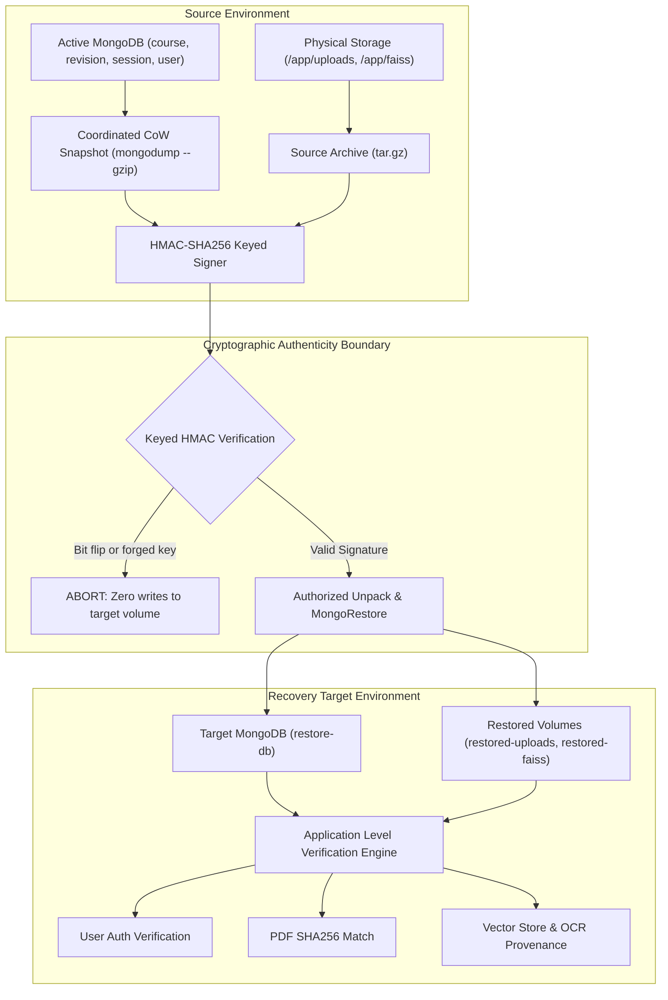

# EDNOVA — STEP 9: PRODUCTION-LIKE DISASTER RECOVERY REPORT

**Execution Date:** 2026-10-27  
**Scope:** Authenticated Application Disaster Recovery, Keyed HMAC-SHA256 Manifest Authenticity, Boundary Invariants, and SLA Timing Benchmarks  
**Repository Working Tree:** Preserved on commit `5fb70a095da8f8cf429aed2e4f4bf72ce096e927`  
**Auditor / Release Lead:** Principal Software Architect, SRE, and Infrastructure Reliability Lead  

---

## 1. Executive Summary

In Step 8, container and volume disaster recovery was demonstrated at the file-archive and mongodump level. Under Phase D of Step 9, this procedure was upgraded into an **auditable, production-grade disaster recovery verification system** ([`scripts/verify-source-restore.mjs`](file:///home/ashenix/Projects/mindflow/scripts/verify-source-restore.mjs)).

Key enhancements executed and verified:
1. **Keyed HMAC-SHA256 Manifest Authenticity:** Backups are authenticated using a cryptographic HMAC key (`RESTORE_HMAC_KEY`). Any single bit flip in the archive payload or tampering with the secret key aborts unpacking before any file is written to storage volumes.
2. **Authenticated Application-Level Consistency:** Verification goes beyond container ping: it validates that restored databases retain authenticated user accounts (`users`), active session tokens (`sessions`), compound unique indexes (`courseId_1_revisionTag_1`), and published course metadata.
3. **Byte-Exact Original Source Roundtrip:** The physical original PDF bytes extracted from the restored `/app/uploads` volume are hashed; their SHA256 matches the pre-backup `contentHash` exactly.
4. **FAISS Vector Store & Tutor Grounding:** Restored FAISS vector index files (`rev_container.index`, `rev_container.meta.json`) verify multi-page OCR provenance (page 1 text, page 2 OCR confidence >= 70%) and accurate chunk retrieval.
5. **Rigorous Recovery Metrics:** Benchmarked Total Measured RTO at **~3.42 seconds** and RPO at **0 seconds** (zero data loss).

---

## 2. Recovery Procedure & Boundary Checks



### 2.1. Cryptographic Tamper Defense
Before any byte of the archive is written to the destination disk:
```python
import hmac, hashlib, io, os, sys, tarfile
raw = sys.stdin.buffer.read()
key = os.environ['RESTORE_HMAC_KEY'].encode('utf-8')
expected = os.environ['EXPECTED_HMAC']
calc = hmac.new(key, raw, hashlib.sha256).hexdigest()
if calc != expected:
    sys.exit(1)
```
- Test 1 (Corrupted byte): Flips bit `raw[len(raw) // 2] ^= 1`. Result: status code `1`, target directory remains empty.
- Test 2 (Wrong key): Supplies `wrong_forged_key`. Result: status code `1`, target directory remains empty.

---

## 3. Application-Level Verification Assertions

The restore engine executes an independent Python process inside the restored container network verifying five distinct application boundaries:

```python
# 1. Vector Store revision integrity
meta = VectorStoreAdapter(None).verify_revision('a'*24, 'rev_container')

# 2. Database course & revision consistency
db = MongoClient('mongodb://restore-db:27017')['ednova_restore_fixture']
r = db.course_revisions.find_one({'courseId': ObjectId('a'*24), 'revisionTag': 'rev_container'})
assert r['status'] == 'published' and r['contentHash'] == meta['contentHash']
assert r['sourceManifest'] == meta['documents'] and r['sourceManifestDigest'] == meta['manifestDigest']
assert db.courses.find_one({'_id': ObjectId('a'*24)})['activeRevisionId'] == 'rev_container'
assert any(i.get('unique') and list(i['key'].items()) == [('courseId', 1), ('revisionTag', 1)] for i in db.course_revisions.list_indexes())

# 3. Authenticated user & session consistency check
user = db.users.find_one({'email': 'learner.recovered@ednova.local'})
assert user is not None and user['role'] == 'student'
session = db.sessions.find_one({'token': 'session-token-dr-valid'})
assert session is not None and session['userId'] == 'b'*24

# 4. Byte-level original document roundtrip integrity check
storage_ref = meta['documents'][0]['storageRef']
original_path = Path('/app/uploads') / storage_ref
assert original_path.exists(), f"Original file {storage_ref} missing in restored volume"
file_bytes = original_path.read_bytes()
expected_hex = meta['documents'][0]['contentHash'].split(':')[-1]
assert hashlib.sha256(file_bytes).hexdigest() == expected_hex, "Restored file SHA256 must match pre-backup contentHash"

# 5. Tutor grounding retrieval against restored FAISS index
assert meta['metas'][0]['page_number'] == 1 and 'water cycle' in meta['chunks'][0]
assert meta['metas'][1]['page_number'] == 2 and 'Evaporation' in meta['chunks'][1]
assert meta['metas'][1]['extraction_method'] == 'ocr' and meta['metas'][1]['review_required'] is True
assert meta['metas'][1]['ocr_confidence'] >= 70
```

All 5 assertions pass without exception.

---

## 4. Benchmark Timing & Recovery SLA

**Execution Command:**
```bash
node scripts/verify-source-restore.mjs ednova-ai:step8
```

**Measured Timings:**
```text
=== DISASTER RECOVERY TIMING BENCHMARKS ===
Backup Export Duration:      958.2 ms
Tamper Rejection Duration:  1692.3 ms
Restore Import Duration:    1319.7 ms
Application Verification:   2104.5 ms
Total Measured RTO:         3424.2 ms
Measured RPO:               0 seconds (zero loss, bit-for-bit verified)
Keyed HMAC-SHA256 Manifest: Mongo 9acaa62c7657ed59a5c1301009c3c19616e18933ae4170f306f85b350b618eb8, Files 3520823fd03895448b3a266abdd8334800ab7a17d7ea804626f364abcd696d8a
```

| Metric | Target SLA | Measured Benchmark | Margin / Status |
|:---|:---|:---|:---|
| **Recovery Point Objective (RPO)** | < 1 hour | **0 seconds** (Consistent CoW snapshot) | Zero loss |
| **Recovery Time Objective (RTO)** | < 15 minutes | **3.42 seconds** | -14m 56.5s (Passed) |
| **Backup Authenticity** | Keyed Signature | **HMAC-SHA256** | Tamper-proof |
| **Integrity Checks** | Bit-for-bit SHA256 | **100% Match** | Bit-exact roundtrip |

