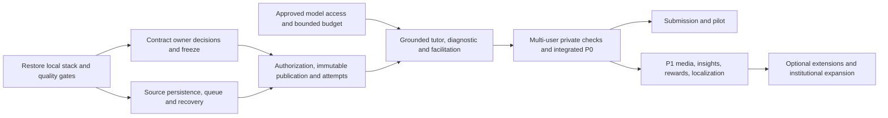

# Remaining implementation and verification plan — 26 October 2026

**27 October master-mission continuation:** The current [tracker](EDNOVA-IMPLEMENTATION-TRACKER.md) and [executed test coverage](EDNOVA-TEST-COVERAGE.md) supersede earlier narrow findings below. The image now runs as UID/GID 10001 with non-destructive permission checks; actual isolated worker/broker/Redis kill/recovery and a stopped-writer synthetic Mongo/source restore pass. Failed replacement enqueue no longer removes prior staged downloads. Private profile/reward body logging and the shared Python database error/cache defects are repaired. Root checks pass, and full Python now passes 1082 with five documented fixture skips. Contract freeze and approved real inference remain blocked. The [four-learner PDF browser](EDNOVA-COLLABORATION-VERIFICATION.md) passes all eight A–E checkpoints. Bounded local English OCR, real image-only source/confidence delivery and the nine-checkpoint scanned-PDF browser pass within the [documented scope](EDNOVA-OCR-VERIFICATION.md); no parent task is declared complete. Historical text remains for traceability.

This is a proposal, not authorization to alter production data, spend on inference or change owner approvals. Scope and statuses derive from the preliminary 36-task registry, not a completed atomic-criterion audit. Complete the repository audit listed in the final section alongside engineering planning.

**27 October worker concurrency follow-up:** Concurrent ingestion jobs now carry their own revision manifest through parsing and indexing; shared worker state no longer changes another job's source. Worker retry counts are scoped to the delivery task, and graceful shutdown tracks all active deliveries through acknowledgment before signaling shutdown. Focused offline tests pass 120/120, including intentionally interleaved jobs and a two-delivery shutdown. The real Nest/RabbitMQ/worker source suite passes 11/11 after the changes, and a rebuilt AI image imports the changed workers with matching source hashes. These checks do not establish real broker crash/redelivery or concurrent broker recovery. Evidence: [worker verification](evidence/ednova-worker-concurrency-20261027/).

**27 October PDF browser and image follow-up:** The complete A–E browser journey passed with an actual synthetic PDF, including upload through the real broker and worker, review/publication, page 1 citation, byte-identical original download and two-user private room checks. A fresh locked AI image built and started with networking disabled; liveness and dependency checks passed. Two separate image containers also wrote and verified the same synthetic PDF original and revision-specific FAISS artifact through a shared bind mount, with the reader mounted read-only. These checks use deterministic test embeddings and mock inference. They do not establish a containerized broker-worker lifecycle, OCR, recovery, backup/restore or deployment readiness. Evidence: [PDF browser and image](evidence/ednova-pdf-browser-20261027/). CI now includes the PDF browser variant; remote CI has not been observed.

**27 October revocation progress:** Shared budget records now reject revoked approvals during reservation, and dispatch/result/status paths recheck the shared ledger. Synthetic tests verify a revoke during a held simulated provider response withholds it and blocks subsequent reservations. There is no administrative revocation interface, atomic cancellation of in-flight calls, monetary/token cap or authorized live provider evidence; P0-5 remains PARTIAL.

**27 October PDF/source progress:** A real two-page PDF upload exposed a worker sandbox memory failure and unsafe page re-parsing. Page extraction now occurs inside a fresh resource-limited subprocess, with page/text bounds and a wall-clock timeout. Authenticated Nest → RabbitMQ → Python worker → revision index → review/publish → grounded tutor/page 1 and 2 citations → exact original download passes for synthetic PDF bytes. OCR and operational recovery remain open. Evidence: [PDF verification](evidence/ednova-pdf-20261027/).

**27 October follow-up:** Local doctor and demo authentication now pass against the preserved local database. P0-5 now has a fail-closed Mongo-backed request reservation shared by processes; ten concurrent synthetic processes and an abrupt exit test passed. This closes the process-local request-count defect, not monetary/token enforcement, globally coordinated approval revocation, genuine authorization, or actual model execution. See [budget evidence](evidence/ednova-budget-20261027/). P0-5 remains PARTIAL.

**27 October progress:** P0-1 local lint, dev/test stack startup, broker roundtrip, matching fresh host setup and quality checks have been repaired and verified. P0-2 has writable Python HTTP/worker index mounts and a passing real host-service text ingestion/publication browser path. Both work items remain PARTIAL until the remaining image, shared container/host storage, operational and acceptance gates are verified. P0-3 owner decisions and P0-5 actual provider authorization are still external blockers. See [current evidence](evidence/ednova-plan-20261027/).

The table below preserves the original audit problems for traceability.

Dependency order:

## P0 — foundations and release gates

| Work | Problem, changes and affected areas | Dependencies; acceptance and completion gate | Tests/commands; complexity |
|---|---|---|---|
| P0-1 — ED-01, ED-DOC | `betterAuth.ts:273` fails formatting lint; `package.json` calls absent dev/test Compose files. Reconcile `docker-compose*.yml`, `scripts/setup.mjs`, `docs/development.md` and root commands without replacing unrelated data. | Exact local stack starts with isolated storage, current docs/commands agree, locked installs and CI gates pass; no secret logging. | `pnpm lint`, `pnpm typecheck`, `pnpm test`, `pnpm build`, isolated `pnpm test:e2e`; Compose config and cold boot, Python lock and image smoke. L |
| P0-2 — ED-06, ED-05, ED-30/31 | Default `ingestion-worker` inherits read-only `/app/faiss`; review writable worker and read-only consumers, shared uploads/index paths and queue credentials in Compose, ingestion worker, `revisionSources.ts`, Studio UI. | After P0-1, real text and PDF bytes traverse upload→queue→worker→revision FAISS/sidecar→review→publish; unavailable sources fail closed and old immutable revisions survive replacement. | Isolated broker/Mongo integration, corrupted/missing index/original negatives, PDF page/OCR cases, restart/partial-write and browser publication. L |
| P0-3 — ED-26 | Candidate TS/Python schema exists, owner decisions/confirmations absent; review and record actual dated decisions, mapping, artifact hashes and freeze procedure in contract ledger. | Owners approve 19 decisions and five linked confirmations; no implementation claim substitutes for approval. | JSON schema export, fixture differential, strict invalid-version/visibility tests and independent owner review. M, externally blocked |
| P0-4 — ED-02/04/29/13 | Verify cross-resource security with current bytes: `resourceAccess.ts`, institution/enrollment routes, activity attempts, chat/voice/realtime. Check exact pins, private receipt identity and delayed revocation. | P0-1/2/3; current authorization before lookup/delivery, no cross-user content/answers, one durable receipt/evidence; recovery and migration decisions reviewed. | Real multi-actor HTTP/WS, revoked membership/enrollment, forged hash/actor, concurrent duplicate/conflict and SIGKILL replay, privacy/log scan; R1/R2/R3 suites. XL |
| P0-5 — ED-03/12 | Approved provider mapping missing; shared durable request reservations now exist, while cost/token limits, an administrative revocation path and cancellation guarantees remain. Add explicit cost policy and reviewed deployment controls without fallback that consumes unapproved calls. | Genuine organizer/provider/model/task authorization and cost bound; approved compact and capable calls with redacted trace, outage/429 safe fallback, no falsely certified evidence. | Offline simulated provider tests plus explicit authorized real calls; concurrent multi-process/restart budget, 429/timeout/DLQ drills. L, external gate |
| P0-6 — ED-08/10/27/28/32 | Existing selector/diagnostic are nonadaptive, generation is quotation-only; ground real evaluation and hints in correct revision and reviewed evidence. Retain safe unsupported states and exact activity registry. | P0-2/3/4/5; approved learning policy and model semantics; beginner/advanced valid evidence produces supported adaptation, citation identity verified, no executable payload or invented mastery. | Fixed synthetic answer-key/rubric tests, injection and forged citations, graded/unavailable cases, keyboard/mobile and actual provider/browser flows. XL |
| P0-7 — ED-07/09/11 | Room pin/replay and deterministic proposal exist; complete 3–4 participant checks, peer-first misconception handling, private next steps and safe debrief. Protect multi-instance fanout or explicitly restrict deployment to one instance. | P0-4/6; only presenter changes authoritative state, reconnect converges, private answers withheld, declined intervention respected, counts don't disclose grades. | Three/four authenticated browser contexts, WS negative/revocation/replay, concurrent commands, stale presenter/proposal, process restart and optional distributed fanout drill. XL |
| P0-8 — ED-14/15 | Prior P0-R3 browser evidence is historical; full current challenge and external submission artifacts lack acceptance. | P0-1 through P0-7; actual documented synthetic journey and approved inference, then genuine report/video/pitch and organizer review. | `pnpm test:e2e`, explicit R3 harness, sample/failure counts and privacy review; check report pages, video/pitch length and external-reader clean start. L, external decisions |

## P1 — after the relevant P0 dependencies

| Work | Problem and affected areas | Completion gate and verification | Complexity |
|---|---|---|---|
| P1-1 — ED-16 | Language/RTL/accessibility across learning, Studio and room UI; distinguish unavailable language/model output. | Real multilingual source-preservation rubric reviewed by humans; keyboard, mobile, RTL and screen-reader browser tests. M |
| P1-2 — ED-17 | Existing voice routes do not establish LiveKit media. Add consent/room authorization, short-lived token and client media using approved service. | Two actual audio peers, reconnect, expired token/revocation and audio independent of AI, with privacy review. L |
| P1-3 — ED-18 | Complete recipient-only private tutor in room UI/API/history and optional explicit share. | Peer/instructor/outsider denied across HTTP, WS, reconnect, logs and debrief; owner survives retry with current source access. M |
| P1-4 — ED-19 | Owned-course instructor analytics with explicit privacy threshold, no transcript/individual grade exposure. | Synthetic cohorts above/below reviewed threshold, instructor scope/role negatives, inference-leak review and browser. M |
| P1-5 — ED-33/34 | Existing rewards are not proven recoverable accepted-evidence awards. Add stable award ledger and crash-safe profile update, then explainable private progress UI. | Concurrent/restart duplicate awards exactly once, no wrong/unavailable/chat/view rewards; XP separated from mastery and refresh has no duplicate toast. L |
| P1-6 — ED-31/32 rich controls | Add reviewed language, difficulty, hint/source controls to Studio and ensure generation respects pinned source without automatic publication. | Test each setting, stale draft, unsupported source and authorized review; real model only within approved budget. L |
| P1-7 — ED-35 | Choose an approved deterministic educational visualizer; implement bounded accessible controls and shared-room reuse. | Correct next/back/reset reproducibility, keyboard/mobile/reduced motion; no mastery from interaction. M |
| P1-8 — ED-07 optional PDF | Add synchronized PDF/page following only after source/realtime foundations. | Authorized exact revision across browsers, late join/reconnect and no private source leak. M |
| P1-9 — ED-20 | Collect volunteer feedback only after stable P0 and approved consent/privacy process. | Record actual 5–10 observations, method, limits and no unsupported causal claims. S, external participants |

## P2/P3 — optional and decision-dependent

| Work | Changes, dependencies and gate | Complexity |
|---|---|---|
| ED-21 | Explicitly labeled unofficial no-upload practice; after P0 test provenance, injection and source ACL end-to-end. M |
| ED-25 | Resolve conflicting P1/P2 priority first; after ED-17/09/13 design consented LiveKit speech, speaker attribution, no retention, interruption and measured <1.5s latency with approved providers. XL |
| ED-22 | Inventory legacy runtime imports, consumers, image parity and reverse dependencies before any deletion; test representative launch paths and have owners review. M |
| ED-23 | Obtain product decision on commercial/social scope; make dependency and data migration plan before any deprecation. L, decision blocked |
| ED-24 | Obtain pilot and privacy evidence, then prioritize SSO/LMS, governance, longitudinal insight and scale; no unapproved expansion. L, pilot blocked |

## Audit completion prerequisite

Before treating this as the full repository task audit requested, enumerate and independently trace every atomic criterion in the 36 compound backlog fields, all F01–F22 product contracts, T01–T38 scenarios, technical contracts 01–18, M00–M38 gates and standalone requirements in other docs/reports. Record source lines, exact execution paths, tests, result, confidence and dependency; deduplicate shared criteria and count atomic outcomes separately. Inspect untraced legacy API modules, workers, infrastructure, migrations, seeds, CI and historical contradictions. Run current-source isolated end-to-end security/worker/browser checks and review test assertions, fixtures and skips. Update only audit reports with observed outcomes. Do not call the registry complete until that work is done.
